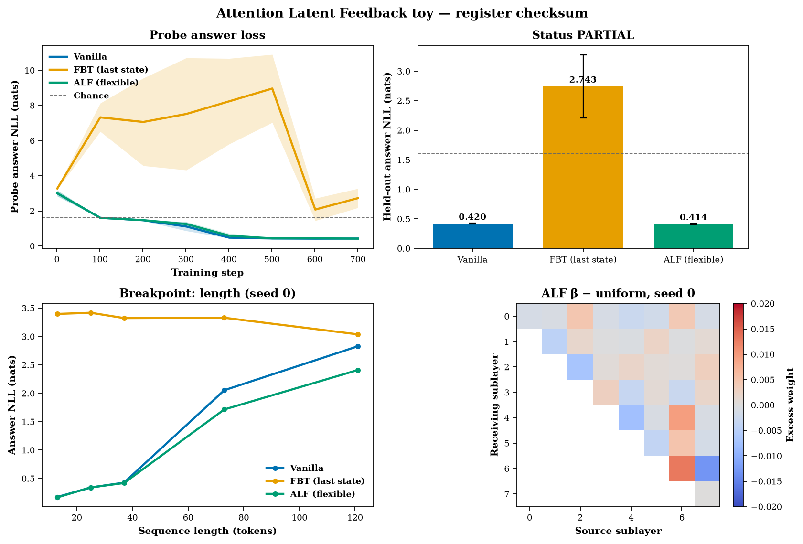

# alf-feedback-transformer

CPU toy of **Attention Latent Feedback** (Xiong, Chen, Chen, Su, Yang, Luo, and Liu, [arXiv:2611.31154](https://arxiv.org/abs/2611.31154)). During decoding, deeper states of the previous token already exist, but a standard transformer only lets a sublayer read that same depth. ALF lets every sublayer attend to the previous position from its own depth upward, and also adds a projection of the previous top state to the token embedding. The Full-bandwidth Transformer (FBT) feeds back only the final state.

Found via a bookmarked X post by [@rosinality](https://x.com/rosinality/status/2125165189570167284). The post was **not fetched**. The bookmark text (“Feedback transformer with flexible connection (not only the last layer).”) was checked against the arXiv abstract and HTML. Official code is MIT at [xjxyys/ALF](https://github.com/xjxyys/ALF) and was **not vendored**. This directory reimplements equations (3.1)–(3.8) and the reported FBT gate product. See `NOTICE`.

## Hypothesis (pre-registered)

On held-out **answer tokens** of a 3-register trace in \(\mathbb{Z}/5\mathbb{Z}\) (12 rounds, checksum digit after each op), seeds 0/1/2, parameter counts matched within 2%:

1. ALF answer-token NLL is strictly below FBT and strictly below the vanilla transformer on every seed.
2. Seed-mean gap versus vanilla is at least **0.10 nats**.
3. Seed-mean gap versus FBT is at least **0.04 nats**.

PASS is all three. PARTIAL is a seed-mean win for ALF with a seed or a gap missed. FAIL is anything else. Breakpoints are not in the status.

Vanilla is scored with one pass. FBT and ALF are scored with three Jacobi passes, last pass only, matching the paper’s evaluation protocol at toy width. The primary metric is `answer_nats` (natural-log cross-entropy on the checksum tokens). Chance is \(\ln 5 \approx 1.609\).

Thresholds live in `experiments/exp1_cpu_register/config.yaml` and in the list above. They were committed before seeds 0/1/2.

## What the paper reports (quoted, not re-run)

Standard-residual held-out loss in nats, Table 2, three evaluation passes for FBT and ALF:

| Model | MoE-1.6B | MoE-2.6B | MoE-4.0B |
|---|---:|---:|---:|
| Standard residual | 2.0577 | 1.9400 | 1.8456 |
| + FBT | 2.0447 | 1.9261 | 1.8322 |
| + ALF | 2.0333 | 1.9170 | 1.8238 |

The abstract’s 0.022–0.024 nat reduction is that table (0.0244, 0.0230, 0.0218). ALF stays at least 0.008 nats under FBT at every scale. MoE-4.0B domain-balanced accuracy on seventeen tasks moves from 45.1% to 47.0%. On MoE-1.6B, ALF matches a 1.38× larger baseline token budget. A fixed nearest-four window keeps 89%–94% of ALF’s loss reduction. Figure 2: feeding back one intermediate block instead of the final block lowers loss by \(4.4 \times 10^{-3}\) and \(4.1 \times 10^{-3}\) nats on MoE-1.6B and MoE-2.6B. Decoding overhead is about 1.1% FLOPs. None of those runs are repeated here.

## Run (CPU)

```bash
cd apps/alf-feedback-transformer
python3 -m venv .venv && source .venv/bin/activate
pip install --index-url https://download.pytorch.org/whl/cpu torch
pip install -r requirements.txt
./run_all.sh
```

`./run_all.sh` runs the unit checks, a 20-step smoke on seed 99 (finite loss only), seeds 0/1/2, the breakpoints, the figure, and the MP4. No GPU.

The official MoE ladder is sketched and **not run** in `notebooks/alf_official_moe_colab.ipynb`. That job needs NVIDIA GPUs. A budget for it needs Gyanateet’s approval.

After the run, open the viewer from this directory:

```bash
python3 -m http.server 43133
```

Then open `http://127.0.0.1:43133/viewer/`.

## Status (honest): **PARTIAL**

Threshold commit, before seeds 0/1/2: `0492e582a51513dc7f9fb6fa5f101cbdc38afd01`. The bars were not edited after that commit. Wall time on 4 vCPUs, including the smoke and the breakpoints: 180 s.

| Check | Bar | Result |
|---|---|---|
| Every seed: ALF answer NLL below both others | strict | **miss** (seed 1: ALF 0.4248, vanilla 0.4237) |
| Seed-mean vanilla − ALF | ≥ 0.10 nats | **miss** (0.0069 ± 0.0105) |
| Seed-mean FBT − ALF | ≥ 0.04 nats | **met** (2.330 ± 0.538) |

PARTIAL because the seed-mean still ranks ALF first (0.4136 < 0.4205 and 0.4136 < 2.743). The FBT gap is the 3-pass collapse below, not a 0.04-nat language-model improvement.

### Answer-token NLL (mean ± sample std, 512 traces × 12 checksums)

| Model | Params | FFN width | Answer NLL | Answer accuracy |
|---|---:|---:|---:|---:|
| Vanilla | 54,368 | 141 | 0.4205 ± 0.0107 | 0.822 |
| FBT, 3 passes | 54,368 | 133 | 2.743 ± 0.532 | 0.200 |
| ALF, 3 passes | 54,376 | 128 | 0.4136 ± 0.0101 | 0.823 |

Chance is \(\ln 5 = 1.609\). Full-sequence NLL, report only: vanilla 1.105, FBT 1.885, ALF 1.103. Two of every three tokens are an op or the literal `Q`, so the full-sequence gap is about one third of the answer gap.

Per seed, answer NLL:

| Seed | Vanilla | FBT | ALF | Vanilla − ALF |
|---:|---:|---:|---:|---:|
| 0 | 0.4085 | 3.3519 | 0.4055 | +0.0031 |
| 1 | 0.4237 | 2.5118 | 0.4248 | −0.0011 |
| 2 | 0.4292 | 2.3656 | 0.4104 | +0.0187 |



*Probe loss, held-out answer NLL, length breakpoint, and ALF’s depth weights minus a uniform read.* Video: [`artifacts/alf-feedback-transformer.mp4`](artifacts/alf-feedback-transformer.mp4). On the traced document, vanilla and ALF put their mass on the true checksum and 3-pass FBT does not.

## Breakpoints (seed 0, not in the status)

Jacobi passes on a fresh 12-round draw. Vanilla is always 1 pass.

| Passes | Vanilla | FBT | ALF |
|---:|---:|---:|---:|
| 1 | 0.430 | 0.454 | 0.424 |
| 2 | 0.430 | 0.511 | 0.424 |
| 3 | 0.430 | 3.327 | 0.424 |
| 8 | 0.430 | 3.920 | 0.424 |

FBT’s own 1-pass score sits next to vanilla. The pre-registered 3-pass score is where it falls to chance. ALF does not move from 1 pass to 8. The paper reports the same direction at a much smaller size: extra Jacobi passes lower ALF’s loss and raise FBT’s (Section 6.3). Here the FBT rise is from 0.45 nats to above 3, after 175 two-pass steps.

Length, fresh traces. Training length is 37 tokens.

| Rounds | Length | Vanilla | FBT | ALF |
|---:|---:|---:|---:|---:|
| 4 | 13 | 0.175 | 3.398 | 0.167 |
| 12 | 37 | 0.428 | 3.325 | 0.420 |
| 24 | 73 | 2.055 | 3.331 | 1.716 |
| 40 | 121 | 2.829 | 3.039 | 2.410 |

Past the training length, ALF is 0.34 and 0.42 nats under vanilla. That gap is not the status. Both models are still far from the in-distribution 0.42.

Depth, same 700 steps, seed 0. Widths are re-matched. Answer NLL:

| Layers | Vanilla | FBT | ALF |
|---:|---:|---:|---:|
| 1 | 0.430 | 3.607 | 0.428 |
| 2 | 0.416 | 2.548 | 0.417 |
| 4 | 0.409 | 3.352 | 0.405 |
| 8 | 0.415 | 2.207 | 0.415 |

No depth reaches the 0.10 nat bar. At 2 layers ALF is slightly worse than vanilla.

ALF rank 1 / 4 / 16: answer NLL 0.418 / 0.405 / 0.420. The low-rank maps are not the difference.

Inference reads on the trained seed-0 ALF, same draw as the pass table: full 0.4239, uniform nearest-4 0.4236, deepest source only 0.4240. Seed-0 depth weights deviate from uniform by at most 0.013. The corner cell of a raw \(\beta\) map is 1 because the deepest sublayer has one eligible source; the figure shows the excess over uniform instead. Flexible routing is not what this checkpoint uses.

## What this does not claim

The MoE ladder was not trained. Table 2’s 0.022–0.024 nat drop, the 45.1% → 47.0% accuracy lift, the 1.38× token match, and the 89%–94% nearest-window retention are quoted above and were not re-run. This toy is a 54k-parameter dense transformer on a synthetic register trace, with fixed sinusoids instead of the paper’s positions, a GELU FFN instead of MoE, and no prefix mixin or jitter. FBT uses the reported gate product at unit RMS. ALF uses equations (3.1)–(3.8), with \(W_E\)’s learning rate divided by width. Official JAX code was read and not copied. `notebooks/alf_official_moe_colab.ipynb` only records that the GPU ladder was not started. A budget for that ladder needs Gyanateet’s approval.

## Licences

App harness: **MIT** (`LICENSE`). Official ALF code is MIT and is not included. Marin is not included. No paper figures are copied.
