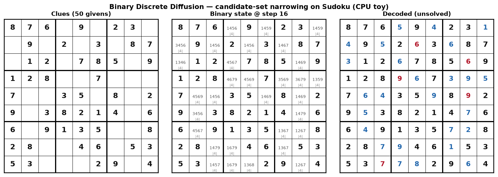
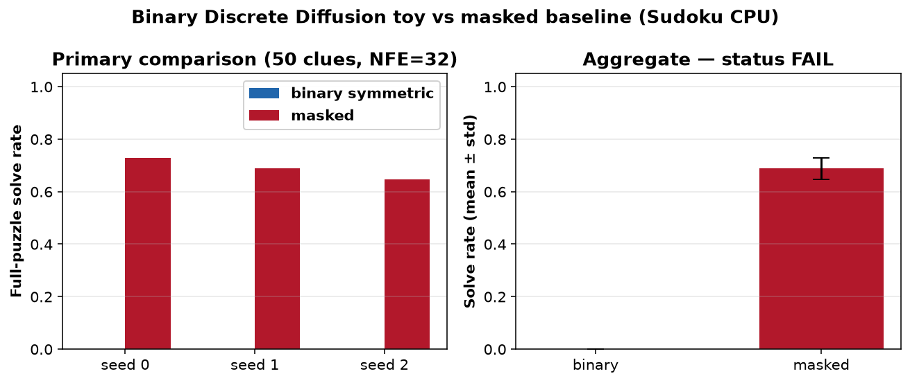

# binary-discrete-diffusion-sudoku

CPU-only clear-experiment toy of **Binary Discrete Diffusion: Candidate-Set Diffusion for Logic and Planning Tasks** (Casado Noguerales, von Rütte, Schölkopf, Hofmann, Raoufi, [arXiv:2610.28543](https://arxiv.org/abs/2610.28543)). Found via a bookmarked X post by [@rodcasnog](https://x.com/rodcasnog/status/2113287405142675759). The paper ships **no official code** (none found on arXiv, the [author research page](https://rodcasnog.github.io/research/), or public GitHub as of 2026-10-28) — this is an **independent minimal re-implementation** of the candidate-set / binary-symmetric vs masked diffusion comparison on synthetic 9×9 Sudoku. See `NOTICE`.



*Candidate-set narrowing on a 50-clue puzzle (seed-0 binary model): clues → mid-trajectory multi-candidate cells → final decode (often unsolved on this tiny model).* Video: [`artifacts/binary-discrete-diffusion-sudoku.mp4`](artifacts/binary-discrete-diffusion-sudoku.mp4).

## What is implemented (paper ideas, toy scale)

- **Binary symmetric forward kernel** (paper Sec. 3.1): each cell is a membership vector in `{0,1}^9`; bits differ from the clean one-hot with probability `t/2`.
- **Candidate-set embedding** (Eq. 15): `Eᵀ (z / ‖z‖₂)` into a shared tiny transformer trunk (~111k params, 2 layers, d=64).
- **Masked baseline** (matched trunk): MDLM-style mask corruption + confidence unmasking sampler.
- **Binary sampler (toy):** start from the full vocabulary on blanks and iteratively prune to top-k model candidates (absorbing-style narrowing + light early re-open) — a simplified stand-in for Sec. 4 confidence-guided revision, **not** the authors' full sampler.
- **Primary metric:** full-puzzle solve rate on a held-out set of 48 boards (50 clues, NFE=32, one attempt, no verifier/search).

Not claimed: Sudoku-Extreme, 43M DiTs, 256 NFE, or Table 1 numbers.

## Status (honest): **FAIL**

| Check (fixed in `config.yaml` before the run) | Threshold | Result |
|---|---|---|
| `solve_rate_binary > solve_rate_masked` on every seed 0/1/2 | strict | **not met** (binary 0 on all seeds) |
| mean gap `binary − masked` ≥ 0.05 | ≥ 5 pp | **not met** (gap = **−0.688**) |

Status rule: PASS needs both; PARTIAL if mean(binary) > mean(masked) but a seed or the 5 pp bar fails; else FAIL. → **FAIL**.

### Per-seed results (48 held-out puzzles, 50 clues, NFE=32)

| seed | binary solve | masked solve | gap | cell_acc binary | cell_acc masked |
|---|---:|---:|---:|---:|---:|
| 0 | 0.000 | **0.729** | −0.729 | 0.816 | 0.958 |
| 1 | 0.000 | **0.688** | −0.688 | 0.789 | 0.960 |
| 2 | 0.000 | **0.646** | −0.646 | 0.769 | 0.945 |

**Mean ± std:** binary **0.000 ± 0.000**, masked **0.688 ± 0.042**.

On this ~110k-param CPU toy the hypothesis is cleanly falsified: the matched masked baseline solves ~69% of 50-clue boards while binary candidate-set diffusion solves none, despite non-trivial cell accuracy (~0.79). This does **not** contradict the paper's 43M-parameter Sudoku-Extreme result — it shows the mechanism's gains are not automatic at toy scale with simplified samplers.



## Experiment (`experiments/exp1_cpu_sudoku/`)

- **Hypothesis:** on 9×9 Sudoku with 50 clues, tiny binary-symmetric candidate-set diffusion beats matched masked diffusion on full-puzzle solve rate at equal NFE, on every seed 0/1/2, with mean gap ≥ 5 pp.
- **Pre-registration:** `config.yaml` committed with hypothesis, metric and thresholds **before** the official run (git: "pre-register exp1 config"). **Disclosure:** one smoke (40 steps, seed 0; `smoke.json`) verified the code path only; clue count 50 was chosen pre-run so both kernels can reach non-zero solve rates on this tiny model. No threshold changed after any result.
- **Seeds:** 0, 1, 2 — each controls init, training stream, and sampling noise.
- **Machine:** 4-vCPU Linux box, torch 2.14.1+cpu, Python 3.12. Official end-to-end `./run_all.sh`: **~5 min**.

Tables: `results.md` / `results.csv`; raw: `raw.json`; verdict: `status.json`.

## Breakpoints (`breakpoints.md`, `breakpoints.csv`)

Seed 0, pushing to extremes:

- **Fewer clues 50→22:** masked solve rate collapses 0.625 → 0 by 30 clues; binary stays at 0 throughout.
- **Fewer NFE 32→2:** masked degrades smoothly (0.81→0.04); binary stays ~0 (one 1/48 blip at NFE 32 under a different sample seed).
- **Train steps 500 vs 3000:** at 500 steps both solve 0; at 3000 only masked learns to solve.

## Run (CPU)

```bash
cd apps/binary-discrete-diffusion-sudoku
uv venv .venv && source .venv/bin/activate
uv pip install --index-url https://download.pytorch.org/whl/cpu torch
uv pip install -r requirements.txt
./run_all.sh            # ~5 min on 4 vCPUs: train 3×2 kernels + breakpoints + plots + MP4 (needs ffmpeg)
# python src/run_experiment.py --smoke  # disclosed tiny code-path check
```

## Colab (larger GPU run — needs owner approval)

[`notebooks/binary_discrete_diffusion_colab.ipynb`](notebooks/binary_discrete_diffusion_colab.ipynb) is prepared but **not executed**. It scales the same toy to a larger transformer / more steps / lower clue counts on a GPU. **Any paid or GPU runtime needs the repo owner's approval first.** No official upstream weights exist to download. No paid or GPU compute was used anywhere in this app.

## Caveats

- **Not the authors' code or scale:** ~110k params vs the paper's 43M; synthetic 50-clue boards vs Sudoku-Extreme; simplified samplers vs their tuned confidence-guided stack.
- **FAIL is about this toy:** a negative result here does not refute the paper; it is an honest stress test of whether the candidate-set idea wins under severe under-parameterization on CPU.
- Cell accuracy shows the binary model is learning (~0.79) but not enough for full-board consistency under its prune sampler.
- Trained weights stay out of git (`work/` is git-ignored).
