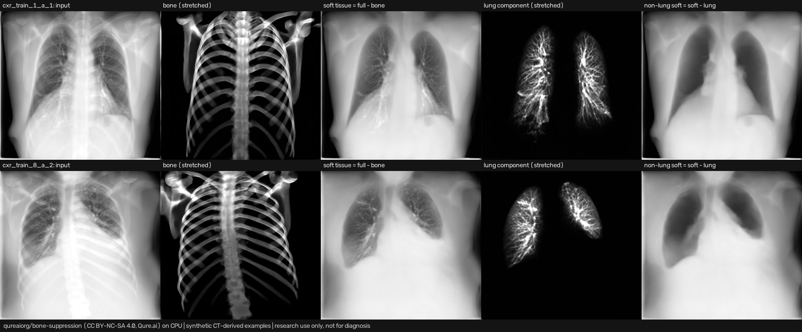
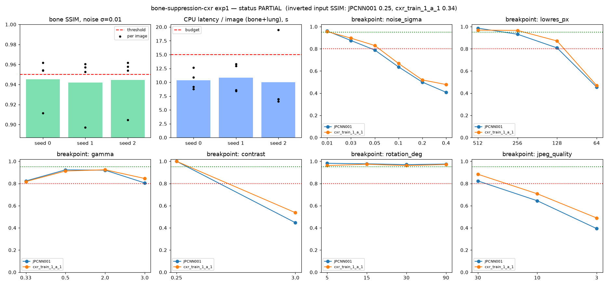

# bone-suppression-cxr

A CPU-only demo of **Qure.ai's bone and lung-component suppression models for frontal chest X-rays**: [`qureaiorg/bone-suppression`](https://huggingface.co/qureaiorg/bone-suppression) (v1.0.0, TorchScript). The paper is Angaitkar et al., *"Anatomy-Decomposed Chest CT Projections as Scalable Supervision for Bone Suppression in Chest Radiographs"*, [arXiv:2609.24937](https://arxiv.org/abs/2609.24937). The pipeline follows the authors' `suppress.py` and the HF Space [`hugging-apps/bone-suppression-chest-xray`](https://huggingface.co/spaces/hugging-apps/bone-suppression-chest-xray). Found via a bookmarked X post by [@EmmaScharfmann](https://x.com/EmmaScharfmann/status/2108591337184326105).

> **Research use only. Not a medical device and not for diagnosis.** The model weights are **CC BY-NC-SA 4.0** (non-commercial research and education only). This folder is CC BY-NC-SA 4.0, separately from the rest of the repo; see `LICENSE`, `NOTICE`, `LICENSE-WEIGHTS.txt` and `LICENSE-UPSTREAM-CODE-Apache-2.0.txt`. Weights and example images are **downloaded at run time** and are not committed.



*Synthetic CT-derived examples (Qure.ai, CC BY-NC-SA 4.0), CPU run. Columns: input, bone, soft tissue = full − bone, lung component, non-lung soft = soft − lung. The bone and lung panels are percentile-stretched for viewing.* Video: [`artifacts/bone-suppression-sweep.mp4`](artifacts/bone-suppression-sweep.mp4) shows the input and the bone output as the input is pushed through the breakpoint sweep.

## Pipeline (as upstream)
Resize to 1024×1024 with `INTER_AREA`, then per-image min-max to [0,1]. `bone = bone_model(full)`, `soft = full − bone`. `lung = lung_model(soft)` takes the float residual with **no** re-normalisation. `nonlung = soft − lung`. Each trace returns a tuple; index 0 is the output.

## Status (honest): **PARTIAL**
| Check | Threshold (fixed before running) | Result |
|---|---|---|
| Precondition: reproduce the authors' published bone PNGs (2 JSRT images) | mean abs diff ≤ 1 grey level | **met** (0.00001 levels; effectively identical) |
| CPU latency, bone + lung per 1024 px image, mean per seed | ≤ 15 s | **met** on all 3 seeds (10.0–10.8 s mean; worst single image 19.5 s on a busy box) |
| Stability: SSIM(bone_clean, bone_noisy), Gaussian σ = 0.01, mean per seed | ≥ 0.95 | **not met** (0.942–0.945). 3 of the 4 images pass on every seed; the real JSRT nodule case JPCLN030 sits at 0.897–0.912 and drags the mean down |

The model runs comfortably on CPU, and its outputs are deterministic and match upstream. The pre-registered stability bar was **not** met, so the stability half of the hypothesis is rejected at this threshold. Even σ = 0.01 noise (about 2.5 grey levels in 8-bit) moves the bone output enough to drop SSIM to roughly 0.90–0.96.

## Experiment (`experiments/exp1_cpu_stability/`)
- **Hypothesis:** on a CPU-only machine, the released models decompose a 1024 px frontal CXR fast enough to be practical, and the bone output is stable under small input noise.
- **Config:** `config.yaml` was committed with the thresholds before the run (see git history: "pre-register exp1 config"). One later commit fixed YAML quoting only. **Disclosure:** before the config was written, one smoke test ran the bone model once (warm forward 3.6 s), so the latency budget was set knowing that number. The SSIM threshold was set blind.
- **Inputs:** 2 real JSRT radiographs (JPCLN030 with a nodule, JPCNN001 without) and 2 synthetic CT projections (cxr_train_1_a_1, cxr_train_8_a_2).
- **Metric:** `ssim_bone` (skimage SSIM, data_range = range of the clean bone image, computed on 1024² float outputs). Secondary metric: `latency_s_pipeline` (wall clock, bone forward + lung forward, `torch.inference_mode`, fp32, 8 threads). Report-only: SSIM of the lung output, PSNR and max abs diff.
- **Seeds:** 0, 1, 2 (the noise RNG is `default_rng(seed*1000 + image_index)`).
- **Machine:** shared 8-vCPU Linux box, torch 2.14.1+cpu, Python 3.13. Load average climbed to about 35 during the run, so latencies are a noisy upper bound. Peak RSS was 1.5 GB because the models are loaded one at a time.

| seed | mean ssim_bone | min ssim_bone | mean ssim_lung | mean latency (s) | max latency (s) | SSIM ≥ 0.95 | latency ≤ 15 s |
|---|---|---|---|---|---|---|---|
| 0 | 0.9453 | 0.9115 | 0.9358 | 10.37 | 12.62 | no | yes |
| 1 | 0.9419 | 0.8970 | 0.9356 | 10.81 | 13.30 | no | yes |
| 2 | 0.9445 | 0.9047 | 0.9326 | 9.99 | 19.48 | no | yes |

Per-image numbers are in `results.md` / `results_per_image.csv`, the per-seed table is in `results.csv`, raw numbers are in `raw.json` and the plot is `plot.png`. Repeated clean-input runs were bit-identical (max |Δ| = 0). The first TorchScript call took 6.0 s (bone) and 5.6 s (lung) and is excluded from latency. A single warm bone forward took about 3.3–6 s.



## Breakpoints (`breakpoints.md`, `breakpoints.csv`)
Seed 0, bone model, images JPCNN001 (real) and cxr_train_1_a_1 (synthetic). Each output is compared by SSIM with the clean bone output. Bands: ok ≥ 0.95, degraded ≥ 0.80, broken < 0.80.

| Family | Where it leaves "ok" | Where it breaks (< 0.80) |
|---|---|---|
| Gaussian noise σ | 0.03 (0.88–0.90) | 0.05 on JPCNN001 (0.79); 0.1 on both (0.64–0.67); 0.4 → 0.41–0.48 |
| Low resolution (down, then up to 1024) | 256 px on real (0.93), 128 px on synthetic (0.87) | 64 px (0.45–0.47) |
| Gamma | already at 0.5 / 2.0 (0.91–0.92) | 3.0 only just stays degraded (0.81–0.85); 0.33 is 0.82 |
| Contrast ×0.25 | never: min-max re-normalisation undoes a linear contrast change exactly (SSIM 1.000) | — |
| Contrast ×3 (with clipping) | — | broken (0.45–0.54) |
| Rotation 5–90° | never (0.96–0.98) | — *Caveat:* both images share black corners after warping, which inflates SSIM. This shows the output rotates with the input; it doesn't show rotated inputs are handled well clinically |
| JPEG quality | 30 (0.82–0.88) | 10 (0.65–0.71), 3 (0.39–0.49) |
| Inverted (bone-dark) | — | broken (0.25–0.34). The Space's `looks_inverted()` heuristic correctly flags both inverted inputs, and no clean input |

In short, the decomposition is robust to geometry and to linear intensity scaling. It is sensitive to pixel-level noise, JPEG artefacts, non-linear intensity changes (gamma or clipping) and resolution below about 256 px. It fails on inverted (MONOCHROME1-style) input, so invert first.

## Run (CPU)
```bash
cd apps/bone-suppression-cxr
python3 -m venv .venv && . .venv/bin/activate
pip install torch --index-url https://download.pytorch.org/whl/cpu && pip install -r requirements.txt
./run_all.sh            # about 90 model passes, roughly 10 min on 8 vCPUs; needs ffmpeg for the MP4
# ./run_all.sh --skip-breakpoints   # quicker
```
No HF token is needed (the repo is not gated). Downloads are about 835 MB of weights plus the example PNGs, into the HF cache. Intermediates go to `work/`, which is git-ignored.

**Colab:** [`notebooks/bone_suppression_cxr_colab.ipynb`](notebooks/bone_suppression_cxr_colab.ipynb) runs on the free CPU runtime. A GPU is optional, and it only costs anything if you choose a paid runtime yourself.

## Caveats
- Only 4 images (2 real, 2 synthetic) and one perturbation size are used. This is a smoke-level robustness probe, not a clinical or paper-level evaluation, and it does not test the paper's claims about suppression quality.
- SSIM on low-intensity bone images (peaks of about 0.27 on the [0,1] scale) is sensitive to small absolute changes. The threshold of 0.95 is strict by choice.
- Latency was measured on a shared, heavily loaded box, so it varies from run to run (3.1–15.8 s for a single forward pass).
- The JSRT images are used at run time only and are not redistributed. The committed media uses only the synthetic CC BY-NC-SA examples.
