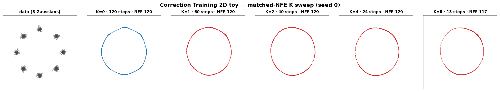
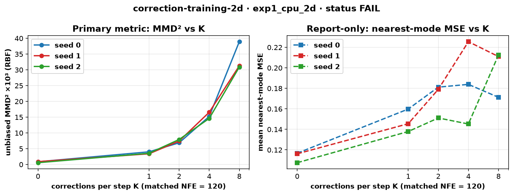

# correction-training-2d

CPU-only clear-experiment toy of **Correction Training for Diffusion Models** (Ahn, Wang, Efros, Park, Belhe, 2026, [arXiv:2610.14136](https://arxiv.org/abs/2610.14136); project [correction-training.github.io](https://sunovivid.github.io/correction-training/); code [sunovivid/correction-training](https://github.com/sunovivid/correction-training), MIT). Found via a bookmarked X post by [@donghoon_ahn](https://x.com/donghoon_ahn/status/2110038016622493951).

> Upstream code is **MIT** (see `LICENSE`, `NOTICE`). The official ImageNet sampling path needs an **NVIDIA GPU and ~11 GB checkpoints** and is intentionally **not** run or vendored here. This app is a pedagogical 2D re-implementation of the paper's two algorithms on a mixture of Gaussians, with tiny MLPs, on CPU. No HF token, no downloads.



*Matched-NFE K sweep on 8 Gaussians (seed 0): data, then K=0…8 corrections per step at a fixed budget of 120 network evaluations.* Video: [`artifacts/correction-training-2d.mp4`](artifacts/correction-training-2d.mp4) animates the K=0 vs K=8 sampling trajectories from t=1 to t=0.

## What is implemented (paper equations)

Flow-matching interpolation (Eq. 1): `z_t = (1-t)·x + t·ε`, `t ~ U[0,1]`.

Training (Algorithm 1, joint denoiser **D** + stop-gradient corrector **C**):

```python
pred    = D(z, t)
refined = C(stopgrad(pred), t)
loss    = mse(pred, x) + weight * mse(refined, x)
```

Sampling with K corrections per step (Algorithm 2):

```python
z = randn(shape)
for t, s in zip(times, times[1:]):
    pred = D(z, t)
    for _ in range(K):
        pred = C(pred, t)
    v = (z - pred) / t
    z = z + (s - t) * v
```

Both D and C are `TimeMLP`s (2 inputs + 16 Fourier time features → 3×128 SiLU → 2) in `src/ctd2d.py`. The paper fine-tunes a pretrained denoiser; here both nets train jointly from scratch with the same loss (noted as a caveat below).

## Status (honest): **FAIL**

| Check | Threshold (fixed before running) | Result |
|---|---|---|
| Primary: best K∈{1,2,4,8} has strictly lower unbiased RBF MMD² than K=0 at matched NFE 120, per seed | all three seeds 0/1/2 | **not met on any seed** — K=0 wins everywhere (e.g. seed 0: 0.844 vs 3.994 ×10³ for best K=1) |
| Secondary (report-only): training wall time per seed | ≤ 180 s | met (5.0–5.1 s) |
| Secondary (report-only): 2000 samples at K=0, NFE 120 | ≤ 60 s | met (≈0.05 s) |

MMD² ×10³ at matched NFE 120 (lower is better; eval = 2000 held-out samples, RBF γ=0.0622 by median heuristic):

| seed | K=0 | K=1 | K=2 | K=4 | K=8 | K>0 wins? |
|---|---|---|---|---|---|---|
| 0 | **0.844** | 3.994 | 6.850 | 15.208 | 38.916 | no |
| 1 | **0.876** | 3.371 | 7.399 | 16.537 | 31.253 | no |
| 2 | **0.538** | 3.532 | 7.898 | 14.579 | 30.868 | no |

On this toy, the hypothesis is cleanly falsified: MMD² grows monotonically with K on every seed. This *inverts* the paper's ImageNet result, and the likely reason is instructive. The paper's own analysis attributes correction's gain to narrowing the **training–inference gap** (exposure bias) of a high-dimensional denoiser — and reports that correction *increases* reconstruction error on training inputs. A 3×128 MLP on a 2D mixture is close enough to the optimal denoiser that there is barely any gap to close, so iterating the corrector only injects its contraction bias (visible in the video: K=8 samples pull **inside** the ring) while eating the step budget. A diagnostic at *unmatched* NFE (120 steps for every K, post-hoc, not pre-registered) shows the same ordering (K=1: 6.2, K=8: 45.6 ×10³), so the failure is not a step-count artifact.

## Experiment (`experiments/exp1_cpu_2d/`)

- **Hypothesis:** on 8 Gaussians on a ring (radius 2, σ=0.1), sampling with the best K∈{1,2,4,8} iterative corrections at a matched budget of 120 network evaluations gives strictly lower unbiased RBF MMD² (2000 generated vs 2000 held-out samples) than the K=0 baseline, on all seeds 0/1/2.
- **Config:** `config.yaml` committed with thresholds **before** the official run (git: "pre-register exp1 config"). **Disclosure:** one smoke (100 iters, 200 samples, seed 0) verified the code path only; no threshold changed after it.
- **Metric:** primary `mmd2_rbf` (unbiased estimator, γ from median heuristic on the fixed eval set, seed 9999). Report-only: sliced W1, nearest-mode MSE, mode coverage, wall times.
- **Seeds:** 0, 1, 2 — each controls training data stream, init, and sampling noise. Matched NFE: `steps = floor(120/(1+K))`.
- **Machine:** 4-vCPU Linux box, torch 2.14.1+cpu, Python 3.12.

Tables: `results.md` / `results.csv`; raw numbers: `raw.json`; verdict: `status.json`; plot:



## Breakpoints (`breakpoints.md`, `breakpoints.csv`)

Seed 0, pushing to extremes:

- **K → 64** (matched NFE 120, so 1 denoising step): MMD² ×10³ climbs 2.4 → 124 (K=32) and mode coverage collapses to 0.12 at K=64.
- **NFE budget 6 → 240** (K=0 vs K=4): K=0 beats K=4 at *every* budget; even 6 plain Euler steps (0.68) beat 1 step + 4 corrections (87.3).
- **Mixture difficulty:** tighter modes (σ 0.02–0.4) and more modes (16) never flip the ordering. The one exception: **4 well-separated modes**, where K=2 *does* beat K=0 (0.033 vs 0.627 ×10³) — the only regime where correction helped.
- **Post-hoc sensitivity (disclosed, not pre-registered):** retraining seed 0 with 20 000 iters (≈7× longer; sharper denoiser, nearest-mode MSE 0.078 vs 0.117) leaves the ordering unchanged — K=0 still wins at every K. The FAIL is not an underfitting artifact at the K-comparison level.

## Run (CPU)

```bash
cd apps/correction-training-2d
uv venv .venv && source .venv/bin/activate
uv pip install --index-url https://download.pytorch.org/whl/cpu torch
uv pip install -r requirements.txt
./run_all.sh            # ~2 min on 4 vCPUs: 11 trainings + sweeps + plots + MP4 (needs ffmpeg)
# ./run_all.sh --skip-breakpoints     # main comparison only
# python src/run_experiment.py --smoke  # disclosed tiny code-path check
```

## Colab (real ImageNet sampling — needs owner GPU approval)

[`notebooks/correction_training_imagenet_colab.ipynb`](notebooks/correction_training_imagenet_colab.ipynb) is prepared but **not executed**. It clones the official [sunovivid/correction-training](https://github.com/sunovivid/correction-training), auto-downloads SiT-REPA-XL/2 (~11 GB) and samples with `--corrections_per_step K` (K in the paper), including a K∈{0,4,8} sweep. A free Colab T4 can run small grids; **any paid GPU runtime should be approved by the repo owner first.**

## Caveats

- This is a 2D pedagogical toy with tiny MLPs — a *negative result here does not contradict the paper*, whose gains are on high-dimensional ImageNet denoisers with a real training–inference gap. It demonstrates the mechanism's precondition: correction helps when exposure bias exists, and hurts when the denoiser is already near-optimal.
- The paper fine-tunes a pretrained denoiser and (in the official sampler) can restrict correction to a t-interval (`--correction-interval`); this toy trains jointly from scratch and corrects at every step, exactly as in the paper's Algorithm 2 pseudocode.
- The unbiased MMD² estimator has visible sampling variance at K=0 levels (0.16–2.4 ×10³ across sampling seeds), but the K effect (3–45 ×10³) is an order of magnitude larger.
- The trained denoiser leaves samples ring-like rather than fully clustered at 3000 iters (nearest-mode MSE ≈ 0.12 vs ≈ 0.02 ideal); the post-hoc 20k-iter check above shows the conclusion survives sharper training.
