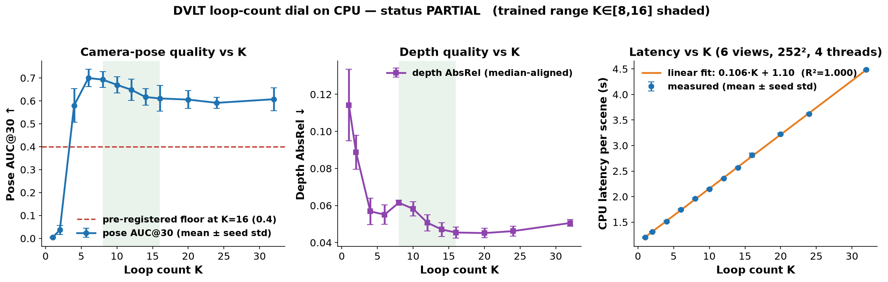

# dejaview-loop-knob

CPU-only, pre-registered experiment on the central knob of **Déjà View (DVLT)**,
*Looping Transformers for Multi-View 3D Reconstruction* (NVIDIA et al.,
[arXiv:2605.30215](https://arxiv.org/abs/2605.30215), NeurIPS 2026 oral):
the loop count **K** — one shared transformer block applied K times — as an
**inference-time compute/quality dial** on a single 117M-parameter checkpoint.

Found via a bookmarked X post by
[@NVIDIAAI](https://x.com/NVIDIAAI/status/2120617173286883692) (related quote
bookmark by [@kwangmoo_yi](https://x.com/kwangmoo_yi/status/2121148907464101903)).
**Neither post was fetched** — no X API, no X MCP, no x.com scraping. Every
claim here was verified from the [arXiv abstract](https://arxiv.org/abs/2605.30215),
the [official repository](https://github.com/nv-tlabs/dvlt) (pinned commit
`f59bb18`), and the [Hugging Face model card](https://huggingface.co/nvidia/dvlt)
on 2026-11-13.

**The code under test is the official `dvlt` package** (not a reimplementation),
installed from the pinned commit at setup time. Weights download from
`nvidia/dvlt` at run time and are **not committed**. The K dial is upstream's
own `inference_steps` attribute, read by the looped block at every `predict`.

## Hypothesis (pre-registered)

> On small synthetic multi-view scenes with known cameras, raising K of the
> released checkpoint from 8 to 16 monotonically improves camera-pose accuracy
> (pose AUC@30 over all view pairs, upstream metric) and does not worsen
> scale-aligned depth error (AbsRel, median alignment), while CPU latency per
> scene grows roughly linearly in K.

Metrics, protocol, and numeric bars were frozen in
[`experiments/exp1_cpu_loop_knob/config.yaml`](experiments/exp1_cpu_loop_knob/config.yaml)
**before** the measured run (see the pre-registration commit; `raw.json` records
the config SHA-256). The bars:

| Check | Bar |
|---|---|
| Floor: mean pose AUC@30 at K=16 | ≥ 0.40 |
| H1a: mean AUC@30 gain, K=8 → K=16 | ≥ +0.01 |
| H1b: mean AUC@30 monotone over K ∈ {8,10,12,14,16} | each step ≥ −0.005 |
| H1c: mean depth AbsRel at K=16 vs K=8 | ≤ |
| H2: latency vs K linear fit over full grid {1…32} | R² ≥ 0.98, slope > 0 |

PASS = all five. FAIL = floor broken, or no quality improvement at all 8→16
(neither H1a nor H1c). PARTIAL = anything else. Breakpoints are report-only.



*Quality and latency vs K, 4 scenes × seeds 0/1/2, trained range shaded. Video:
[`artifacts/dejaview-loop-knob.mp4`](artifacts/dejaview-loop-knob.mp4). Still:
[`artifacts/dejaview-loop-knob.png`](artifacts/dejaview-loop-knob.png).*

## Status (honest): **PARTIAL**

Three of five pre-registered bars hold; the two that fail, fail in a direction
the hypothesis did not predict. The bars were not moved
(`config_sha256` in `raw.json` = frozen config = `7672a6c3…edc1`;
pre-registration commit `cf75964`).

| Check | Bar | Result |
|---|---|---:|
| Floor: mean pose AUC@30 at K=16 | ≥ 0.40 | **0.611 — PASS** |
| H1a: mean AUC@30 gain, 8 → 16 | ≥ +0.01 | **−0.082 — FAIL** |
| H1b: AUC@30 monotone over {8,10,12,14,16} | each step ≥ −0.005 | **0.69→0.67→0.65→0.62→0.61 — FAIL** |
| H1c: depth AbsRel, 16 vs 8 | ≤ | **0.0454 vs 0.0615 — PASS** |
| H2: latency linear in K over {1…32} | R² ≥ 0.98, slope > 0 | **R² = 0.9998, 0.106 s/step — PASS** |

**What actually happened:** on these easy synthetic scenes the K dial splits by
task. Depth improves steadily with K exactly as hypothesised (AbsRel
0.0615 → 0.0454, monotone to K=20). Camera pose does the opposite: it peaks at
K≈6–8 (AUC@30 0.700 at K=6, R err 8.3°) and *declines gently* through the
trained range to 0.611 at K=16 (R err 11.4°), then plateaus. Latency is almost
perfectly linear: **0.106 s per extra loop + 1.10 s fixed cost** (DINOv2 encode
+ decode heads) per 6-view scene on 4 CPU threads. The compute dial works; the
"more loops ⇒ better pose" half of the pre-registered hypothesis does not hold
in this domain, so by the frozen rule (quality must improve on at least one of
pose or depth 8→16 to avoid FAIL, all five bars for PASS) this is **PARTIAL**.

### Results (mean over 4 scenes × seeds 0/1/2; ± is seed std)

| K | grid | pose AUC@30 | R err (°) | T err (°) | depth AbsRel | latency (s) |
|---:|---|---:|---:|---:|---:|---:|
| 1 | break | 0.004 ± 0.003 | 98.93 | 55.35 | 0.1142 ± 0.0193 | 1.20 |
| 2 | break | 0.037 ± 0.020 | 94.73 | 47.84 | 0.0888 ± 0.0091 | 1.31 |
| 4 | break | 0.580 ± 0.073 | 17.70 | 9.98 | 0.0569 ± 0.0072 | 1.51 |
| 6 | break | 0.700 ± 0.038 | 8.31 | 5.52 | 0.0551 ± 0.0053 | 1.75 |
| 8 | main | 0.693 ± 0.034 | 8.57 | 5.58 | 0.0615 ± 0.0014 | 1.96 |
| 10 | main | 0.670 ± 0.035 | 9.37 | 6.05 | 0.0582 ± 0.0039 | 2.15 |
| 12 | main | 0.649 ± 0.047 | 10.31 | 6.52 | 0.0507 ± 0.0044 | 2.35 |
| 14 | main | 0.617 ± 0.036 | 11.15 | 7.50 | 0.0471 ± 0.0037 | 2.57 |
| 16 | main | 0.611 ± 0.056 | 11.38 | 7.68 | 0.0454 ± 0.0029 | 2.81 |
| 20 | break | 0.606 ± 0.039 | 11.50 | 7.50 | 0.0451 ± 0.0026 | 3.23 |
| 24 | break | 0.591 ± 0.024 | 11.59 | 7.90 | 0.0462 ± 0.0026 | 3.62 |
| 32 | break | 0.607 ± 0.050 | 11.28 | 7.56 | 0.0506 ± 0.0018 | 4.48 |

Full per-cell data: `experiments/exp1_cpu_loop_knob/raw.json`; per-K CSV:
`results.csv`; machine: 4 vCPU, Python 3.12.3, torch 2.5.1+cpu, fp32,
`torch.set_num_threads(4)`; measured run wall time 405 s with weights cached.

### Breakpoints (report-only — where it breaks)

- **K below the trained range:** hard collapse at K ∈ {1,2} — pose is random
  (R err ≈ 95–99°, AUC@30 ≈ 0) and depth roughly doubles its error. K=4
  mostly works; K=6 is the best pose setting on this data despite being
  outside the stated [8,16] validity range.
- **K above the trained range:** no catastrophe. Pose plateaus (~0.59–0.61);
  depth bottoms out at K=20 (0.0451) and drifts slightly worse by K=32
  (0.0506). You pay 0.106 s/loop for nothing past ~K=16–20.
- **Very few views (2):** still works (AUC@30 0.55–0.74); same pose-vs-depth
  split between K=8 and K=16.
- **Low resolution (140²):** the real breakpoint. Quality drops overall, and
  K=16 is *less stable* than K=8: two of four scenes collapse at K=16
  (R err 52–61°, AUC@30 0.06–0.23) while K=8 stays at 8–18°. More loops
  amplify failure on degraded inputs.
- **More views (12):** fine on CPU (4.4–6.6 s/scene); same gentle pose decline
  at K=16, best depth. Latency stays linear.

Full table: `experiments/exp1_cpu_loop_knob/breakpoints.md`.

### Caveats

- Synthetic, textured-primitive scenes are an easy, narrow domain. The paper's
  benchmark claim (K buys quality up to 16) is made on five real benchmarks
  (DTU, ETH3D, 7Scenes, ScanNet++, NuScenes) at higher resolution (img 504+)
  with many views; nothing here contradicts those numbers — upstream's own
  reference table reports e.g. DTU AUC@30 0.988. This run shows the dial's
  *shape* on small CPU-sized inputs, where the pose head saturates early.
- 252² CPU inputs are half the resolution the model card quickstart uses; the
  low-res breakpoint shows resolution interacts strongly with K.
- Latency intercept (1.10 s) is 10 loop-steps' worth of fixed cost, so halving
  K from 16 to 8 saves only ~30% wall clock at this scale.
- `Auc_5` is near 0 everywhere: absolute pose errors (R err ≥ 8°) are large
  compared to upstream's real-benchmark numbers; the synthetic domain gap and
  low resolution both plausibly contribute.

## Data

Four procedural Kubric-style tabletop scenes (textured ground + 5–7 textured
primitives), rendered by a pure-numpy perspective-correct z-buffer rasterizer
(`src/make_scenes.py`) at 504² → 252². Ground-truth cameras are exact by
construction (OpenCV c2w), ground-truth depth comes from the z-buffer, sky is
masked out. No third-party assets, so the data is licence-clean and CPU-cheap.
20 candidate views per scene; **seed s ∈ {0,1,2} draws which 6 views each
scene contributes**. Synthetic data is an easy, in-distribution-adjacent domain
for DVLT (its training mix includes synthetic datasets such as Kubric) — this
experiment probes the K dial, not in-the-wild robustness.

## Run it

```bash
cd apps/dejaview-loop-knob
bash setup.sh                                  # venv + pinned dvlt clone + CPU torch
.venv/bin/python src/make_scenes.py --out data/scenes
.venv/bin/python src/run_experiment.py         # measured run -> raw.json
.venv/bin/python src/analyze.py                # tables, plots, status.json
python3 -m http.server 43130 -d viewer         # open http://127.0.0.1:43130
```

First run downloads ~450 MB of DVLT weights from Hugging Face plus the DINOv2
backbone from Meta's CDN. No credentials required. `HF_TOKEN` is optional (rate
limits only); never commit it.

## Licences

- DVLT **code**: Apache-2.0, portions under VGGT License v1 —
  [`LICENSES/DVLT-APACHE-2.0.txt`](LICENSES/DVLT-APACHE-2.0.txt),
  [`LICENSES/VGGT-LICENSE.txt`](LICENSES/VGGT-LICENSE.txt). Not vendored.
- DVLT **weights** (`nvidia/dvlt`): **NVIDIA License — non-commercial research
  and evaluation use only** —
  [`LICENSES/NVIDIA-MODEL-LICENSE.txt`](LICENSES/NVIDIA-MODEL-LICENSE.txt).
  Downloaded at run time, never committed. This app uses them strictly for
  research evaluation. The model card states the released checkpoint is valid
  for K ∈ [8, 16]; this experiment deliberately also probes outside that range
  and labels those rows as breakpoints.
- This app's own code (`src/`, `viewer/`): Apache-2.0 ([`LICENSE`](LICENSE)).

See [`NOTICE`](NOTICE) for the full attribution map.
