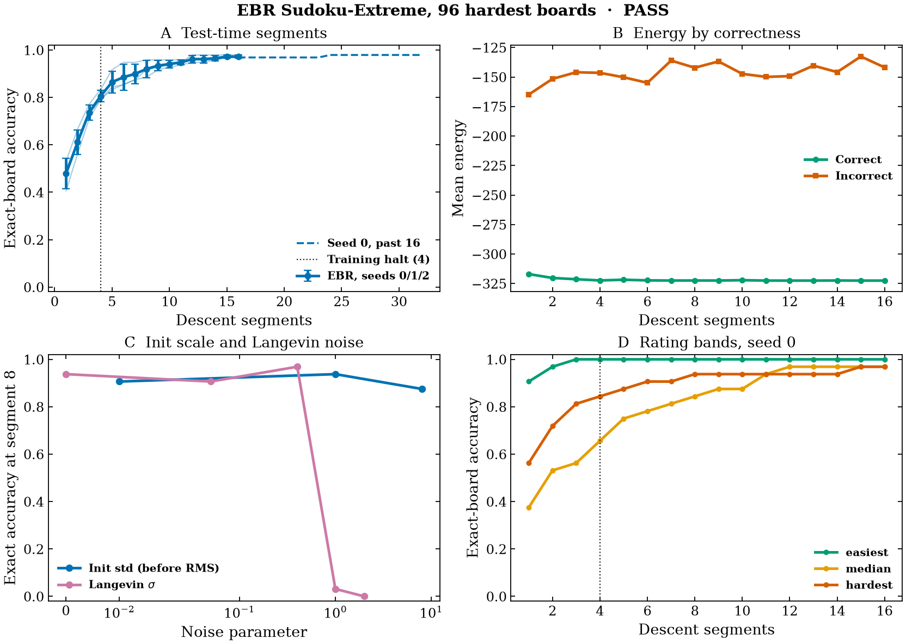

# ebr-test-time-descent

CPU subset of the official **Energy-Based Reasoners** Sudoku-Extreme checkpoint (Chen, Gladstone, Li, Ji, Du, [arXiv:2611.08977](https://arxiv.org/abs/2611.08977)). The model learns a scalar energy over a latent state and reasons by gradient descent on it. Found via a bookmarked X post by [@askalphaxiv](https://x.com/askalphaxiv/status/2123301495617565124); the post was **not fetched**. The bookmark text was checked against the paper, the [project page](https://energy-based-reasoners.github.io/), and the [GitHub README](https://github.com/wwillchen/ebr).

Upstream code is MIT (see `NOTICE` and `LICENSES/EBR-UPSTREAM-MIT.txt`). It is cloned at a pinned commit into `work/ebr` and is not vendored. The released weights are one EMA checkpoint (1.8M parameters, training step 60 000). ARC checkpoints are not in the release. The upstream README asks for CUDA 12.x and an H200 for training; Sudoku and Maze training use fused Triton kernels. Their evaluator falls back to CPU eager float32, and that is the path used here. The full test (422 786 boards × 8 samples × 64 segments) was not run. [`notebooks/ebr_official_eval_colab.ipynb`](notebooks/ebr_official_eval_colab.ipynb) only records that a GPU budget decision would be required for that protocol. It was not executed.

## Hypothesis (pre-registered)

Section 4.1 says that, despite training with only four iterations, exact accuracy keeps improving as descent continues. Table A.2 sets Sudoku training segments to 4 and evaluation segments to 64, with 21 microsteps inside each segment. Section 4.2 and figure 6 say solved trajectories end at lower energy and with a smaller tangent gradient than unsolved ones.

On the **96 highest-rated** Sudoku-Extreme test puzzles, one trajectory each, inference seeds 0/1/2:

1. Seed-mean exact accuracy at segment 16 exceeds segment 4 by at least 0.02.
2. That curve does not fall by more than one board from 4→8 or 8→16.
3. Every seed has AUROC(−energy) ≥ 0.70 at the deepest segment in {16, 8, 4, 2, 1} that still has at least 5 correct and 5 incorrect boards.
4. At that depth, the mean tangent gradient on incorrect boards is at least twice the mean on correct boards.

PASS is all four. PARTIAL is at least two. FAIL is fewer than two. Breakpoints are not in the status. The ± in the paper is over three training seeds. Only one checkpoint is released, so the ± here is trajectory noise.

Thresholds live in `experiments/exp1_cpu_sudoku_extreme/config.yaml` and were committed before the measured seeds.

## Run (CPU)

```bash
cd apps/ebr-test-time-descent
python3 -m venv .venv && source .venv/bin/activate
pip install -r requirements.txt
./run_all.sh
```

`./run_all.sh` clones the pinned upstream commit, checks the checkpoint sha256, builds the rating subsets from the public test CSV, runs a 2-board smoke (seed 99, not a result), then seeds 0/1/2 and the breakpoints. No GPU. Batches of 16 boards share the CPU threads.

After the run, open the viewer:

```bash
python3 -m http.server 43131 -d viewer
```

## Status (honest): **PASS**

Threshold commit, before the measured seeds: `629a47f43a440229f724f453bea7e0ca9f6f6f14`. The bars were not edited after that commit.

| Check | Bar | Result |
|---|---|---|
| Seed-mean exact accuracy, segment 16 − segment 4 | ≥ 0.02 | **met** (0.167 ± 0.028) |
| Seed-mean curve 4→8→16 | drop of at most 1 board | **met** (0.806 → 0.920 → 0.972) |
| AUROC of −energy, every seed | ≥ 0.70 | **met** (1.000, 1.000, 1.000) |
| Tangent-gradient ratio, incorrect / correct | ≥ 2 on every seed | **met** (90×, 92×, 102×) |

The energy depth is the deepest segment in {16, 8, 4, 2, 1} with at least 5 correct and 5 incorrect boards. Segment 16 leaves only 2 or 3 boards wrong, under that minimum, so the bar uses segment 4 on seed 0 and segment 8 on seeds 1 and 2. A report-only AUROC at segment 16, with those 2–3 errors, is also 1.000. It is not the bar.

### Exact accuracy (mean ± sample std, seeds 0/1/2, 96 boards)

| Segment | Microsteps | Exact accuracy | Cell accuracy |
|---|---|---|---|
| 1 | 21 | 0.479 ± 0.065 | 0.809 ± 0.022 |
| 2 | 42 | 0.611 ± 0.052 | 0.855 ± 0.018 |
| 4 | 84 | 0.806 ± 0.024 | 0.923 ± 0.015 |
| 8 | 168 | 0.920 ± 0.037 | 0.968 ± 0.012 |
| 16 | 336 | 0.972 ± 0.006 | 0.989 ± 0.002 |

Per seed at segment 4: 0.833, 0.792, 0.792. At segment 16: 0.969, 0.979, 0.969. Seed 0 was continued to 32 segments on the same trajectory: 0.979 at segment 24 (94/96) and still 0.979 at segment 32. One more board after segment 16, then a plateau.

The main curve uses the checkpoint’s cosine noise schedule (σ from 0.4 down to 0.05). Inference seeds reseed the latent init and that noise. The ± is not the paper’s three training seeds. One EMA checkpoint is what the release contains (config seed 1, step 60 000).

Wall time on 4 vCPUs: seed 0 (32 segments) 98 s, seeds 1 and 2 (16 segments) 48 s and 47 s. Batches of 16 boards. Breakpoints added about two minutes.



*Exact accuracy past the 4-segment training halt, energy of correct versus incorrect boards, and the two breakpoints.* Video: [`artifacts/ebr-test-time-descent.mp4`](artifacts/ebr-test-time-descent.mp4). The viewer plays one rating-317 board that is wrong through segment 7 and solved from segment 8.

### Breakpoints (seed 0, not in the status)

32 hardest boards, 8 segments, cosine schedule turned off so σ is constant:

| Knob | What happens |
|---|---|
| Init std 0.01, 1, 8 | Segment-8 accuracy 0.906, 0.938, 0.875. The unit-RMS projection removes the scale of the initial Gaussian, so this knob does not collapse the run. |
| Langevin σ 0, 0.05, 0.4 | Segment-8 accuracy 0.938, 0.906, 0.969. |
| Langevin σ 1 and 2 | Accuracy falls to 0.031 and 0. Descent noise past the training scale breaks the trajectory. |

Rating bands, 32 boards, 16 segments, official noise schedule:

| Band | Segment 1 | Segment 4 | Segment 16 |
|---|---|---|---|
| Easiest (rating 0) | 0.906 | 1.000 | 1.000 |
| Median rating (17) | 0.375 | 0.656 | 0.969 |
| Hardest 32 (ratings 255–385) | 0.562 | 0.844 | 0.969 |

Easy boards are finished inside the training halt. The hard tail is where extra segments still move the accuracy.

## What this does not claim

Paper numbers below are **quoted**, not reproduced: 99.4% single-sample and 99.9% with 5 samples on the full Sudoku-Extreme test, 87.4% / 88.3% on Maze-Hard, near-100% N-Queens and zero graph-coloring conflicts, and 345× fewer inference FLOPs than EqR at matched accuracy. Table 3’s learned-transition ablation (98.96% → 60.05%) was not re-trained. This subset is the hard tail of the test set (ratings 206–385), so 97.2% here is not the full-test 99.4%. One released checkpoint means the ± is trajectory noise. ARC training configs and checkpoints are still unreleased. The full multi-sample protocol is the GPU job in the Colab notebook; it was not started.
