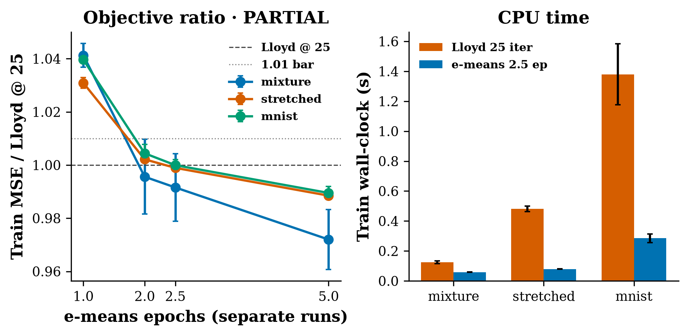

# emeans-vs-kmeans

CPU comparison of FAISS 1.16.0 e-means against FAISS Lloyd k-means. The algorithm is Bessa, Mazaré, Szilvasy, Touvron, Picard, Douze, and Jégou, [arXiv:2611.09501](https://arxiv.org/abs/2611.09501), *e-means: outperforming k-means (in one-tenth the epochs)*. Found via a bookmarked X post by [@swann_bessa](https://x.com/swann_bessa/status/2120200714630594911). That post was **not** fetched. The abstract, Section 3, and Appendix D were read from the arXiv HTML on 2026-11-11.

**e-means is the released FAISS code**, `faiss.contrib.e_means.NumpyEmeans` from `faiss-cpu==1.16.0`. The 1.16.0 changelog (9 November 2026) lists it, and the import succeeds. FAISS is MIT and is not vendored. See `NOTICE`.



*Train MSE of separate e-means budgets, divided by FAISS Lloyd at 25 iterations, and the training wall-clock. Video: [`artifacts/emeans-vs-kmeans.mp4`](artifacts/emeans-vs-kmeans.mp4).*

## Status (honest): **PARTIAL**

The loss bar holds on every gated dataset. The 10× wall-clock bar does not.

| Check | Bar | mixture | stretched | MNIST |
|---|---|---:|---:|---:|
| Train MSE ratio at 2.5 epochs | ≤ 1.01 | **0.992 ± 0.013** | **0.999 ± 0.001** | **1.000 ± 0.002** |
| Wall-clock ratio at 2.5 epochs | ≤ 0.10 | **0.475 ± 0.023** | **0.165 ± 0.005** | **0.208 ± 0.009** |

**PASS** needed both bars on all three datasets. **PARTIAL** is every loss bar met and at least one clock bar missed. All three clock bars missed, so the status is **PARTIAL**. Sample std is ddof=1 over seeds 0/1/2. Every individual seed at 2.5 epochs is also inside 1.01.

## What the paper reports

The abstract: e-means beats Lloyd's loss at 25 epochs in 1.4 to 2.6 epochs, and that is a 10–45× GPU wall-clock cut against the implementations they compare. Table 11, eleven VIBE sets on 64 CPU cores: 1.6 to 2.6 epochs, and 9.0× to 15.0× against FAISS. Appendix D.2: on synthetic draws the median epochs to match Lloyd@25 is about 3.1 across a dimension sweep.

Those numbers are not this run. This machine is 4 vCPUs. The matrices are 10k–20k rows, not the paper's 1e5–1e10.

## Hypothesis

On CPU, released e-means at 2.5 epochs (10× fewer than 25) reaches FAISS Lloyd's training mean squared error within 1%, and the training call takes at most 1/10 of Lloyd's wall-clock.

## What was compared

Lloyd is one `faiss.Kmeans` call: `niter=25`, `nredo=1`, `spherical=False`, `gpu=False`, `max_points_per_centroid=1e9`, `min_points_per_centroid=1`. The two caps are the paper reproduction's full-matrix setting. On these sizes `256 * k` is larger than `n`, so the library default cap of 256 would not have subsampled either. Seed 0 of the mixture confirms it: default-cap Lloyd and full-matrix Lloyd land on the same train MSE, 11.4779.

e-means is `NumpyEmeans` with `batch_law="auto"` and no batch or step override. The library's shipped coefficients are the ones in its readme. Its source notes they differ slightly from Table 2, and that the initial decayed count is \(2^{-16}\) rather than the paper's \(10^{-10}\). Both were left as shipped. `auto` picked the throughput law on all three gated sets (d is 32, 64, and 784).

Both methods start from the same `k` training rows, drawn with the seed. The score is a fresh `faiss.knn` mean squared L2 on the centroids `train()` returns. The timer wraps `train()` only. Each e-means budget is its own run, because the batch size and the cosine schedule depend on the epoch count.

## Experiment (`experiments/exp1_cpu_emeans/`)

- **Pre-registration:** `config.yaml` is commit `04b6165`, before `raw.json`. Thresholds were not edited after that commit. `config_sha256` in `raw.json` matches the file.
- **Smoke:** `smoke.json` is a 400×16 mixture, code-path only.
- **Seeds:** 0, 1, 2. The dataset draw is fixed. The seed changes the shared init and e-means' shuffle and revivals.
- **Primary metric:** train MSE ratio at 2.5 epochs.
- **Gated sets:** balanced Gaussian mixture (n=20000, d=32, k=512), stretched Gaussian with exponent 1 (n=20000, d=64, k=512), MNIST pixels in `[0, 1]` (n=10000, d=784, k=256).
- **Machine:** 4 vCPU, Python 3.12.3, faiss-cpu 1.16.0, 2 processes × 2 FAISS threads. Official `./run_all.sh` wall time **11 s**, including the unit tests, the MNIST download, and the video.

### Train MSE, mean ± std

| dataset | Lloyd @ 25 | e-means @ 2.5 | ratio | seconds, Lloyd | seconds, e-means |
|---|---:|---:|---:|---:|---:|
| mixture | 11.471 ± 0.077 | 11.374 ± 0.090 | 0.992 ± 0.013 | 0.124 ± 0.009 | 0.059 ± 0.002 |
| stretched | 33.454 ± 0.020 | 33.418 ± 0.027 | 0.999 ± 0.001 | 0.482 ± 0.019 | 0.080 ± 0.001 |
| MNIST | 23.926 ± 0.050 | 23.925 ± 0.038 | 1.000 ± 0.002 | 1.379 ± 0.204 | 0.285 ± 0.028 |

Held-out MSE, same centroids, report-only: mixture 12.051 vs Lloyd 12.206, stretched 36.380 vs 36.413, MNIST 25.833 vs 25.906.

The ladder, report-only, mean train-MSE ratio:

| epochs | mixture | stretched | MNIST |
|---:|---:|---:|---:|
| 1 | 1.041 ± 0.004 | 1.031 ± 0.002 | 1.040 ± 0.001 |
| 2 | 0.996 ± 0.014 | 1.002 ± 0.000 | 1.004 ± 0.003 |
| 2.5 | 0.992 ± 0.013 | 0.999 ± 0.001 | 1.000 ± 0.002 |
| 5 | 0.972 ± 0.011 | 0.988 ± 0.001 | 0.990 ± 0.003 |

One epoch is still 3–4% above Lloyd@25, outside the 1% bar. Two epochs is already inside it on every gated mean. That is 12.5× fewer epochs than 25. The pre-registered gate was 2.5, and it passes.

Seed 0 batch sizes at 2.5 epochs: mixture 1024, stretched 1024, MNIST 512, all throughput. Peak step about 0.25. Dead-cluster splits on that seed: 112, 392, and 84.

MNIST label purity at k=256, report-only: e-means 0.894, 0.900, 0.902 and Lloyd 0.902, 0.893, 0.885. k is not 10, so purity is a split of the ten digits, not a classification accuracy.

## Breakpoints

Seed 0. Not part of the PARTIAL rule. Full table: `breakpoints.md`.

| Stress | What happened |
|---|---|
| k=2000, n=8000, d=32 (n/k=4) | Train-MSE ratio 0.948, so the loss is better. Wall ratio 1.12, so e-means is slower. The run revived 998 clusters. |
| d=512, n=4000, k=64, stretched | Ratio 1.001, inside 1%. Wall ratio 0.35. |
| Zipf mixture, n=20000, d=32, k=128 | Ratio 0.976. Wall ratio 0.39. Imbalance did not push the loss over the bar on this seed. |
| n=200, d=16, k=20 | Ratio 1.076, outside 1%. Wall ratio 31. `batch_law=auto` selects the quality law at d≤16, and the batch size came out at 2. Lloyd's `train()` was 0.27 ms. The scaling law was fit on much larger n. |
| Library default caps, mixture seed 0 | Same train MSE as the full-matrix call. `256 * 512 > 20000`, so the default subsample does not engage. |

## Run (CPU)

```bash
cd apps/emeans-vs-kmeans
python3 -m venv .venv && source .venv/bin/activate
pip install -r requirements.txt
./run_all.sh
PYTHONPATH=src python -m unittest test_cluster -v
```

MNIST is downloaded into `work/mnist/` (gitignored) from the CVDF or OSSCI mirror. No GPU. `python src/run_experiment.py --smoke` rewrites `smoke.json` only.

## Caveats

- This is not VIBE, not DINO10B, and not 64 cores. Table 11's 8–15× CPU speedup is a different scale. Here the clock ratios are 0.47, 0.17, and 0.21: about 2.1×, 6.1×, and 4.8×.
- Each e-means epoch does many mini-batch assignments. Ten times fewer epochs is not ten times less CPU time when the batch loop has overhead and Lloyd's 25 iterations are one tight C++ loop. The gap is smallest on the mixture, whose Lloyd call is 0.12 s.
- The shipped step and batch coefficients are not Table 2's rounded figures. The initial count is \(2^{-16}\). The run did not retune either.
- k is below the paper's \(4\sqrt{n}\) to \(32\sqrt{n}\) band on the mixture and the stretched set (512 vs about \(4\sqrt{20000} \approx 566\) rounded up). MNIST uses k=256.
- The objective is training MSE with a fresh assignment. The paper's headline tables are mostly test MSE. Test MSE moved the same way and was not a gate.
- At n=200 the automatic law leaves the fit range and the claim fails in both loss and time. At k=2000 the loss still wins and the clock does not.
- Upstream code was not copied. This directory is MIT.

## Licences

- This directory: **MIT** (`LICENSE`).
- FAISS (Meta): **MIT**. Not vendored. See `NOTICE`.
