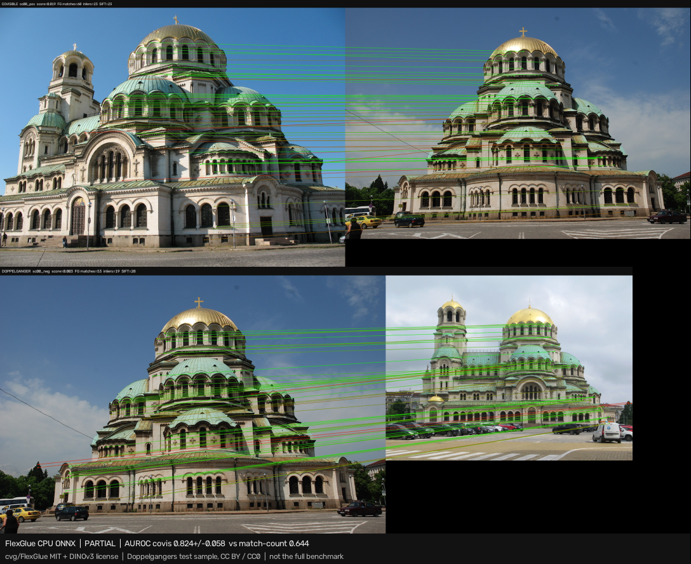
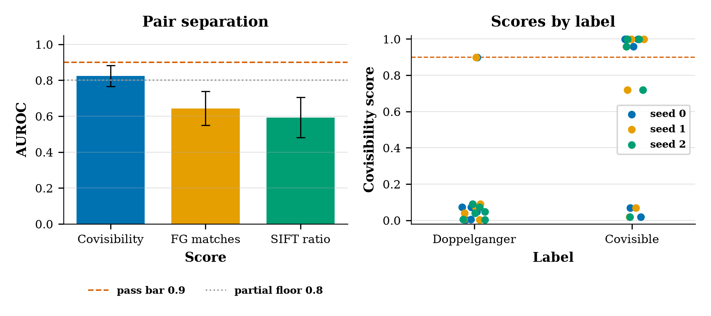

# flexglue-doppelganger

CPU-only clear experiment for **FlexGlue** ([cvg/FlexGlue](https://github.com/cvg/FlexGlue)): sparse-to-dense matching with a pair covisibility head that is meant to reject doppelgangers (look-alike, non-overlapping pairs). Paper: Lindenberger, Sarlin, Miksik, and Pollefeys, [arXiv:2610.32976](https://arxiv.org/abs/2610.32976). Found via a bookmarked X post by [@PhilippCSE](https://x.com/PhilippCSE/status/2117655733911044147). The numbers below were measured from the paper and the official ONNX release, not copied from the post.



*Seed-0 protocol pair from the Doppelgangers test set (Alexander Nevsky Cathedral, Sofia). Top: labelled covisible, covisibility 0.019, 60 FlexGlue matches. Bottom: labelled doppelganger, covisibility 0.003, 53 matches. The head rejects both. Video: [`artifacts/flexglue-doppelganger.mp4`](artifacts/flexglue-doppelganger.mp4) holds those two pairs, then rotates image B through 0°, 45°, 90°, 135°, and 180°.*

> Upstream inference code is **MIT** (`LICENSE-UPSTREAM`). The ONNX descriptor redistributes a DINOv3 ConvNeXt-B backbone under the **DINOv3 License** (`DINOv3_LICENSE.md`). That backbone is gated on Hugging Face; this demo does **not** download `facebook/dinov3-convnext-base-pretrain-lvd1689m` and does not use a token. It uses the public FlexGlue v0.1 ONNX files. Weights and images are not committed.

## Status (honest): **PARTIAL**

| Check | Threshold (fixed before the matcher run) | Result |
|---|---|---|
| Mean AUROC of `covisibility_score` over seeds 0/1/2 | ≥ 0.90 | **not met** (0.8241 ± 0.0578) |
| Mean margin vs FlexGlue match-count AUROC | ≥ 0.05 | **met** (0.1806 ± 0.1463) |
| Partial floor | ≥ 0.80 and exactly one of the two checks | **met** → PARTIAL |

SIFT Lowe-ratio AUROC is report-only: **0.5926 ± 0.1123**. It does not enter the status.

## What the paper reports (Table 3)

FlexGlue AUROC on the full benchmarks, and the paper's GPU matching time:

| Training labels | Doppelgangers | ViSym-F | LaMAR | GPU time |
|---|---|---|---|---|
| matching only | 0.970 | 0.953 | 0.885 | 28.7 ms |
| DG + matching | 0.984 | 0.959 | 0.888 | 28.7 ms |

The pass bar **0.90** sits below both Doppelgangers figures and above LaMAR (0.888 / 0.885). One rank swap in a 6×6 set moves AUROC by 1/36 ≈ 0.028, so 0.90 allows a few mistakes that 0.984 does not. The partial floor **0.80** sits just under LaMAR. Paper inference uses \(t = 0.9\); the README example uses `min_covisibility=0.8`. This run leaves `min_covisibility` at 0 so the match-count baseline is not gated by the head, and it uses the full fp32 matcher (no early stop) so the score is the final-layer score. The 28.7 ms figure is GPU time, not ours.

## Hypothesis

FlexGlue's covisibility head separates true covisible pairs from doppelganger pairs on CPU, with AUROC at least 0.90 on a tiny balanced Doppelgangers sample, and that AUROC beats a plain match count from the same model by at least 0.05.

## Experiment (`experiments/exp1_cpu_covisibility/`)

- **Config:** `config.yaml` thresholds were committed before any matcher call. A later edit switched image loading from live Wikimedia (HTTP 429) to the official `test_set.tar.gz` and fixed the anchor YAML. The three AUROC thresholds were not changed. There was no score-based pair picking.
- **Data:** 8 scenes, alphabetical, first CC0 / public-domain / CC BY positive and first such negative that exist in the tarball (no NC, no ND, no SA). Each seed draws 6 of the 8 scenes (12 pairs). Provenance: `provenance.md`.
- **Seeds:** 0, 1, 2. The seed draws the scenes and subsamples 768 SIFT points from the top 2048. The covisibility score did not change across seeds for a given pair (it is a token vote, not a function of the keypoints). Match counts did.
- **Baselines:** FlexGlue match count with the head gate off, and SIFT Lowe ratio 0.75 on the same keypoints. Inliers are USAC_MAGSAC at 1 px, report-only.
- **Machine:** 4 vCPU, ONNX Runtime CPU, descriptor fixed at 512×512. Peak RSS about 2.1 GB.

| seed | AUROC covis | AUROC FG matches | AUROC SIFT | margin | covis pos | covis neg | inliers pos | inliers neg | uncached s |
|---|---|---|---|---|---|---|---|---|---|
| 0 | 0.8056 | 0.6111 | 0.5278 | 0.1944 | 0.674 | 0.183 | 36.8 | 24.0 | 4.37 |
| 1 | 0.7778 | 0.7500 | 0.7222 | 0.0278 | 0.627 | 0.184 | 44.5 | 26.2 | 4.31 |
| 2 | 0.8889 | 0.5694 | 0.5278 | 0.3194 | 0.782 | 0.043 | 36.0 | 32.2 | 4.41 |

**Mean ± std:** covisibility AUROC **0.8241 ± 0.0578**, FlexGlue match count **0.6435 ± 0.0945**, SIFT **0.5926 ± 0.1123**, margin **0.1806 ± 0.1463**.

Uncached time per pair **4.36 ± 0.05 s** (describe both images + SIFT + match). Matcher only **3.28 ± 0.05 s**. Mean MAGSAC inliers **39.1** on positives vs **27.4** on negatives: doppelgangers still collect geometric inliers, which is why a match count is a weak rejector here.

Seed 1's own margin is 0.028, under 0.05. The pre-registered rule uses the mean across seeds, which clears 0.05. That is why the margin clause passes and the status is PARTIAL rather than FAIL.

The head misses three pairs in the seed-0 pool (scores identical on the other seeds):

- `sc00_pos` (Sofia, positive): covisibility **0.019** with 60 matches
- `sc03_pos` (Berlin Cathedral, positive): **0.068** with 83 matches
- `sc03_neg` (Berlin Cathedral, negative): **0.898** with 27 matches

Several other positives sit at 0.96–1.00 and their negatives sit below 0.1. The upstream Berlin demo pair (`assets/berlin1.jpg`, `berlin2.jpg`), which is not in the AUROC, scored **0.993**.



## Breakpoints

Seed 0, first positive and first negative in that seed's scene sample (`sc00`, Sofia). Positive-score tags use the paper threshold 0.9 (ok) and 0.5 (degraded). This positive is already at 0.019 before any stress, so every clean tag is "broken". The sweep still shows where the score moves.

| Stress | What happened |
|---|---|
| Rotation of image B, 0/45/90/135/180° | Positive score 0.019, 0.101, 0.070, **0.468**, 0.247. Never reaches 0.9. 135° is the jump. Negative stays ≤ 0.089. |
| Downscale of B to 0.125 | Positive matches fall to 4 and the score rises to 0.461. Milder scales (0.5, 0.25) leave the score near 0.02. |
| Blur σ=8 on B | Positive matches fall to 3 and the score rises to **0.769** (degraded, not ok). σ=2 does not move it. |
| 70% mix toward the mean colour | Positive score 0.105, matches 17. Negative stays at 0.004. |
| Input long side 512 / 1024 / 1600 | Matcher time stays **3.4–3.6 s**. RSS stays **~2.0–2.1 GB**. The exported descriptor always squashes to 512×512, so extra pixels do not buy a bigger ConvNeXt grid. The score is not invariant: 0.229 at long side 512 vs 0.019 at 1600. |

## Run (CPU)

```bash
cd apps/flexglue-doppelganger
python3 -m venv .venv && source .venv/bin/activate
pip install -r requirements.txt
./run_all.sh
```

Downloads are the FlexGlue v0.1 ONNX models (~550 MB) and the Doppelgangers test tarball (~2 GB) into `work/` (git-ignored). No GPU.

Colab, CPU runtime: [`notebooks/flexglue_doppelganger_colab.ipynb`](notebooks/flexglue_doppelganger_colab.ipynb). A GPU is not required.

## Caveats

- Twelve pairs are not Table 3. The 0.824 AUROC is not a claim about the 0.984 Doppelgangers number or the 0.888 LaMAR number.
- OpenCV SIFT is the detector in the upstream ONNX example. The paper's tables use other keypoints.
- The Berlin Cathedral negative in this sample is scored 0.898, just under the paper's reject threshold of 0.9, while its positive is scored 0.068. A threshold of 0.9 would reject the true pair and keep the doppelganger.
- Positives still only average 39 MAGSAC inliers against 27 for negatives. Geometry alone does not separate this sample.
- DINOv3 weights inside the descriptor ONNX are under the DINOv3 License, not MIT. The gated Hugging Face file was not used.
- Input resolution does not change CPU time on this export. That is a property of the ONNX graph, not evidence that the paper's higher-resolution setting is free.
