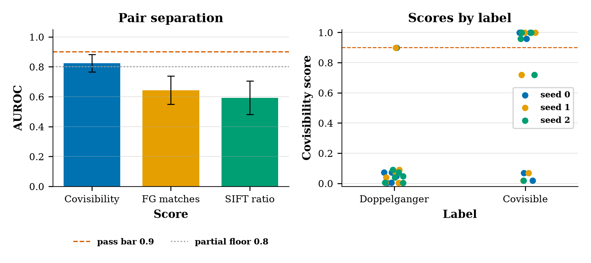

# Exp1 results — FlexGlue covisibility on CPU

**Status: PARTIAL**

Mean ± sample std (ddof=1) across seeds 0/1/2.

| metric | mean ± std | bar |
|---|---|---|
| AUROC covisibility | 0.8241 ± 0.0578 | ≥ 0.9 (not met) |
| AUROC FlexGlue match count | 0.6435 ± 0.0945 | baseline |
| AUROC SIFT ratio count | 0.5926 ± 0.1123 | report-only |
| margin (covis − match count) | 0.1806 ± 0.1463 | ≥ 0.05 (met) |
| uncached seconds / pair | 4.3623 ± 0.0465 | report-only |
| matcher seconds / pair | 3.2802 ± 0.0476 | report-only |
| MAGSAC inliers pos / neg | 39.1 / 27.4 | report-only |

| seed | AUROC covis | AUROC FG matches | AUROC SIFT | margin | covis pos | covis neg | inliers pos | inliers neg | uncached s |
|---|---|---|---|---|---|---|---|---|---|
| 0 | 0.8056 | 0.6111 | 0.5278 | 0.1944 | 0.674 | 0.183 | 36.8 | 24.0 | 4.37 |
| 1 | 0.7778 | 0.7500 | 0.7222 | 0.0278 | 0.627 | 0.184 | 44.5 | 26.2 | 4.31 |
| 2 | 0.8889 | 0.5694 | 0.5278 | 0.3194 | 0.782 | 0.043 | 36.0 | 32.2 | 4.41 |

Pairs where a positive scores below 0.2 or a negative scores above 0.5 (seed 0 shown; the score does not depend on the keypoint subsample):

- `sc00_pos` (positive, Alexander_Nevsky_Cathedral,_Sofia): covisibility 0.019, FlexGlue matches 60, SIFT 23
- `sc03_pos` (positive, Berlin_Cathedral): covisibility 0.068, FlexGlue matches 83, SIFT 2
- `sc03_neg` (negative, Berlin_Cathedral): covisibility 0.898, FlexGlue matches 27, SIFT 12

