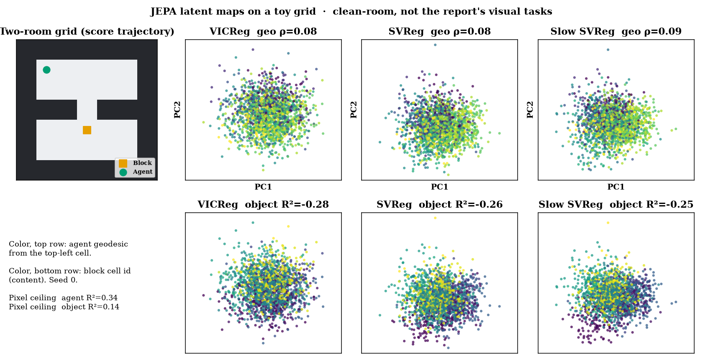
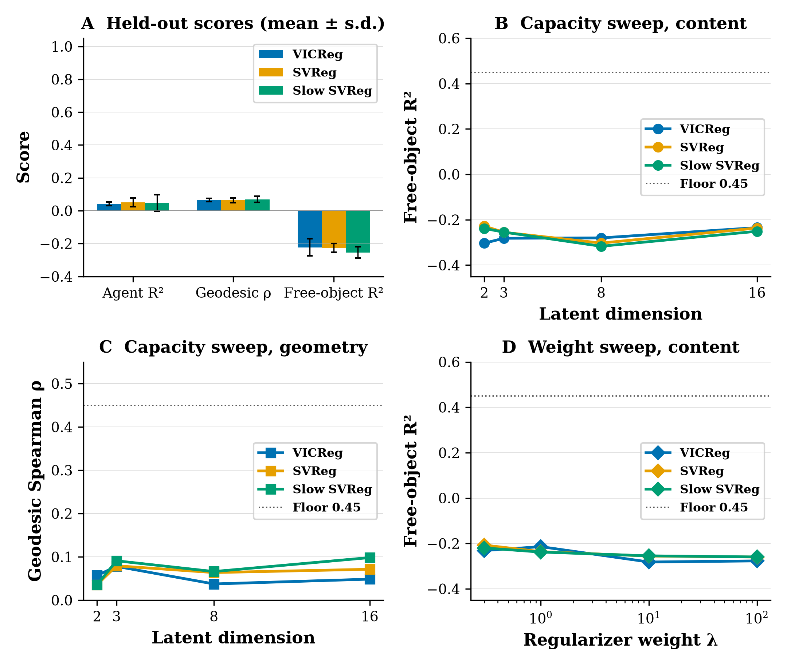

# jepa-latent-maps

CPU-only clear-experiment toy of **The Content–Geometry Tradeoff in World Models: When JEPA Learns Latent Maps** (Ren, Wang, Hoang, Kuang & LeCun — NYU / AMI Labs, technical report **AGL-TR-2026-04**, 18 Nov 2026, [doi:10.5281/zenodo.24356797](https://doi.org/10.5281/zenodo.24356797)). Found via bookmarked posts by [@askalphaxiv](https://x.com/askalphaxiv/status/2124121398268559382) and [@TheTuringPost](https://x.com/TheTuringPost/status/2124303722671153346). Those posts were not fetched. The report was checked on [Zenodo](https://zenodo.org/records/24356797), the [project page](https://agenticlearning.ai/content-geometry-tradeoff/), and the [lab PDF](https://cdn.agenticlearning.ai/25c41dcbc4b7a11e/content-geometry-tradeoff-2026.pdf) on 2026-11-23. **There is no arXiv id** and **no official code**. This is a clean-room toy. See `NOTICE`.



*Seed-0 latent PCA. Top row colored by the agent's maze geodesic, bottom row by the block's cell. None of the three objectives lays out the grid. Video: [`artifacts/jepa-latent-maps.mp4`](artifacts/jepa-latent-maps.mp4).*

## What is implemented (report idea, toy scale)

- **Grid:** 7×7 two-room maze, one door. A point agent takes uniform-random actions. A block stays put until the agent enters its Chebyshev radius, then jumps to a random free cell outside that radius (Section B: "the object jumps to a random position when the arm enters a contact radius").
- **Observation:** two noisy occupancy maps (agent, block), noise std 0.30, the number used for the report's linear world. On this grid that noise is harsher than in the report: a linear ridge on the pixels themselves only reaches agent R² 0.34 and free-object R² 0.14.
- **Model:** MLP encoder (98→64→3) and an action-conditioned MLP predictor. Latent size 3 is below the 4-D agent+object state, the capacity regime of Section B. No stop-gradient on the prediction target. About **7.3k** parameters (Slow SVReg 7,305; the others 7,302).
- **VICReg:** variance hinge + covariance on every frame in the batch (Bardes et al., 2022). No term pulls consecutive latents together. This is the distributional anti-collapse regularizer the report says was built for i.i.d. multi-view batches.
- **SVReg:** one-sided floor on the latent standard deviation along random directions (Equation 1).
- **Slow SVReg:** SVReg, plus a variance-normalized slowness term on the last latent channel (Equation 2; the report uses the last 1/8, at least one channel) and a gated residual predictor initialized at 0.1 (Equation 3).
- **Collapse scale, fixed in advance:** at a fully collapsed latent, SVReg's penalty is λ (up to the 1e-4 inside the square root) and VICReg's variance hinge uses Bardes' coefficient 25. Primary λ = 10, so `vicreg_weight = 0.4`. Slow-channel weight is `1/λ = 0.1`, the coupling in the report's Table 6. Not fit on these metrics.
- **Geometry:** held-out ridge R² of agent position, and Spearman correlation between latent L2 and maze geodesic (Section 3).
- **Content:** held-out ridge R² of the block on frames where it did not just jump and the agent is outside the contact neighborhood (the report's free-block readout).

Not claimed: PointMaze / Reacher / Cube / PushT planning, ResNet or ViT world models, SIGReg-BN, stop-gradient, city-walk maps, or any number in the report's Tables 1–11.

## Status (honest): **FAIL**

| Check (fixed in `config.yaml` before the run) | Threshold | Result |
|---|---|---|
| Every seed, Slow SVReg agent R² | ≥ 0.60 | **not met** (per seed 0.091, 0.057, −0.007) |
| Every seed, Slow SVReg geodesic ρ | ≥ 0.45 | **not met** (0.091, 0.057, 0.060) |
| Every seed, Slow SVReg free-object R² | ≥ 0.45 | **not met** (−0.255, −0.220, −0.288) |
| Every seed, Slow geodesic ρ > VICReg | strict | **not met** (seed 1: 0.057 vs 0.061) |
| Every seed, SVReg geodesic ρ > VICReg | strict | **not met** |
| Every seed, Slow free-object R² > SVReg | strict | **not met** (seed 0 only) |
| Mean Slow agent R² | ≥ 0.70 | **not met** (0.047) |
| Mean (SVReg − VICReg) geodesic ρ | ≥ 0.05 | **not met** (−0.002) |
| Mean (Slow − VICReg) geodesic ρ | ≥ 0.05 | **not met** (+0.004) |
| Mean (Slow − SVReg) free-object R² | ≥ 0.10 | **not met** (−0.029) |
| Mean (SVReg − Slow) geodesic ρ | ≤ 0.05 | **met** (−0.006) |

Status rule: PASS needs every row; PARTIAL if mean Slow geodesic beats VICReg and mean Slow free-object R² beats SVReg but a row fails; else FAIL. The content gap has the wrong sign, so this is **FAIL**, not PARTIAL.

The 0.05 / 0.10 gaps are toy margins chosen before training. They are not copied from a table. The report's U-maze geodesic gap (SVReg − VICReg) is about 0.22 and its Medium gap is about 0.03. The report calls an object "kept" at R² ≥ 0.70 in the linear experiment.

### Per-seed results

| seed | method | agent R² | geodesic ρ | free-object R² | jaggedness |
|---|---|---:|---:|---:|---:|
| 0 | VICReg | 0.054 | 0.078 | −0.282 | 2.21 |
| 0 | SVReg | 0.080 | 0.079 | −0.255 | 2.78 |
| 0 | Slow SVReg | 0.091 | 0.091 | −0.255 | 2.71 |
| 1 | VICReg | 0.039 | 0.061 | −0.196 | 3.27 |
| 1 | SVReg | 0.049 | 0.051 | −0.210 | 2.87 |
| 1 | Slow SVReg | 0.057 | 0.057 | −0.220 | 2.64 |
| 2 | VICReg | 0.033 | 0.058 | −0.190 | 2.51 |
| 2 | SVReg | 0.026 | 0.060 | −0.210 | 3.25 |
| 2 | Slow SVReg | −0.007 | 0.060 | −0.288 | 3.07 |

**Mean ± sample std**

| method | agent R² | geodesic ρ | free-object R² |
|---|---:|---:|---:|
| VICReg | 0.042 ± 0.011 | 0.066 ± 0.011 | −0.223 ± 0.051 |
| SVReg | 0.052 ± 0.027 | 0.063 ± 0.014 | −0.225 ± 0.026 |
| Slow SVReg | 0.047 ± 0.050 | 0.069 ± 0.019 | −0.254 ± 0.034 |

Participation ratio is about 2.5–2.7 out of 3, so the variance floor is doing its job: the latent is not a single collapsed point. It is also not a map. Jaggedness on the scripted route is about 2.2–3.3 (a smooth path is near 1). Prediction loss at step 800 is still about 0.5–0.9 and was still falling for SVReg and Slow SVReg.



## Experiment (`experiments/exp1_cpu_grid/`)

- **Hypothesis:** Slow SVReg keeps a latent map of the agent and a decodable resting block; VICReg's map is worse; SVReg's map is better than VICReg's and its block readout is worse than Slow SVReg's.
- **Pre-registration:** `config.yaml` and the bar in this README were committed before the official run (`252c049`, "pre-register jepa-latent-maps content-geometry toy"). **Disclosure:** one smoke (VICReg, seed 0, 40 steps; `smoke.json`) checked the code path only (agent R² ≈ −0.005). No threshold changed after that smoke or after `raw.json`.
- **Seeds:** 0, 1, 2. They change initialization and minibatch order. The three trajectories (train / ridge-fit / ridge-score) are fixed.
- **Machine:** 4-vCPU Linux, torch 2.15.0+cpu, Python 3.12. Official `./run_all.sh`: **~20 s**.

Tables: `results.md` / `results.csv`; raw: `raw.json`; verdict: `status.json`.

## Breakpoints (`breakpoints.md`, `breakpoints.csv`)

Seed 0. The primary budget never enters a regime where the floors are close, and the sweeps do not find one either.

- **Latent dim** {2, 3, 8, 16}, 800 steps. Dim 16 is the high point and still fails: Slow SVReg agent R² 0.162, geodesic ρ 0.098, free-object R² −0.251. Extra capacity does not recover the block or the map at this budget.
- **Regularizer weight** λ ∈ {0.3, 1, 10, 100}, with slow weight kept at 1/λ. Free-object R² stays between about −0.21 and −0.28. Larger λ does not create a map; it makes the block readout slightly worse.
- **Short training:** 100 steps is chance (geodesic ρ ≤ 0.021). 400 steps reaches Slow geodesic ρ 0.066, close to the 800-step primary. The curve is still rising at the frozen budget, and it is far below 0.45.

## Run (CPU)

```bash
cd apps/jepa-latent-maps
python3 -m venv .venv && source .venv/bin/activate
pip install --index-url https://download.pytorch.org/whl/cpu torch
pip install -r requirements.txt
./run_all.sh
# python src/run_experiment.py --smoke   # disclosed code-path check; does not set thresholds
```

## Caveats

- **FAIL is about this toy at the frozen budget, not a refutation of the report.** The report's SVReg latents trace maze corridors in the leading principal components and reach planning success above 90% on hard first-person goals. This run never produced a decodable map, so it cannot show the content–geometry tradeoff those maps exhibit.
- **The variance floor is satisfied and the coordinates are still wrong.** Participation ratio near 3 means anti-collapse worked in the narrow sense. Position R² near 0 means the spread is not the agent's state.
- **Noise std 0.30 was copied from the report's linear world**, where the state is observed through a 32×2 map. Here the same std sits on 98 pixels of which one is the agent. A linear pixel readout, the ceiling, is only 0.34 / 0.14. The MLP did not reach that ceiling.
- **Not the authors' code or scale.** No official repository is linked from the project page or the Zenodo record (checked 2026-11-23). A third-party toy, `aicumene/BOID-JEPA`, is not vendored. The visual protocol (ResNet, block-causal ViT, 5k–470k frames, CEM planning) needs code the authors have not released, so there is no faithful GPU notebook to add.
- **Jaggedness** uses a trailing window of 3 because the scripted route is 9 cells. The report uses 9 on long routes. Jaggedness is report-only.
- The block jump is the Section B contact rule on a grid, not a physical push, and not PushT or Cube.
- Trained weights stay out of git (`work/` is git-ignored).

## Licences

- App harness / this folder: **MIT** (`LICENSE`). Clean-room; no upstream code vendored.
- The report is an open Zenodo record (AGL-TR-2026-04). It is not a software licence, and no code was copied from it.
