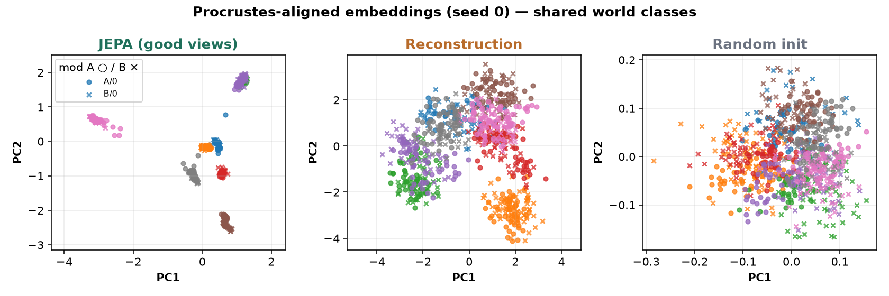
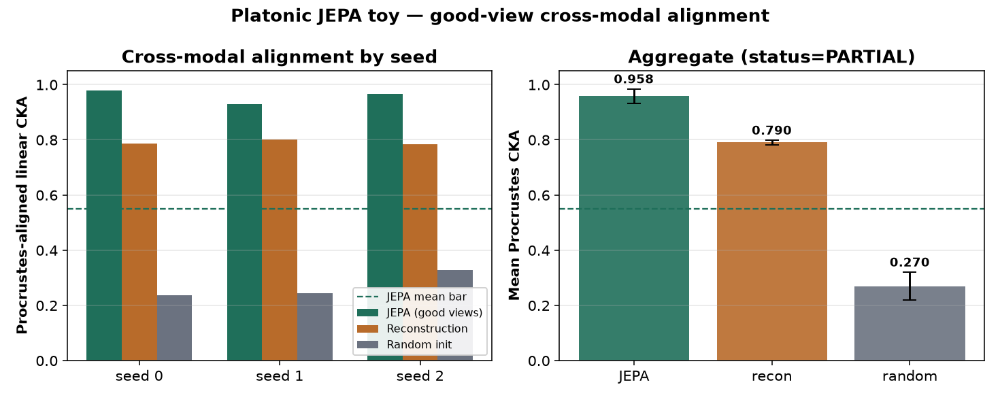

# jepa-platonic-toy

CPU-only clear-experiment toy of **Proving and Improving the Platonic Representation Hypothesis with JEPAs** (Balestriero & LeCun — Brown / NYU / AMI Labs, [arXiv:2610.39302](https://arxiv.org/abs/2610.39302)). Found via a bookmarked X post by [@HuggingPapers](https://x.com/HuggingPapers/status/2116804737207021735) (thread with [2116804727228784718](https://x.com/HuggingPapers/status/2116804727228784718)). Paper verified on arXiv + [Hugging Face Papers](https://huggingface.co/papers/2610.39302) on 2026-11-02. Official code ([galilai-group/prh-proof](https://github.com/galilai-group/prh-proof)) and [demo Space](https://huggingface.co/spaces/galilai-group/prh_demo) exist — **not vendored**. This is a **clean-room** toy of good-view JEPA cross-modal alignment on a synthetic finite world. See `NOTICE`.



*Procrustes-aligned PCA of modality-A (○) vs modality-B (×) embeddings, coloured by world class (seed 0). Video: [`artifacts/jepa-platonic-toy.mp4`](artifacts/jepa-platonic-toy.mp4).*

## What is implemented (paper idea, toy scale)

- **Synthetic world:** 8 classes × 4 states (|Z|=32) in a 16-D latent; two injective linear renderings (modality A: 24-D, B: 20-D) plus independent nuisance noise.
- **Good-view JEPA:** VICReg-style whitened JEPA (identity predictor: invariance MSE + variance hinge + covariance) trained on two independent observations of the same world state. JEPA-A sees only modality A; JEPA-B only modality B; different MLP widths (`[64,64]` vs `[96,48]`), separately trained.
- **Baselines:** (1) randomly initialised encoders; (2) reconstruction autoencoders with the same trunks.
- **Primary metric:** Procrustes-aligned linear CKA on 1024 held-out paired observations (same z, both modalities). Report-only: mutual k-NN overlap, Procrustes RMSE.

Not claimed: the paper's Flickr / COCO / Recap-DataComp tables, 33M–109M text JEPAs, 70B LM comparisons, LeJEPA SIGReg, or pair-free rotation recovery.

## Status (honest): **PARTIAL**

| Check (fixed in `config.yaml` before the run) | Threshold | Result |
|---|---|---|
| `cka_jepa > cka_recon` on every seed 0/1/2 | strict | **met** |
| `cka_jepa > cka_random` on every seed 0/1/2 | strict | **met** |
| `mean(cka_jepa) ≥ 0.55` | ≥ 0.55 | **met** (0.9580) |
| `mean(cka_jepa − cka_recon) ≥ 0.20` | ≥ 0.20 | **not met** (0.1679) |
| `mean(cka_jepa − cka_random) ≥ 0.35` | ≥ 0.35 | **met** (0.6883) |

Status rule: PASS needs all five; PARTIAL if mean(JEPA) beats both baselines but a seed or gap/absolute bar fails; else FAIL. → **PARTIAL**.

### Per-seed results (Procrustes-aligned linear CKA; higher is better)

| seed | JEPA | recon | random | JEPA−recon | JEPA−random |
|---|---:|---:|---:|---:|---:|
| 0 | **0.9797** | 0.7871 | 0.2370 | +0.1926 | +0.7427 |
| 1 | **0.9282** | 0.8000 | 0.2437 | +0.1283 | +0.6846 |
| 2 | **0.9662** | 0.7833 | 0.3285 | +0.1829 | +0.6377 |

**Mean ± std:** JEPA **0.9580 ± 0.0267**, recon **0.7901 ± 0.0088**, random **0.2697 ± 0.0510**.

Params: JEPA-A **6,280**, JEPA-B **7,064** (recon AE adds a decoder).

On this ~7k-param / 800-step CPU toy the Platonic claim *directionally* holds — separately trained good-view JEPAs align near-perfectly up to a rotation and beat both baselines on every seed — but the pre-registered **≥0.20 mean gap vs reconstruction** is missed (reconstruction already captures shared class geometry at CKA≈0.79). This does **not** reproduce the paper's large-scale vision–language tables; it shows the rotation-alignment idea is easy to see on a tiny synthetic world, while beating a strong recon baseline by a large margin is not automatic.



## Experiment (`experiments/exp1_cpu_views/`)

- **Hypothesis:** two tiny JEPAs trained independently on good views of modalities A and B achieve Procrustes-aligned linear CKA that beats random-init and reconstruction baselines on every seed 0/1/2, with mean CKA ≥ 0.55, mean gap vs recon ≥ 0.20, and mean gap vs random ≥ 0.35.
- **Pre-registration:** `config.yaml` committed with hypothesis, metric and thresholds **before** the official run (git: “pre-register exp1 config”). **Disclosure:** one smoke (40 steps, seed 0; `smoke.json`) verified the code path only (CKA≈0.71). No threshold changed after any result.
- **Seeds:** 0, 1, 2 — each controls init; modality B uses seed+1000.
- **Machine:** 4-vCPU Linux box, torch 2.15.0+cpu, Python 3.12. Official end-to-end `./run_all.sh`: **~30 s** (21 s train+eval+breakpoints) including media.

Tables: `results.md` / `results.csv`; raw: `raw.json`; verdict: `status.json`.

## Breakpoints (`breakpoints.md`, `breakpoints.csv`)

Seed 0:

- **Bad views** (corrupt one observation with noise_std=0.5 + dropout_p=0.3): CKA **0.9551** vs good-view primary **0.9797** (Δ only +0.025). On this linear world, mild corruptions barely break alignment — a soft breakpoint, not a collapse.
- **Embedding dim** (400 steps): emb=4 is the soft low (**0.748**); emb=2 still **0.860**; emb=16 **0.963**. Tiny width hurts more than bad views here.
- **Short training:** 50 steps already **0.842**; 200 **0.847**; 800 **0.985**. Alignment appears early; the last budget mostly polishes CKA.

## Run (CPU)

```bash
cd apps/jepa-platonic-toy
uv venv .venv && source .venv/bin/activate
uv pip install --index-url https://download.pytorch.org/whl/cpu torch
uv pip install -r requirements.txt
./run_all.sh            # ~1 min on 4 vCPUs: 3 kernels × 3 seeds + breakpoints + plots + MP4
# python src/run_experiment.py --smoke  # disclosed tiny code-path check
```

## Caveats

- **Not the authors' code or scale:** ~7k params / synthetic 32-state world vs 33M–109M text JEPAs on Flickr–Recap-DataComp and 70B LM comparisons.
- **PARTIAL is about the pre-registered ≥0.20 gap vs reconstruction.** JEPA still wins every seed and clears the random and absolute bars; recon is a strong baseline because class geometry is linearly readable from either modality.
- **Bad-view breakpoint is mild** on this toy — paper-style “crops / masked spans” that keep modality nuisance are only approximated by additive noise + coordinate dropout.
- Official Apache/code at galilai-group/prh-proof was **not** copied; this harness is MIT clean-room.
- Trained weights stay out of git (`work/` is git-ignored).

## Licences

- App harness / this folder: **MIT** (`LICENSE`). Clean-room; no upstream code vendored.
