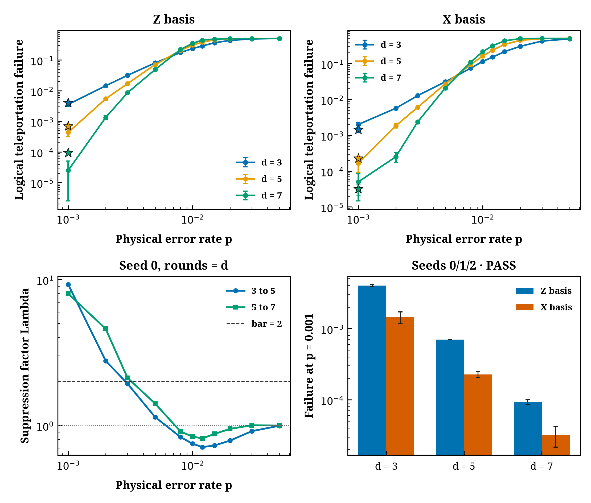

# lattice-surgery-teleport

CPU-only clear-experiment simulation of logical-qubit teleportation by lattice surgery, the protocol in **"Teleportation of Logical Qubits using Lattice Surgery with Superconducting Circuits"** (Hofele, Song, Márton, et al., ETH Zurich, [arXiv:2611.23165](https://arxiv.org/abs/2611.23165)). Found via a bookmarked X post by [@AndreasAtETH](https://x.com/AndreasAtETH/status/2123013303689515201); the post was **not fetched**. Every number below that is attributed to the experiment was read from the arXiv HTML.

Stim has no lattice-surgery generator. This app builds a rotated-surface-code XX merge and decodes it with PyMatching. Both libraries are Apache-2.0 (see `NOTICE`). No figures from the paper are copied. Hardware numbers are marked **QUOTED** and were not re-run.

**This is a simulation of the protocol, not a reproduction of the 41-qubit device.**



*Decoded failure versus physical error rate, the suppression factor, and the pre-registered point.* Video: [`artifacts/lattice-surgery-teleport.mp4`](artifacts/lattice-surgery-teleport.mp4) draws the distance-3 merge and the seed-0 sweep.

## Status (honest): **PASS**

The pass bar was fixed in `config.yaml` before the official seeds and was not edited afterward. A 400-shot smoke (`smoke.json`, seed 0, both bases, zero failures) only checked the code path.

| Check | Bar | Result |
|---|---|---|
| Λ(3→5) and Λ(5→7) on seed-mean p_bar | both ≥ 2 | **met** (5.90 and 7.40; neither is a zero-failure bound) |
| Raw Z and X failure strictly decreasing in d, every seed | all 6 series | **met** |

p_bar(d) = (p_fail_Z + p_fail_X) / 2. Λ is the ratio of the means of p_bar over seeds 0, 1 and 2, not the mean of the ratios.

### Failure at p = 10⁻³, rounds = d (mean ± sample std)

| d | basis | mean ± std | pooled |
|---|---|---|---|
| 3 | Z | 4.02×10⁻³ ± 1.4×10⁻⁴ | 1205/300 000 |
| 3 | X | 1.44×10⁻³ ± 2.6×10⁻⁴ | 432/300 000 |
| 5 | Z | 6.98×10⁻⁴ ± 2.9×10⁻⁶ | 419/600 000 |
| 5 | X | 2.27×10⁻⁴ ± 2.3×10⁻⁵ | 136/600 000 |
| 7 | Z | 9.33×10⁻⁵ ± 7.6×10⁻⁶ | 112/1 200 000 |
| 7 | X | 3.17×10⁻⁵ ± 1.0×10⁻⁵ | 38/1 200 000 |

Seed-mean p_bar: **2.73×10⁻³**, **4.63×10⁻⁴**, **6.25×10⁻⁵**. Per-basis Λ (report-only): Z is 5.75 then 7.48; X is 6.35 then 7.16.

Per-seed p_bar, which is what the strict-decrease check uses inside each basis, not as this average:

| seed | p_bar(3) | p_bar(5) | p_bar(7) |
|---|---|---|---|
| 0 | 2.80×10⁻³ | 4.73×10⁻⁴ | 5.38×10⁻⁵ |
| 1 | 2.73×10⁻³ | 4.53×10⁻⁴ | 6.88×10⁻⁵ |
| 2 | 2.66×10⁻³ | 4.63×10⁻⁴ | 6.50×10⁻⁵ |

## Hypothesis (locked)

Under uniform circuit-level depolarizing noise at **p = 10⁻³**, with `init_rounds = merge_rounds = d`, the decoded teleportation failure

`p_bar(d) = (p_fail_Z(d) + p_fail_X(d)) / 2`

falls by a factor **Λ ≥ 2** at each step d = 3→5 and d = 5→7. Λ is the ratio of the means over seeds 0, 1 and 2. `p_fail_b` is the shot fraction on which PyMatching disagrees with the sampled observable in basis b.

| | Rule |
|---|---|
| PASS | both Λ steps ≥ 2, and on every seed both bases are strictly decreasing in d |
| PARTIAL | both Λ steps > 1, but the PASS conjunction fails |
| FAIL | either Λ step ≤ 1 |

A larger-distance basis with zero failures contributes `3/shots` to the denominator, and that Λ is a lower bound. The bar applies to the lower bound. Breakpoints do not change the status.

## Breakpoints (seed 0)

Rounds = d unless noted. p_bar is the mean of the two bases. Full table: `experiments/exp1_cpu_teleport/breakpoints.md`.

- **p sweep.** Λ(3→5) is 9.3 at p = 10⁻³, 2.8 at p = 0.002, and **first falls below 2 at p = 0.003** (1.93). Λ(5→7) falls below 2 at **p = 0.005** (1.41). **Both fall below 1 at p = 0.008** (0.83 and 0.91): the wider patch fails more often. At p = 0.02 the ratios are 0.79 and 0.95. At p = 0.05 every distance is within a percent of 1/2, so the ratio is no longer a threshold diagnostic.
- **Missing merge rounds.** At p = 10⁻³, 0.01 and 0.02, and at d = 3 and d = 5, **fewer merge rounds have a lower failure rate** in both bases. Example, d = 3, Z basis, p = 10⁻³: 2.1×10⁻³ (1 round), 2.4×10⁻³ (2), 3.6×10⁻³ (3 rounds). The same ordering holds at p = 0.02. Graphlike distance stays equal to d even at one merge round, because the final data measurement closes the last syndrome layer. This run does not show a p where dropping merge rounds makes teleportation worse.
- **Very few rounds** (init = 1, merge = 1) are lower still. At d = 5, p = 10⁻³, the X basis has 0 failures in 30 000 shots.
- **Paper round counts at d = 3** (init = 2, merge = 3, Appendix E) at p = 10⁻³: Z failure 4.3×10⁻³, X failure 1.4×10⁻³, against 3.6×10⁻³ and 2.0×10⁻³ for init = merge = 3 on the same shot budget. Not a device comparison.

## What the paper reports (QUOTED)

Checked against the arXiv HTML of 2611.23165 (preprint date 17 November 2026):

- Two distance-3 surface-code logical qubits on a **41-qubit** superconducting device. The merged patch is a 3×7 surface code: 21 data qubits, 12 X-type and 8 Z-type stabilizers, eight weight-2 and twelve weight-4 checks. Four interface X ancillas multiply to `X_L1 X_L2`.
- Mean physical errors: single-qubit gates **1.2(9)×10⁻³**, CZ gates **1.6(8)×10⁻²**, two-state assignment **1.3(12)×10⁻²**, three-state assignment **2.2(10)×10⁻²**, weight-2 stabilizers **4.4(17)×10⁻²**, weight-4 stabilizers **7.5(13)×10⁻²**, reset residual **6(5)×10⁻³**.
- Memory logical error per cycle, from exponential fits: L1 **ε_Z = 6.3%**, **ε_X = 8.3%**; L2 **ε_Z = ε_X = 4.9%**.
- Fully modular teleportation (Fig. 4a): Z-basis success probability **0.57** (`⟨m_S m_Z Z_L2⟩ = 0.14` for `|0⟩`), X-basis success probability **0.65** (`⟨m_X X_L2⟩ = 0.31` for `|+⟩`). Section V averages the two eigenstates of circuit 4a at absolute expectations **0.14** and **0.32**.
- First optimization (Fig. 4b): absolute expectations **0.23** (Z) and **0.30** (X). Further depletion (Fig. 4c): **0.29** and **0.47**, success probabilities **0.65** and **0.73**.
- After leakage rejection, retained fractions for circuits 4a/4b/4c are **0.484 / 0.544 / 0.719**.

## What this simulation actually runs

Two rotated surface-code patches of distance d, separated by one data column, merged by turning on the stabilizers of the d × (2d+1) rectangle. At d = 3 the counts match the device layout: **21 data, 20 ancillas (41 qubits), 12 X and 8 Z checks, 8 weight-2 and 12 weight-4, 4 seam X checks whose product is exactly `X_L1 X_L2`**. The CNOT order is the four-layer order from stim's rotated-memory generator, not the device's pipelined 1664 ns cycle with echo pulses.

L1 is prepared in `|0⟩` (Z basis) or `|+⟩` (X basis). L2 is prepared in `|0⟩`. The interface column is reset to `|0⟩` when the merge starts. The checked observable is deterministic and equals 0 with no noise:

- Z basis: the weight-(2d+1) merged logical Z, which is the paper's `m_S m_Z Z_L2`.
- X basis: the last merge round's seam-X product, XOR X on L2's facing column, which is the paper's `m_X X_L2` when `X_L1 = +1`.

The final readout is destructive and in the basis being tested. Pauli corrections stay in the observable; there is no physical feedforward gate. The decoder is PyMatching minimum-weight matching on stim's decomposed detector error model, with weights from the uniform noise model. The paper's decoder uses weights fit to measured syndromes.

Noise is **uniform circuit-level depolarization**: the same p on two-qubit depolarization after every CX, single-qubit depolarization after every H and on data at the start of each round, X error after every reset, and X error before every measurement. It is not SI1000 and not the paper's per-qubit RB table (Fig. 2a is a plot; this app does not invent a per-qubit list).

The scaling schedule uses `init_rounds = merge_rounds = d`. The hardware modular circuit uses 2 initialization rounds and 3 merge rounds at d = 3 (Appendix E). That round count is a report-only breakpoint, under this noise model.

Graphlike distance of the circuit equals d for d = 3, 5 and 7 in both bases (`src/verify.py`). A weight-d logical flips the observable and no detector. A single data error is detected.

## Run (CPU)

```bash
cd apps/lattice-surgery-teleport
python3 -m venv .venv && source .venv/bin/activate
pip install -r requirements.txt
./run_all.sh    # verify + smoke + seeds 0/1/2 + breakpoints + figure + mp4
```

No GPU, no network, no weights. [`notebooks/lattice_surgery_colab.ipynb`](notebooks/lattice_surgery_colab.ipynb) is the same CPU path and was **not executed**.

## Caveats

- Not the ETH gate schedule, not their inhomogeneous Pauli model, not leakage rejection, not a `|3⟩` simulator, not TLS defects.
- Only the +1 eigenstates `|0⟩` and `|+⟩` are in the pass bar. Appendix F reports that `|1⟩` and `|-⟩` have the same success probabilities to the quoted precision (0.57 and 0.67 for the modular circuit).
- End-to-end decoded failure is not the paper's step-by-step expectation-value trace (Fig. 3). The final destructive measurement supplies the last syndrome layer.
- QUOTED hardware success probabilities were not re-run. A simulation at p = 10⁻³ is far below this device's CZ error of about 1.6×10⁻².
