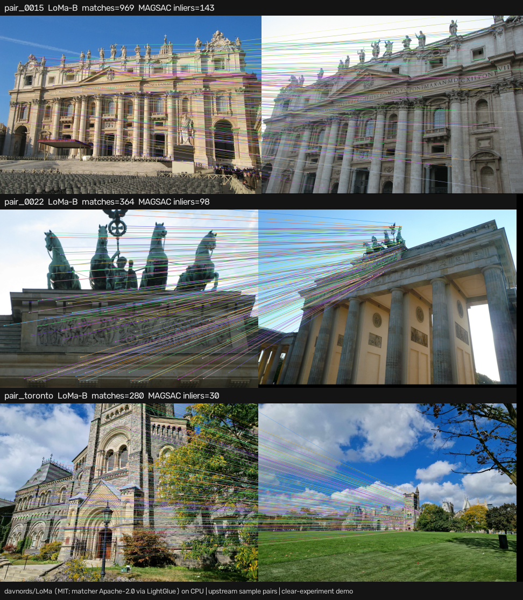
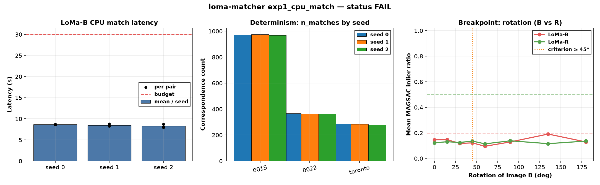

# loma-matcher

A CPU-only clear-experiment demo of **LoMa** ([davnords/LoMa](https://github.com/davnords/LoMa)): local feature matching revisited (ECCV 2026 Oral). Paper [arXiv:2604.04931](https://arxiv.org/abs/2604.04931); project [davnords.com/loma](https://www.davnords.com/loma). LoMa-R is the rotation-invariant sibling ([arXiv:2604.11809](https://arxiv.org/abs/2604.11809)). Found via a bookmarked X post by [@gabriberton](https://x.com/gabriberton/status/2109348718298427571) (LoMa live on AstroLoc for aerial localisation).

> Upstream is **MIT** except the matcher, which inherits **Apache-2.0** from LightGlue. See `LICENSE`, `NOTICE`, `LICENSE-Apache-2.0.txt`. Weights (LoMa-B, LoMa-R, DaD, DINOv2) **auto-download at run time** into `work/` and are not committed. No HF token. No GPU.



*Upstream sample pairs (MIT), CPU run with LoMa-B. Match lines + MAGSAC inlier counts.* Video: [`artifacts/loma-matcher-rotation.mp4`](artifacts/loma-matcher-rotation.mp4) sweeps in-plane rotation of image B for LoMa-B vs LoMa-R on `pair_0015`.

## Pipeline (as upstream)
```python
from loma import LoMa, LoMaB, LoMaR
model = LoMa(LoMaB())   # or LoMaR()
kptsA, kptsB = model.match(path_a, path_b)
F, mask = cv2.findFundamentalMat(
    kptsA, kptsB, ransacReprojThreshold=0.2, method=cv2.USAC_MAGSAC,
    confidence=0.999999, maxIters=10000,
)
```
This demo installs `lomatch` from `git+https://github.com/davnords/LoMa.git` and keeps only thin experiment scripts under `src/`.

## Status (honest): **FAIL**
| Check | Threshold (fixed before running) | Result |
|---|---|---|
| CPU latency, LoMa-B `match()` per pair, mean per seed | ≤ 30 s | **met** on all 3 seeds (8.26–8.65 s mean; worst single pair 8.77 s) |
| Determinism: `n_matches` identical across seeds 0/1/2 for each clean pair | identical counts | **not met** (drifts by a few matches, e.g. pair_0015: 971 / 975 / 969) |
| Rotation: mean MAGSAC `inlier_ratio(LoMa-R) > inlier_ratio(LoMa-B)` for every angle ≥ 45° | R > B on {45,60,90,135,180} | **not met** (R > B at 45/60/90/180°; **fails at 135°** where toronto LoMa-B collapses to 55 matches and an inflated ratio) |

Latency is comfortably practical on CPU. Correspondence counts are *nearly* stable but not bit-identical across seeds under upstream autocast on CPU, so the strict determinism half fails. The rotation story is mixed: on `pair_toronto`, LoMa-R does beat LoMa-B at 45–90°, but the pre-registered “every angle ≥ 45°” rule fails at 135°. Overall status is therefore **FAIL**, not PARTIAL (PARTIAL requires exactly one of the two blocks to pass; latency+determinism is one block and both failed halves make that block fail).

## Experiment (`experiments/exp1_cpu_match/`)
- **Hypothesis:** on a CPU-only machine, LoMa-B matches the upstream sample pairs fast enough (≤ 30 s mean) with identical correspondence counts across seeds 0/1/2; separately, under in-plane rotation of image B, LoMa-R retains a higher MAGSAC inlier fraction than LoMa-B past ~45°.
- **Config:** `config.yaml` was committed with thresholds **before** the official run (git: “pre-register exp1 config”). **Disclosure:** one smoke ran LoMa-B on `pair_0015` (load 12.4 s, warm match 9.17 s); the 30 s budget was left unchanged. Determinism and rotation thresholds were blind to that smoke.
- **Inputs:** upstream MIT assets `0015_*`, `0022_*`, `toronto_*` (downloaded at run time).
- **Metric:** primary `latency_s_match` (wall clock `model.match`); secondary identical `n_matches` across seeds. Report-only: `n_inliers`, `inlier_ratio` (USAC_MAGSAC, reproj 0.2 px as in upstream `demo.py`).
- **Seeds:** 0, 1, 2 (`torch.manual_seed` + `numpy` seed before each match).
- **Machine:** 4-vCPU Linux box, torch 2.14.1+cpu, Python 3.12, peak RSS ~4.5 GB.

| seed | mean latency (s) | max latency (s) | mean n_matches | latency ≤ 30 s | n_matches identical |
|---|---|---|---|---|---|
| 0 | 8.65 | 8.73 | 541.0 | yes | no |
| 1 | 8.44 | 8.77 | 539.7 | yes | no |
| 2 | 8.26 | 8.70 | 537.7 | yes | no |

Per-pair numbers are in `results.md` / `results_per_pair.csv`; the per-seed table is `results.csv`; raw numbers are in `raw.json`; plot is `plot.png`.



## Breakpoints (`breakpoints.md`, `breakpoints.csv`)
Seed 0; rotate image B only; angles 0–180°. Labels ok ≥ 0.50 / degraded ≥ 0.20 / broken < 0.20 are on absolute `inlier_ratio` (upstream MAGSAC threshold 0.2 px is strict, so clean pairs already sit ~0.09–0.16 — labelled “broken” on the absolute scale). The **pass rule** is relative: mean R > mean B for every angle ≥ 45°.

| Angle | mean inlier_B | mean inlier_R | R better? |
|---|---|---|---|
| 45° | 0.122 | 0.136 | yes |
| 60° | 0.095 | 0.114 | yes |
| 90° | 0.129 | 0.138 | yes |
| 135° | 0.191 | 0.116 | **no** (toronto B: 55 matches / ratio 0.236 vs R: 226 / 0.093) |
| 180° | 0.129 | 0.136 | yes |

On `pair_0015` (wide-baseline facade), both models keep ~900+ matches across rotations; relative R−B is tiny. On `pair_toronto`, LoMa-R is ahead at 45–90°; at 135° LoMa-B’s match count collapses and the ratio metric misleads.

## Run (CPU)
```bash
cd apps/loma-matcher
# uv recommended (upstream uses uv_build)
uv venv .venv && source .venv/bin/activate
uv pip install torch torchvision --index-url https://download.pytorch.org/whl/cpu
uv pip install -r requirements.txt
uv pip install "lomatch @ git+https://github.com/davnords/LoMa.git"
./run_all.sh            # ~45 match passes, roughly 7–10 min on 4 vCPUs; needs ffmpeg for the MP4
# ./run_all.sh --skip-breakpoints   # quicker
# python src/run_experiment.py --smoke   # one disclosed calibration match
```
Downloads are ~2 GB (DINOv2 ViT-L + LoMa-B + LoMa-R + DaD) into `work/cache/` (git-ignored). Sample JPEGs go to `work/assets/`.

**Colab:** [`notebooks/loma_matcher_colab.ipynb`](notebooks/loma_matcher_colab.ipynb) is prepared for the **free CPU runtime**. A GPU is optional and only costs anything if you choose a paid runtime yourself.

## Caveats
- Absolute MAGSAC inlier ratios look low because the upstream demo uses a 0.2 px reprojection threshold; do not read the ok/degraded/broken labels as “matching failed”.
- Seed-to-seed count drift is small (~0.5–1%) but the pre-registered rule required exact identity.
- Rotation of image B expands the canvas (black borders); that changes the detector’s resize path vs a pure content rotation.
- This is a smoke-level CPU probe on three demo pairs, not a MegaDepth / WxBS / HardMatch benchmark.
- Shared-box latency varies; numbers here are an upper-ish bound on a quiet 4-vCPU machine.
