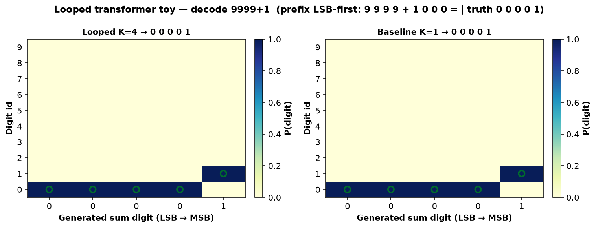
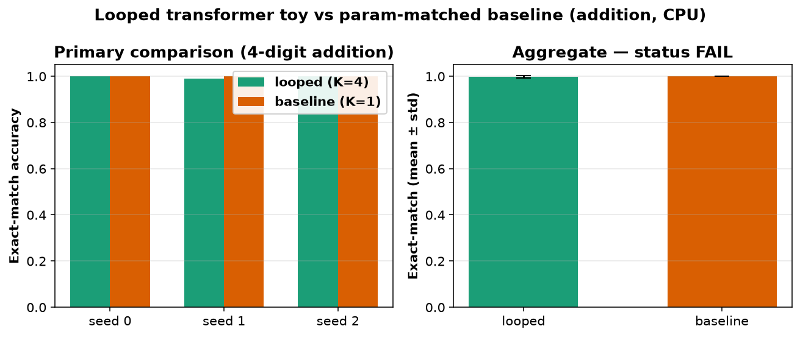

# looped-transformer-toy

CPU-only clear-experiment toy of **How to Loop Your Transformer: Loop Scaling, Specialization, and Parallel Inference** (Ekbote, Pagnoni, Sachan, Bhosale, Lewis, Fazel-Zarandi, Rajput, Gonugondla — FAIR at Meta / MIT, [arXiv:2610.40325](https://arxiv.org/abs/2610.40325)). Found via a bookmarked X post by [@iScienceLuvr](https://x.com/iScienceLuvr/status/2116286474090107140). The X post had no paper link; the arXiv abs URL above was located by title search. Hugging Face Papers for `2610.40325` returned **404** as of 2026-10-31. **No official code** found — this is a **clean-room** full-stack looping toy on synthetic multi-digit addition. See `NOTICE`.



*Decode heatmap for `9999+1` (LSB-first): looped K=4 vs parameter-matched baseline K=1. Circles mark the true digit. Video: [`artifacts/looped-transformer-toy.mp4`](artifacts/looped-transformer-toy.mp4).*

## What is implemented (paper idea, toy scale)

- **Full-stack looping:** a shared stack of 2 transformer blocks is applied **K** times (feed stack output back as next loop input). Matches the paper's "Full-Stack Looping" idea at ~106k params — not middle-stack / LoRA specialization / Parallel Loop Transformers.
- **Parameter-matched baseline:** identical architecture with **K=1** (same weights count; less effective depth).
- **Task:** character-level multi-digit addition, LSB-first (`a_digits + b_digits = sum_digits`), train/eval on **4-digit** operands.
- **Primary metric:** exact-match accuracy on 512 held-out 4-digit additions (greedy decode of sum tokens).

Not claimed: the paper's up-to-1B LM runs, DCLM BPB curves, loop-specific LoRA, or Parallel Loop Transformers.

## Status (honest): **FAIL**

| Check (fixed in `config.yaml` before the run) | Threshold | Result |
|---|---|---|
| `exact_match_looped > exact_match_baseline` on every seed 0/1/2 | strict | **not met** (0/3; baseline already at ceiling) |
| mean gap `looped − baseline` ≥ 0.10 | ≥ 10 pp | **not met** (gap = **−0.003**) |

Status rule: PASS needs both; PARTIAL if mean(looped) > mean(baseline) but a seed or the 10 pp bar fails; else FAIL. → **FAIL**.

### Per-seed results (512 held-out 4-digit additions)

| seed | looped exact | baseline exact | gap | digit_acc looped | digit_acc baseline |
|---|---:|---:|---:|---:|---:|
| 0 | 1.000 | **1.000** | +0.000 | 1.000 | 1.000 |
| 1 | 0.990 | **1.000** | −0.010 | 0.998 | 1.000 |
| 2 | 1.000 | **1.000** | +0.000 | 1.000 | 1.000 |

**Mean ± std:** looped **0.997 ± 0.006**, baseline **1.000 ± 0.000**, gap **−0.003**.

On this ~106k-param / 2500-step CPU toy the hypothesis is falsified by a **ceiling effect**: the shallow K=1 baseline already solves 4-digit LSB-first addition perfectly, so looping cannot show a ≥10 pp gain. This does **not** contradict the paper's fixed-parameter LM results — it shows the advantage is not automatic when the non-looped model already saturates the task.



## Experiment (`experiments/exp1_cpu_addition/`)

- **Hypothesis:** a tiny full-stack looped transformer (2 shared blocks × K=4) beats a parameter-matched non-looped baseline (K=1) on 4-digit addition exact-match accuracy on every seed 0/1/2, with mean gap ≥ 10 pp.
- **Pre-registration:** `config.yaml` committed with hypothesis, metric and thresholds **before** the official run (git: “pre-register exp1 config”). **Disclosure:** one smoke (40 steps, seed 0; `smoke.json`) verified the code path only. No threshold changed after any result.
- **Seeds:** 0, 1, 2 — each controls init, training stream, and eval stream offsets.
- **Machine:** 4-vCPU Linux box, torch 2.15.0+cpu, Python 3.12. Official end-to-end `./run_all.sh`: **~4 min** (246 s) including breakpoints.

Tables: `results.md` / `results.csv`; raw: `raw.json`; verdict: `status.json`.

## Breakpoints (`breakpoints.md`, `breakpoints.csv`)

Seed 0:

- **Test-time loops (trained K=4):** at K=1 exact-match drops to **0.627**; K=2 recovers to 0.998; K=4/8 stay at 1.000; at K=16 accuracy **falls to 0.934** (saturation / instability).
- **Digit length 2→6:** both models only succeed on the trained length 4; shorter and longer collapse to ~0 (no length generalization).
- **Train steps 500 vs 2500:** at 500 steps both are ~0; at 2500 both saturate on ID length.

## Run (CPU)

```bash
cd apps/looped-transformer-toy
uv venv .venv && source .venv/bin/activate
uv pip install --index-url https://download.pytorch.org/whl/cpu torch
uv pip install -r requirements.txt
./run_all.sh            # ~5 min on 4 vCPUs: 2 models × 3 seeds + breakpoints + plots + MP4
# python src/run_experiment.py --smoke  # disclosed tiny code-path check
```

## Caveats

- **Not the authors' code or scale:** ~106k params vs the paper's up to 1B; synthetic addition vs DCLM / QA suites.
- **FAIL is about the pre-registered gap bar** under a ceiling effect. The looped model still needs ≥2 test-time loops to decode well (breakpoint), which is consistent with “depth via looping” even though it cannot beat an already-perfect baseline.
- No loop-specific LoRA, middle-stack looping, or Parallel Loop Transformers are implemented.
- Trained weights stay out of git (`work/` is git-ignored).

## Licences

- App harness / this folder: **MIT** (`LICENSE`). Clean-room; no upstream code vendored.
