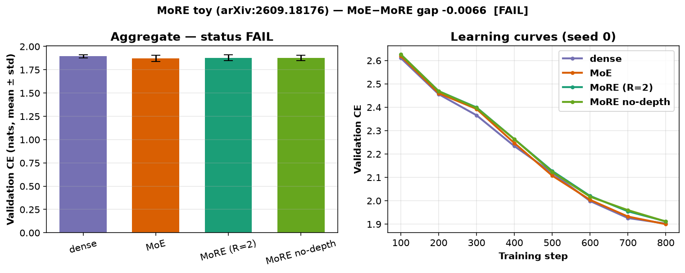

# more-experts-toy

CPU-only clear-experiment toy of **MoRE: Mixture of Reused Experts** (Qiu, Acikalin, Lovelace, Belardi, Mulchandani, Gomes, Weinberger — Cornell, [arXiv:2609.18176](https://arxiv.org/abs/2609.18176) / COLM 2026). Found via a bookmarked X post by [@askalphaxiv](https://x.com/askalphaxiv/status/2116032693280571682). Official full-scale code exists at [`EricQiu6/MoRE`](https://github.com/EricQiu6/MoRE) (**Apache-2.0**) but is a DeepSeek-v3 / C4 stack — **not vendored** here. This is a **clean-room** toy of shared adjacent-layer expert pools + per-layer routers + depth embeddings. See `NOTICE`.



*Validation CE learning curves (seed 0) and aggregate mean±std across seeds 0/1/2. Video: [`artifacts/more-experts-toy.mp4`](artifacts/more-experts-toy.mp4).*

## What is implemented (paper idea, toy scale)

- **MoRE (R=2):** 4 layers in 2 reuse blocks; each block shares a pool of **R·N=8** experts; each layer has its own router and a learnable depth embedding added before routing (paper eqs. 3–4).
- **Matched MoE:** 4 layers × **N=4** independent experts (same **L·N=16** unique experts, same top-K=2 active per token).
- **Dense baseline:** FLOPs-matched FFN width ≈ K·d_ff_expert.
- **Ablation:** MoRE without depth embeddings.
- **Task:** character-level LM on a trimmed Project Gutenberg *Alice* excerpt (~52k chars).
- **Primary metric:** validation cross-entropy (nats); also bits-per-char.

Not claimed: the paper's 114M–1.15B C4 / FineWeb runs, DeepSeek-v3 shared experts / bias load-balancing, or OLMo3 downstream suite.

## Status (honest): **FAIL**

| Check (fixed in `config.yaml` before the run) | Threshold | Result |
|---|---|---|
| `mean(val_ce_more) < mean(val_ce_moe)` | strict | **not met** (1.8776 vs 1.8710) |
| MoE−MoRE mean gap ≥ std(MoRE) | ≥ 0.0316 | **not met** (gap = **−0.0066**) |

Status rule: PASS needs both; PARTIAL if mean(MoRE) < mean(MoE) but the gap bar fails; else FAIL. → **FAIL**.

### Per-seed results (val CE, nats; lower is better)

| seed | dense | MoE | MoRE | MoRE no-depth | MoE−MoRE |
|---|---:|---:|---:|---:|---:|
| 0 | 1.8973 | **1.8957** | 1.8999 | 1.8974 | −0.0042 |
| 1 | 1.8775 | **1.8306** | 1.8415 | 1.8445 | −0.0110 |
| 2 | 1.9081 | **1.8869** | 1.8915 | 1.8883 | −0.0046 |

**Mean ± std:** dense **1.8943 ± 0.0155**, MoE **1.8710 ± 0.0353**, MoRE **1.8776 ± 0.0316**, MoRE no-depth **1.8767 ± 0.0283**, gap MoE−MoRE **−0.0066**.

Params (~matched sparse): MoE **201,888**, MoRE **202,848** (extra routers / depth embeds), dense **126,048**.

On this ~200k-param / 800-step CPU toy the hypothesis is falsified: the matched MoE slightly beats MoRE on every seed. Adjacent-layer expert reuse on MoRE is **0.222** vs random baseline **0.250** (0.89×) — the paper's above-chance reuse pattern does not appear at this scale. Depth embeddings also do not help (no-depth ≈ full MoRE). This does **not** contradict the paper's 114M–1.15B results — it shows the advantage is not automatic on a tiny char LM.


## Experiment (`experiments/exp1_cpu_charlm/`)

- **Hypothesis:** a tiny MoRE (R=2) char LM reaches lower mean validation CE than a parameter-matched standard MoE (same total expert params, same top-K) across seeds 0/1/2, with MoE−MoRE gap ≥ MoRE's cross-seed std.
- **Pre-registration:** `config.yaml` committed with hypothesis, metric and thresholds **before** the official run (git: “pre-register exp1 config”). **Disclosure:** one smoke (40 steps, seed 0; `smoke.json`) verified the code path only. No threshold changed after any result.
- **Seeds:** 0, 1, 2 — each controls init and training/eval stream offsets.
- **Machine:** 4-vCPU Linux box, torch 2.15.0+cpu, Python 3.12. Official end-to-end `./run_all.sh`: **~9 min** (531 s) including breakpoints + media.

Tables: `results.md` / `results.csv`; raw: `raw.json`; verdict: `status.json`.

## Breakpoints (`breakpoints.md`, `breakpoints.csv`)

Seed 0 (breakpoint variants use 400 steps):

- **R=4 (all layers share one pool):** MoRE val CE **2.302** (worse than primary R=2 at 800 steps; extreme sharing does not help the toy).
- **N=2 (very few experts):** MoE **2.281** still beats MoRE **2.320**.
- **Top-1:** MoE **2.432** ≈ MoRE **2.431** (essentially tied; combinatorial routing space collapses).

## Run (CPU)

```bash
cd apps/more-experts-toy
uv venv .venv && source .venv/bin/activate
uv pip install --index-url https://download.pytorch.org/whl/cpu torch
uv pip install -r requirements.txt
./run_all.sh            # ~10 min on 4 vCPUs: 4 kernels × 3 seeds + breakpoints + plots + MP4
# python src/run_experiment.py --smoke  # disclosed tiny code-path check
```

## Caveats

- **Not the authors' scale:** ~200k params / 52k-char Alice excerpt vs the paper's 114M–1.15B on C4 (~6.55B tokens).
- **FAIL is about the pre-registered MoRE-vs-MoE gap** under a tiny budget. MoE and MoRE both beat dense slightly; MoRE does not beat MoE here.
- Official Apache-2.0 code at EricQiu6/MoRE was **not** copied; this harness is MIT clean-room.
- No DeepSeek-v3 fine-grained / shared-expert / bias load-balancing — Switch-style top-K + aux loss only.
- Trained weights stay out of git (`work/` is git-ignored).

## Licences

- App harness / this folder: **MIT** (`LICENSE`). Clean-room; no upstream code vendored.
- Corpus: public-domain Project Gutenberg text under `data/`.
