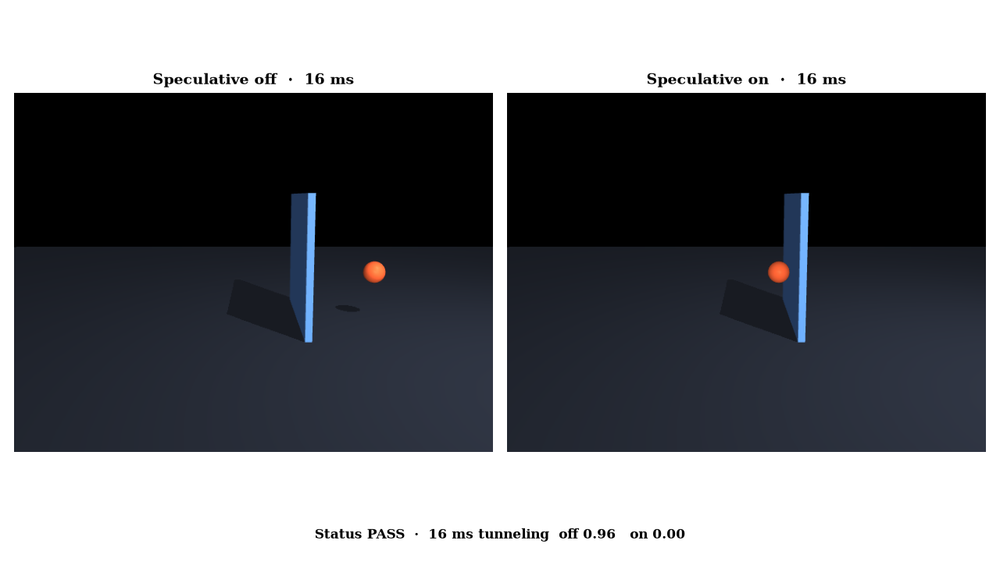
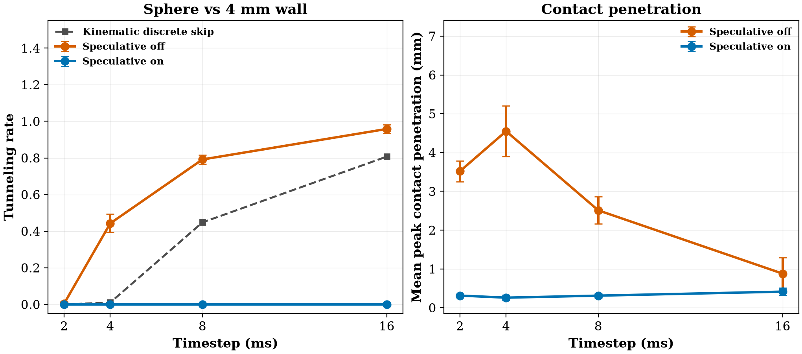

# mujoco4-speculative-contacts

CPU-only clear experiment on **speculative contacts** in MuJoCo 4.0.0 (Google DeepMind). Found via a bookmarked X post by [@_bbelousov](https://x.com/_bbelousov/status/2119200725008024035). That post was **not** fetched. The feature was checked on the [4.0.0 release](https://github.com/google-deepmind/mujoco/releases/tag/4.0.0), the [changelog](https://mujoco.readthedocs.io/en/stable/changelog.html), [discussion #3773](https://github.com/google-deepmind/mujoco/discussions/3773), the [speculative-contacts chapter](https://mujoco.readthedocs.io/en/latest/computation/speculative.html), the [XML reference](https://mujoco.readthedocs.io/en/stable/XMLreference.html), and an installed PyPI wheel `mujoco==4.0.0`. MuJoCo is **Apache-2.0** and is **not vendored**. See `NOTICE`.



*One registered shot: a 7 mm sphere at 4 m/s, 16 ms timestep (8× the default), into a 4 mm wall. Left, speculative contacts off. Right, on. Video: [`artifacts/mujoco4-speculative-contacts.mp4`](artifacts/mujoco4-speculative-contacts.mp4).*

## The flag

MuJoCo 4.0.0 adds an optional enable flag. It is off unless you turn it on.

```xml
<option timestep="0.016"><flag speculative="enable"/></option>
```

In the Python bindings that bit is `mujoco.mjtEnableBit.mjENBL_SPECULATIVE` = **128** (`1<<7`) inside `mjModel.opt.enableflags`. Compiling the XML above sets that bit; `speculative="disable"` (the default) leaves it clear. The installed wheel reports `__version__ == "4.0.0"`. The engine still only does this for **convex primitives and meshes on CPU**. Heightfields, SDFs, flexes, MJX, and MuJoCo Warp are out of scope, and this experiment does not touch them.

Speculative contacts build a contact before the geometries overlap: a swept broadphase, conservative advancement for a time of impact, a line-of-sight test, and a synthetic distance so the solver arrives on the surface at the end of the step. The sweep uses pre-step `qvel` and ignores acceleration. A body that is still at rest, and is then accelerated through a wall inside one step, can still tunnel. That case is a breakpoint below, not the headline test.

## Hypothesis

With the flag **on**, a free sphere fired at a thin fixed box does not end strictly on the far side of the wall, at timesteps 1×, 2×, 4×, and 8× the default 0.002 s. With the flag **off**, the same shots tunnel at 4× and 8×, and the wall still holds at 1×. Seeds 0, 1, and 2 redraw the radius and the speed. Within a seed, both flags and every timestep see the same shots.

The shot box is fixed so that, at 0.002 s, `speed × dt` is shorter than `thickness + radius` for every draw (a discrete sample cannot jump from “separated” to “center already past the far face”). At 0.008 s and 0.016 s the free-flight step is usually longer than the whole overlap window. A kinematic prior, from 20,000 uniform draws and **no** MuJoCo call, puts the discrete-skip rate at 0, 0.011, 0.455, and 0.828 for 2, 4, 8, and 16 ms.

**Tunneled** means the sphere center’s maximum x satisfies `center_x − radius > half_thickness + 0.1 mm`. That counts a missed collision and a contact that does not keep the sphere on the near side. Secondary, not gated: contact rate, peak contact penetration, and `(KE_final − KE_init) / KE_init`.

## Status (honest): **PASS**

| Check (fixed in `config.yaml` before the run) | Threshold | Result |
|---|---|---|
| ON tunneling rate at 2, 4, 8, and 16 ms | ≤ 0.05 | **met** (0.000 at all four) |
| OFF tunneling rate at 2 ms (1×) | ≤ 0.10 | **met** (0.005 ± 0.009) |
| OFF tunneling rate at 8 ms (4×) | ≥ 0.35 | **met** (0.792 ± 0.024) |
| OFF tunneling rate at 16 ms (8×) | ≥ 0.60 | **met** (0.958 ± 0.024) |

Status rule: **PASS** needs all four. **PARTIAL** if ON stays ≤ 0.20 at every primary timestep, OFF − ON ≥ 0.25 at 16 ms, and OFF > ON at 8 ms, but a strict bar fails. **FAIL** otherwise. The 0.35 and 0.60 floors sit below the kinematic skip prior (0.455 at 4×, 0.828 at 8×). All four bars were met.

### Tunneling rate, mean ± sample std over seeds 0/1/2

| dt | OFF | ON | Kinematic skip | OFF KE drift | ON KE drift |
|---|---:|---:|---:|---:|---:|
| 2 ms (1×) | 0.005 ± 0.009 | **0.000** | 0.000 | −0.974 ± 0.010 | −1.000 |
| 4 ms (2×) | 0.443 ± 0.050 | **0.000** | 0.010 ± 0.018 | −0.553 ± 0.049 | −1.000 |
| 8 ms (4×) | 0.792 ± 0.024 | **0.000** | 0.448 ± 0.077 | −0.208 ± 0.024 | −1.000 |
| 16 ms (8×) | 0.958 ± 0.024 | **0.000** | 0.807 ± 0.055 | −0.042 ± 0.024 | −1.000 |

ON contact rate is 1.000 at every cell. Mean peak contact penetration with the flag on stays about 0.3–0.4 mm. With the flag off it is several millimetres at 2–8 ms, then the 16 ms mean drops to 0.88 mm because most of those shots never generate a contact (contact rate about 0.19) and a miss contributes 0.

OFF tunneling sits above the kinematic skip rate. A sample can overlap the wall only after the center has already crossed the far face. That contact is unilateral and does not push the sphere back, so the shot still counts as a tunnel. At 16 ms the two rates are closer, because most failures are pure misses.

Seed 0 at 2 ms is the only primary cell where the disabled flag lets a shot through: 1/64, rate 0.016. Seeds 1 and 2 at 2 ms are 0. The mean 0.005 is inside the 0.10 hold.

## Experiment (`experiments/exp1_cpu_tunnel/`)

- **Scene:** fixed box, half-thickness 2 mm (4 mm wall), 10 cm in y and z. Sphere density 1000 kg/m³, radius uniform on [6 mm, 8 mm], speed uniform on [2.5, 4.5] m/s, launched from x = −0.08 m. Gravity off. Integrator Euler, solver Newton, 100 iterations (MuJoCo 4.0.0 defaults). Contact `condim=1`, `solref="0.002 1"`, `solimp="0.95 0.99 0.001"`.
- **Shots:** 64 per seed. Horizon is a 0.30 m free flight plus 8 settle steps.
- **Pre-registration:** `config.yaml` holds the hypothesis, the metric, and the thresholds. A disclosed design probe (one deterministic shot, then 40 shots on seed 0) checked the flag bit and that a near-face overlap stops a density-1000 sphere. It did not move a threshold. `smoke.json`, when present, is a 4-shot code-path check only.
- **Seeds:** 0, 1, 2.
- **Machine:** 4-vCPU Linux box, `mujoco==4.0.0`, Python 3.12. The official sweep plus tables was under 3 seconds. The OSMesa video added about 6 seconds.



Tables: `results.md` / `results.csv`. Verdict: `status.json`. Raw rollouts: `raw.json`.

## Breakpoints (`breakpoints.md`)

Seed 0, one controlled projectile per cell (7 mm sphere, 4 m/s, 4 mm wall, unless the cell says otherwise). Not part of the PASS rule.

- **Huge speed.** 20 to 1000 m/s, at 2 ms and at 16 ms. OFF tunnels in every cell except 20 m/s at 2 ms, where the step still overlaps and the contact holds. ON does not tunnel in any of these cells. At 1000 m/s and 16 ms the disabled sphere is at x = 144 m; the enabled sphere stops at x = −7.6 mm, with 1.4 mm of contact penetration into the 4 mm wall.
- **Huge timestep.** 32 ms through 0.5 s (250× the default) at 4 m/s. OFF tunnels with no contact. ON stops on the near side in every cell. Nothing diverged. This sweep has no applied acceleration, and it did not find a numerical failure.
- **Thinner wall.** Half-thickness 0.5 mm down to 0.005 mm, at 16 ms. OFF tunnels. ON does not, including the 0.01 mm wall.
- **Acceleration from rest.** This is where speculative contacts fail, as the computation chapter describes. Gravity 200 and 800 m/s², sphere released from rest, 16 ms, 1 mm wall: the first Euler step lands at x = 0.021 m and x = 0.175 m. Both flags tunnel and neither records a contact, because the sweep looked at `qvel = 0`. At 50 m/s² the first step only reaches x = −0.017 m. OFF still tunnels on later steps, once the speed has grown. ON does not.
- **Wall-clock.** After 100 warmup steps, 2000 `mj_step`s. One fast sphere: 1.72 µs/step off vs 1.83 µs/step on at 2 ms (1.07×), and 1.73 vs 1.81 at 16 ms (1.05×). Eight fast spheres: 3.54 vs 4.09 at 2 ms (1.15×), and 3.54 vs 4.24 at 16 ms (1.20×). The flag is a few percent to about 20% more per step on this scene. An 8× timestep that no longer tunnels is still a large cut in steps per simulated second.

## Run (CPU)

```bash
cd apps/mujoco4-speculative-contacts
python3 -m venv .venv && source .venv/bin/activate
pip install -r requirements.txt
./run_all.sh
# python src/run_experiment.py --smoke   # disclosed tiny code-path check
```

The still and the MP4 are rendered offscreen with MuJoCo’s OSMesa software renderer (`MUJOCO_GL=osmesa`, set inside `src/make_media.py` before MuJoCo is imported). If OSMesa cannot start, that script writes a matplotlib trajectory animation instead and says so in `artifacts/media_backend.txt`.

## Caveats

- **Not DeepMind’s demo.** Discussion #3773 describes a robot arm catching a 0.7 mm card, a Newton’s cradle of thin plates, and a chain. This experiment is a sphere against one box. It does not measure those scenes, and it does not measure elasto-plasticity or Filament.
- **Convex primitives on CPU only.** A sphere and a box are in the documented coverage. Nothing here speaks for meshes at scale, flexes, SDFs, heightfields, MJX, or Warp.
- **Acceleration is invisible to the sweep.** The rest-to-wall breakpoint is the failure mode the computation chapter describes. A large constant `qvel` is a different question from a large force applied to a body that is still at rest.
- **Contact is unilateral.** A discrete sample whose center has already crossed the far face can report a contact that does not push the sphere back to the near side. The tunneling rate counts that as a pass-through. It can sit above the pure kinematic skip rate.
- **Energy drift is not a pass gate.** The contact is the default damped `solref`, so a caught sphere loses most of its kinetic energy. A tunneled sphere keeps it. That is reported, not thresholded.
- Upstream Apache-2.0 code was **not** copied into this directory.

## Licences

- This directory: **Apache-2.0** (`LICENSE`), chosen to match MuJoCo.
- MuJoCo (DeepMind Technologies Limited): **Apache-2.0**. Install `mujoco==4.0.0` from PyPI. Not vendored.
