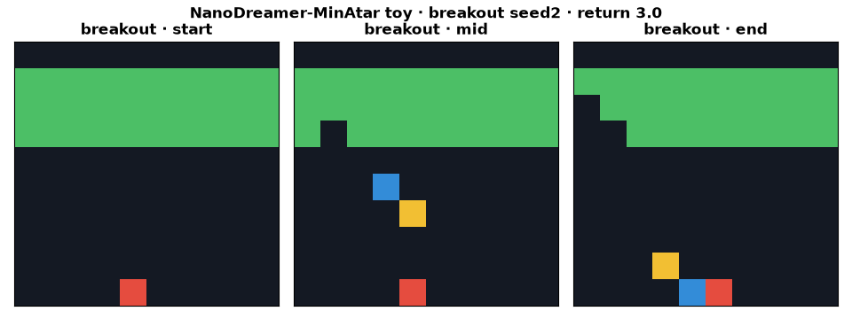
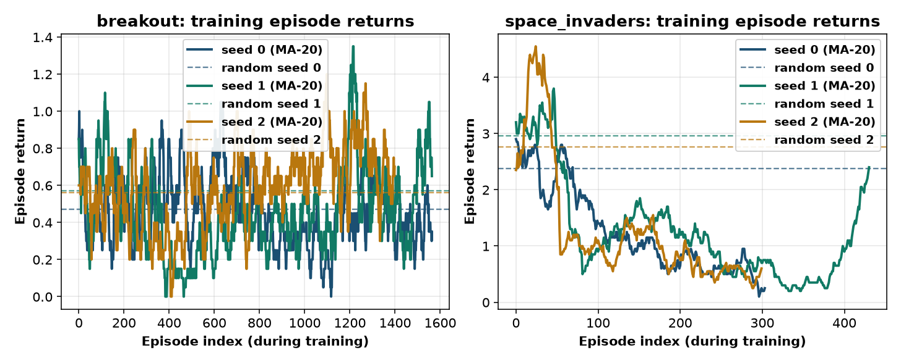

# nanodreamer-minatar

CPU-only clear-experiment toy of **NanoDreamer** (Benjamin Bai, [write-up](https://www.benjamin-bai.com/projects/nanodreamer), [GitHub](https://github.com/benyebai/NanoDreamer)). Found via a bookmarked X post by [@benbye](https://x.com/benbye/status/2115488344050192584).

**Licence approach (verified 2026-10-30):** GitHub API reports `license=null` for `benyebai/NanoDreamer`, and the repo tree has **no** `LICENSE`/`COPYING` file. Upstream is therefore **all rights reserved** by its author. This app does **not** copy, vendor, or pip/git-install upstream source. It is a **clean-room PyTorch reimplementation** of the write-up's ideas (CNN encoder, causal transformer world model, imagination-only actor–critic on MinAtar via the `minatar` package). See `NOTICE`.



*Clean-room toy agent on MinAtar Breakout (headless RGB render of the 10×10 grid). Video: [`artifacts/nanodreamer-minatar.mp4`](artifacts/nanodreamer-minatar.mp4).*

## What is implemented (write-up ideas, toy scale)

- **CNN encoder / decoder** over MinAtar's boolean multi-channel grid; latent residual dynamics with LayerNorm + bounded `tanh` steps.
- **Causal transformer** world model (history 8, width 64, 2 layers) predicting next latent, non-negative reward (`softplus`), and continuation.
- **Actor–critic MLPs** reading `[z, h]`; **actor updates only on imagined rollouts** (5-step λ-returns). Critic mixes imagined returns with a real one-step TD target (write-up mix).
- **~460k params** (&lt;1M), **16k policy steps** per seed per game (vs upstream ~750k params / 500k steps).
- **Primary metric:** mean episode return over **100** eval episodes vs a uniform-random baseline (same sticky-action env).

Not claimed: upstream's 500k-step MinAtar table (e.g. Space Invaders 22.61, Breakout 5.03), 255-bin symlog categoricals, or custom autograd.

## Status (honest): **FAIL**

| Check (fixed in `config.yaml` before the run) | Threshold | Result |
|---|---|---|
| Breakout: agent &gt; random on every seed 0/1/2 | strict | **not met** (seed 0 loses) |
| Breakout: mean(agent) ≥ 2× mean(random) | ≥ 2× | **not met** (0.727 vs 0.533 → 1.36×) |
| Space Invaders: agent &gt; random on every seed | strict | **not met** (0/3) |
| Space Invaders: mean(agent) ≥ 2× mean(random) | ≥ 2× | **not met** (0.937 vs 2.700) |

Status rule: PASS needs both games to clear every-seed + 2× bars; PARTIAL if both games have mean(agent)&gt;mean(random) but a seed/2× bar fails; else FAIL. → **FAIL**.

### Per-seed results (100 eval episodes)

| game | seed | agent mean | random mean | ratio |
|---|---:|---:|---:|---:|
| breakout | 0 | 0.410 | 0.470 | 0.87× |
| breakout | 1 | 0.830 | 0.570 | 1.46× |
| breakout | 2 | 0.940 | 0.560 | 1.68× |
| space_invaders | 0 | 0.230 | 2.380 | 0.10× |
| space_invaders | 1 | 2.330 | 2.960 | 0.79× |
| space_invaders | 2 | 0.250 | 2.760 | 0.09× |

**Means:** Breakout agent **0.727 ± 0.280** vs random **0.533 ± 0.055**; Space Invaders agent **0.937 ± 1.207** vs random **2.700 ± 0.295**.

On this ~460k-param / 16k-step CPU toy the hypothesis is falsified: Breakout mean beats random but misses every-seed and 2× bars; Space Invaders is well below random on every seed. This does **not** contradict the upstream 500k-step report — it shows imagination-only actor learning is not automatic at this toy budget.



## Experiment (`experiments/exp1_cpu_minatar/`)

- **Hypothesis:** a small (&lt;1M param) Dreamer-style world-model agent with imagination-only actor updates beats uniform-random on MinAtar Breakout and Space Invaders on CPU within a fixed small step budget.
- **Pre-registration:** `config.yaml` committed with hypothesis, metric and thresholds **before** the official run (git: “pre-register exp1 config”). **Disclosure:** one smoke (200 steps, seed 0, Breakout; `smoke.json`) verified the code path only. No threshold changed after any result.
- **Seeds:** 0, 1, 2 — each controls init, replay sampling, exploration, and eval.
- **Machine:** 4-vCPU Linux box, torch 2.15.0+cpu, Python 3.12. Official end-to-end run: **~18 min** (1100 s) including breakpoints.

Tables: `results.md` / `results.csv`; raw: `raw.json`; verdict: `status.json`.

## Breakpoints (`breakpoints.md`, `breakpoints.csv`)

Seed 0, Breakout, 40 eval episodes:

- **Tiny step budget 1k→16k:** at 1k/4k the toy stays ≤ random; at 16k it reaches **1.80×** random on this breakpoint slice.
- **Imagination horizon 1 vs 5** (8k steps): horizon 5 edges horizon 1 (1.81× vs 1.42× random).
- **Tiny model (~74k params, 8k steps):** collapses to **0.39×** random — under-parameterization breaks the toy.

## Run (CPU)

```bash
cd apps/nanodreamer-minatar
uv venv .venv && source .venv/bin/activate
uv pip install --index-url https://download.pytorch.org/whl/cpu torch
uv pip install -r requirements.txt
./run_all.sh            # ~20 min on 4 vCPUs: 2 games × 3 seeds + breakpoints + plots + MP4
# python src/run_experiment.py --smoke  # disclosed tiny code-path check
```

## Caveats

- **Unlicensed upstream:** no NanoDreamer source is present in this repo; clean-room only.
- **Not the upstream table:** 16k vs 500k policy steps; scalar softplus reward vs 255-bin symlog; ~460k vs ~750k params.
- **FAIL is about this toy budget.** Breakout shows a weak positive mean signal; Space Invaders does not.
- Trained weights stay out of git (`work/` is git-ignored).
