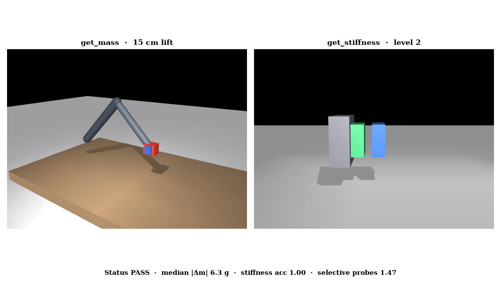
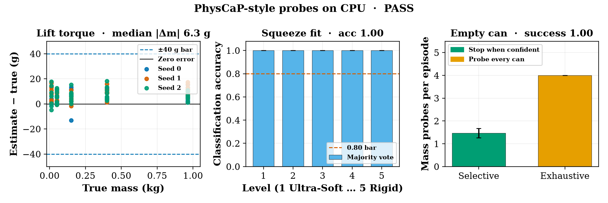

# physcap-mass-stiffness

CPU-only clear experiment on the **PhysCaP** mass and stiffness probes (Lin et al., arXiv:2608.21031). Found via a bookmarked X post by [@NVIDIARobotics](https://x.com/NVIDIARobotics/status/2125632693719167240). That post was **not** fetched. The method was checked on the [paper HTML](https://arxiv.org/html/2608.21031), the [project page](https://physcap.github.io/), and the [repository README](https://github.com/physcap/physcap). PhysCaP is **MIT**. The real-robot measurement code is **not in the repo** (the README lists it as coming soon; dummy mode reads a table of true values; the LIBERO task reveals ground-truth mass after a 3 cm lift). Nothing from that repo is vendored. These probes are a clean-room reading of Sections 3.1.1, 3.1.2 and 5.2 and Appendix B. MuJoCo 4.0.0 is **Apache-2.0** and is not vendored. See `NOTICE`.



*One registered trial: a 0.208 kg can on the lift, and a 630 N/m spring (level 2) in the jaw. Video: [`artifacts/physcap-mass-stiffness.mp4`](artifacts/physcap-mass-stiffness.mp4).*

## The probes

`get_mass` commands a fixed 15 cm lift. It records arm-joint torques with an empty gripper at the lift pose, then after grasping, at the same command. With the vertical row \(J_z\) of the grasp-site Jacobian and \(g = 9.8\,\mathrm{m/s^2}\),

\[
\hat{m} = \frac{J_z \cdot (\tau_\mathrm{loaded} - \tau_\mathrm{empty})}{g\,\|J_z\|^2}.
\]

A lift that does not rise 8 cm returns **−1 kg**. Appendix B.3 uses a large negative value for a failed grasp. The API note is about ±30 g of noise. Section 5.2 reports **38.1 ± 26.0 g** MAE on five objects from **13 g to 963 g** (\(n = 250\)).

`get_stiffness` closes the jaw in 0.5 mm steps, backs off to confirm that force drops, then fits

\[
k = \Delta F / \Delta d
\]

by ordinary least squares up to a 6 N target. Five squeezes, majority vote. Levels use four boundaries at multiples of the paper's **420 N/m** calibration spring: 420, 840, 1260, 1680 N/m. The names are the API's: 1 Ultra-Soft, 2 Soft, 3 Semi-Rigid, 4 Stiff, 5 Rigid. A fit shorter than 0.4 mm, or a non-positive slope, returns 0. The paper does not publish the numeric cut points or a classification percentage. It says one squeeze separates a level-2 avocado from levels 4–5.

The empty-can policy is the Appendix D sufficiency rule with no VLM. Sealed cans are not measured. An open can whose estimate is in \([0, 0.10)\) kg is taken to be empty and the search stops. Otherwise both open cans are weighed and the lighter one is chosen. Exhaustive weighing measures all four cans. The 0.10 kg threshold sits between the project page's 15 g empty can and 208 g full can, outside the ±40 g mass bar. The paper's empty-vs-lightest-full gap is **193 g**.

## Hypothesis

On this planar arm and jaw, the two probes recover ground-truth mass and the five stiffness levels well enough to act on, and stopping when the empty can is identified uses fewer probes than weighing every can while still selecting it. Seeds 0, 1 and 2 redraw torque noise, force noise, a ±8 mm place jitter, and which open can is empty.

## Status (honest): **PASS**

| Check (fixed in `config.yaml` before the run) | Threshold | Result |
|---|---|---|
| Median \(\| \hat{m} - m \|\) on 13, 50, 150, 400, 963 g | ≤ 40 g | **met** (6.32 g) |
| Primary grasp success | ≥ 0.95 | **met** (1.000) |
| Five-level majority accuracy | ≥ 0.80 | **met** (1.000) |
| Level 2 voted in {1, 2} | ≥ 0.90 | **met** (1.000) |
| Levels 4 and 5 voted in {4, 5} | ≥ 0.90 | **met** (1.000) |
| Selective probes | ≤ 2.5 and ≤ 0.70 × exhaustive | **met** (1.467 vs 4.000, ratio 0.367) |
| Selective empty-can success | ≥ 0.90 | **met** (1.000) |

A 10% relative-error bar was not used. Section 5.2 reports an absolute MAE, and 38 g is not 10% of the 13 g endpoint. The median relative error is reported below and is not a gate. Status rule: **PASS** needs every row. **PARTIAL** if the median absolute error is ≤ 80 g, grasp success ≥ 0.80, stiffness accuracy ≥ 0.60, both separation recalls ≥ 0.75, selective probes are strictly fewer, and selective success ≥ 0.70. **FAIL** otherwise.

### Per seed

| Seed | Median \|Δm\| | Grasp | Stiffness | Ripe in 1–2 | Unripe in 4–5 | Selective OI | Exhaustive OI | Success |
|---:|---:|---:|---:|---:|---:|---:|---:|---:|
| 0 | 5.5 g | 1.000 | 1.000 | 1.000 | 1.000 | 1.30 | 4.00 | 1.000 |
| 1 | 8.2 g | 1.000 | 1.000 | 1.000 | 1.000 | 1.40 | 4.00 | 1.000 |
| 2 | 6.1 g | 1.000 | 1.000 | 1.000 | 1.000 | 1.70 | 4.00 | 1.000 |

Pooled median relative error is 0.031. On masses ≥ 150 g it is 0.016. The estimates sit a few grams high (the design probe, before noise, was about +5 to +8 g). That bias is inside the paper's ±30 g API note and inside the 40 g bar.

Real Identify Empty Can in Table 1 is PhysCaP OI **2.00** versus exhaustive CaP+PhysX OI **4.00**. LIBERO Table 2 is success **78%** at OI **1.44** versus 74% at 2.16. Section 5.3 reports **100%** success on the real empty-can task across three VLM backbones. Those numbers are quoted, not re-run. This policy's 1.47 probes are the deterministic rule on four cans, not a VLM.

## Experiment (`experiments/exp1_cpu_probes/`)

- **Arm.** Two links (0.25 m, 0.22 m) and a wrist, in the vertical plane, position-controlled. Parallel jaws pinch a free box. Sliding friction on the finger pairs is 1.0. Finger force limit 30 N. Arm torque limit 12 N·m. Torque noise 0.03 N·m on the three arm actuators, six averaged samples.
- **Jaw.** A slide joint with the object's stiffness as a MuJoCo spring. Force noise 0.05 N. Five votes, six objects per level per seed, centers 210, 630, 1050, 1470, 2100 N/m.
- **Empty can.** 15 g and 208 g open cans, 350 g and 420 g sealed cans. 20 episodes per seed. Both policies see the same cans.
- **Pre-registration.** `config.yaml` holds the hypothesis, the metric, and the thresholds. A disclosed design probe checked the Jacobian sign, that friction 1.0 lifts 0.013–0.963 kg, that friction ≤ 0.15 drops a 0.40 kg can, and that the squeeze slope matches the spring. It did not move a threshold.
- **Seeds.** 0, 1, 2. Eight mass trials per mass per seed (120 lifts). 
- **Machine.** `mujoco==4.0.0`, Python 3.12, fork pool of 3. The official seeds plus breakpoints were about 7 seconds. The OSMesa video was about 35 seconds.



Tables: `results.md` / `results.csv`. Verdict: `status.json`. Raw trials: `raw.json`.

## Breakpoints (`breakpoints.md`)

Seed 0, four repeats per cell. Not part of the PASS rule. Heavy and low-friction lifts print MuJoCo's QACC warning and are stored as −1 kg.

- **Very light.** 1 g, 5 g and 13 g read as 9.9 g, 12.8 g and 15.0 g. The few-gram positive bias is a large fraction of the true mass. At this noise none of those means went negative. The API's "slightly negative on a very light object" is the same regime.
- **Very heavy.** 1.5 kg, 3 kg and 6 kg never leave the table. The estimate is −1 kg on every repeat. The finger force, not a successful torque reading, is what stops the lift.
- **Torque noise.** A 0.208 kg can. At 0, 0.03, 0.10 and 0.30 N·m the mean estimates are 0.214, 0.216 ± 0.004, 0.233 ± 0.006 and 0.214 ± 0.069 kg. At 0.30 N·m the scatter is larger than the paper's ±30 g note.
- **Near-rigid.** The 1680 N/m boundary is voted 5, 4, 4, 4, so a spring sitting on the cut is not stable. 5000 N/m is level 5 on every repeat. 20000 N/m is rejected (level 0) because the compression is under 0.4 mm. 100000 N/m is voted 5: the rejection does not catch every rigid contact, and the level saturates at Rigid.
- **Finger friction.** A 0.40 kg can at μ = 1.0 and 0.40 is held (estimates 0.409 and 0.408 kg). At μ = 0.15 and 0.05 the grasp fails.
- **Jaw friction.** Coulomb frictionloss of 0, 1, 4 and 12 N on the level-3 spring (1050 N/m) leaves the vote at 3. Median slopes stay within about 10 N/m of 1050. A constant jaw friction did not break this fit.

## Run (CPU)

```bash
cd apps/physcap-mass-stiffness
python3 -m venv .venv && source .venv/bin/activate
pip install -r requirements.txt
./run_all.sh
# python src/run_experiment.py --smoke   # one lift, one squeeze, one decision
```

The still and the MP4 use MuJoCo's OSMesa renderer (`MUJOCO_GL=osmesa`, set before import). If that renderer cannot start, `src/make_media.py` writes a matplotlib schematic and says so in `artifacts/media_backend.txt`.

## Caveats

- **Not the paper's robot.** The arm is a planar 3-DoF position-controlled model, not the 6-DoF AgileX PiPER. There is no Molmo2, no ZED, and no VLM. The Planner and Prioritizer are the Appendix D rule, hard-coded.
- **Not LIBERO.** The paper's simulator reveals the true mass after a verified 3 cm lift. This one estimates mass from torques. It does not run CaP-X, OpenVLA, π0.5, or MolmoAct2.
- **Stiffness boundaries are a reading of the spring rig, not a published table.** Each spring is 420 N/m and four boundaries define five levels. The cut points 420/840/1260/1680 are that statement put into numbers. Real avocado curves are not re-measured.
- **The +5 to +8 g bias is in the model.** Finger placement and the grasp site are not a perfect vertical force at the site. It is small next to 40 g and large next to a 1 g object.
- **Jaw friction did not break level 3.** The breakpoint that moves stiffness is a spring too stiff to resolve, and the 1680 N/m boundary, not a 12 N frictionloss.
- **No real-robot claim.** Table 1 times, the 38.1 g MAE, and the avocado levels are the paper's. This directory did not reproduce them on hardware.
- Upstream MIT and Apache-2.0 code was **not** copied into this directory.

## Licences

- This directory: **MIT** (`LICENSE`), chosen to match PhysCaP. The PhysCaP sources are not included.
- PhysCaP (Max Fu and the PhysCaP authors): **MIT**. Not vendored. Measurement modules were not in the repository when this demo was written.
- MuJoCo (DeepMind Technologies Limited): **Apache-2.0**. Install `mujoco==4.0.0` from PyPI. Not vendored.
