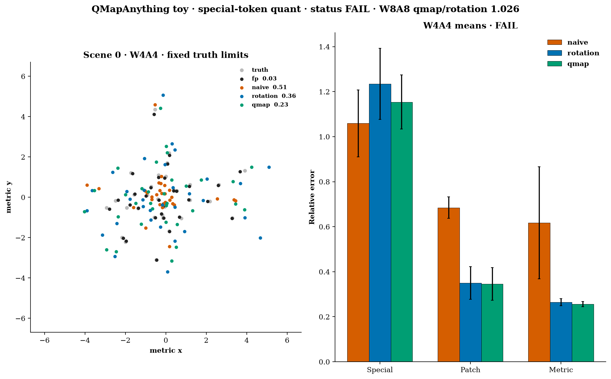
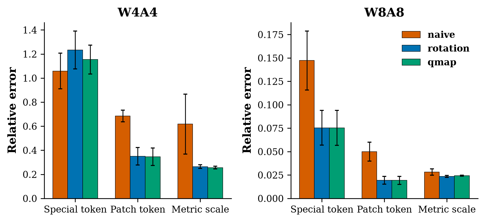

# qmapanything-token-quant

CPU-only clear experiment for the structural claim in He, Zhang, Zhang, Sui, See, Boukhers, and Yang, [arXiv:2611.07955](https://arxiv.org/abs/2611.07955), *Rotation Is Token-Blind*. Found via a bookmarked X post by [@vincieye](https://x.com/vincieye/status/2119415188013138070). That post was **not** fetched. The abstract, Sections 3–4, and Appendices A–D were read from the arXiv HTML on 2026-11-10.

**QMapAnything code was not available.** The reproducibility statement says code and configs will be released upon acceptance. No repository turned up in a search that day. MapAnything ([facebookresearch/map-anything](https://github.com/facebookresearch/map-anything), Apache-2.0) is not run and not vendored. This directory is a clean-room toy. See `NOTICE`.



*One held-out scene at W4A4, truth-scaled axes, and the three-seed mean relative errors. Video: [`artifacts/qmapanything-token-quant.mp4`](artifacts/qmapanything-token-quant.mp4) steps through six scenes.*

## Status (honest): **FAIL**

The rotation half of the claim holds. The row-selective restoration does not clear the bars that were frozen in `config.yaml` before this run.

| Check | Bar | Result |
|---|---|---|
| Prop. 1 SNR-ratio change | ≤ 0.02 | **met** (9.3e-8) |
| qkv/fc1 step shrink \(\Delta/\Delta_R\) | ≥ 1.25 | **met** (4.63 ± 0.41) |
| W4A4 patch rel, rotation / naive | ≤ 0.80 | **met** (0.511) |
| W4A4 special / patch rel after rotation | ≥ 2 | **met** (3.53) |
| W4A4 special-token MSE, qmap / rotation | ≤ 0.80 | **not met** (0.880) |
| W4A4 metric-scale rel, qmap / rotation | ≤ 0.80 | **not met** (0.969) |
| W4A4 rotation metric vs FP, and absolute floor | ≥ 1.5× and ≥ 0.05 | **met** (14.2×, 0.265) |
| W4A4 special MSE, qmap / uniform \(\beta\) | ≤ 0.90 | **not met** (0.914) |
| W8A8 latency, qmap / rotation | ≤ 1.15 | **met** (1.026) |
| W8A8 metric order qmap ≤ rotation ≤ naive | 2% slack | **not met** (qmap 0.0242 vs rotation 0.0236) |

**PASS** needed all nine. **PARTIAL** needed the Prop. 1, common-mode, token-blind, and latency checks plus at least one restoration check. Both restoration checks missed, so the status is **FAIL**. Sample std is ddof=1 over seeds 0/1/2.

## What the paper reports

Table 2, two-view scale relative error: FP 0.05, W4A8 QuaRot and QMapAnything both 0.05, W4A4 RTN 0.48, QuaRot 0.20, QMapAnything 0.12. Table 5, MapAnything on ETH3D W4A4 AUC@30: FP 98.9, naive 77.0, rotation 83.7, rotation+\(\beta\) 88.2, full 91.4, with \(1/\kappa_s = 6.02\) and \(\Gamma = 1.35\times 10^5\). Appendix D: a split-half affine fit cuts held-out scale-token MSE by 34.2% and whole-block MSE by 0.010%. Table 4: on one H20 with TensorRT, W8A8 naive and QMapAnything are both \(0.32\times\) FP32 latency (AUC 91.9 vs 98.9).

Those GPU numbers are not this run. The bars above are discounts of those gaps, written down before the seeds.

## Hypothesis

On a small transformer whose patch tokens and one special token share a per-tensor activation grid, a randomized Hadamard rotation reduces typical-token quantization error but leaves the special token's SNR ratio unchanged, and that special token's error still moves the metric scale. A row-selective affine correction, in the spirit of QMapAnything's \(b_s\), restores special-token fidelity and metric-scale error without a material latency increase over rotation alone.

## Substitution

MapAnything is a DINOv2 feed-forward geometry model. These numbers are from a 4-block pre-LN transformer, width 64, about 136k parameters, trained 300 AdamW steps on synthetic scenes. Patch linear inputs get two Laplace outlier channels after LayerNorm (the paper's S3). The scale token skips LayerNorm, is written only by the two global blocks (S4), and is the only input to the metric-scale head (S2). Heads stay in FP.

A one-seed probe without a pin fit the FP head (metric rel 0.014) but measured qkv \(1/\kappa \approx 95\), because the Laplace channels dominate the grid. The config already named Table 5's \(1/\kappa_s = 6.02\), so each global qkv and fc1 input rescales the special row onto \(\max\|h_{\mathrm{patch}}\|_2 / 6.02\). Direction is unchanged. That pin is disclosed in `config.yaml`. It is not a learned MapAnything range gap, and it is why \(\Gamma\) here is not an independent audit.

Quantization is symmetric signed absmax, per-output-channel weights, per-tensor activations, \(R = DH\) with signs first (Appendix D). \(\beta\) and \(b_s\) are the closed form in Eq. (8), fit on 512 calibration scenes after rotation. \(b_s\) is added only on global blocks. There is no 40-step Adam bias refinement (the paper uses that on MapAnything and the closed form on VGGT and DA3). No packed integers, no TensorRT, no GPU.

## Experiment (`experiments/exp1_cpu_token_quant/`)

- **Pre-registration:** `config.yaml` is commit `e70b573`, before `raw.json`. Thresholds were not edited after the smoke or the probe.
- **Smoke:** `smoke.json` is 40 steps, seed 0, code-path only.
- **Seeds:** 0, 1, 2. Each seed redraws init, data, and Hadamard signs.
- **Primary metrics:** W4A4 special-token relative L2 versus the FP residual, and W4A4 metric-scale relative error \(|\hat m - m| / |m|\).
- **Methods:** naive RTN, rotation, uniform (rotation+\(\beta\)), qmap (rotation+\(\beta\)+\(b_s\)).
- **Machine:** 4 vCPU, PyTorch 2.15.0+cpu, 4 threads. Official `./run_all.sh` wall time **88 s**.

FP metric-scale rel **0.0186 ± 0.0003**. qkv \(1/\kappa\) is **6.02** by the pin. Mean qkv max/P99 is in `raw.json`. \(\Gamma = 2.81\times 10^5 \pm 3.0\times 10^4\). With the grid factor pinned at \(6.02 - 1\), that is a leverage ratio \(\lambda_s / \bar\lambda_{\mathrm{patch}} \approx 5.6\times 10^4\) (paper Table 5: \(2.69\times 10^4\)). Held-out local special-row MSE drop at W4A4, mean over global linears: **0.177 ± 0.021** (paper Appendix D: 0.342).

### W4A4, mean ± std

| method | special rel | patch rel | metric rel | up-to-scale rel | special MSE |
|---|---:|---:|---:|---:|---:|
| naive | 1.059 ± 0.149 | 0.685 ± 0.048 | 0.618 ± 0.249 | 0.921 ± 0.041 | 0.0351 |
| rotation | 1.234 ± 0.158 | 0.350 ± 0.073 | 0.265 ± 0.015 | 0.238 ± 0.033 | 0.0407 |
| uniform | 1.215 ± 0.144 | 0.346 ± 0.073 | 0.263 ± 0.014 | 0.239 | 0.0391 |
| qmap | 1.154 ± 0.120 | 0.346 ± 0.072 | 0.256 ± 0.011 | 0.239 ± 0.034 | 0.0358 |

Rotation cuts patch error by about half and up-to-scale point error from 0.92 to 0.24, and it cuts metric error from 0.62 to 0.26. It also **raises** special-token relative error, from 1.06 to 1.23. That is the token-blind part: the SNR-proxy ratio does not move (relative change \(9\times 10^{-8}\)), the shared step shrinks 4.6×, and the small token's realized error gets worse, which is allowed once values sit near or under one bin. The special row is then 3.5× a patch row. Metric error stays 14× the FP error.

qmap trims special MSE by 12% versus rotation and by 8.6% versus uniform \(\beta\). The bars were 20% and 10%. Metric error moves from 0.265 to 0.256 (3%). Seed 0's own metric error goes the other way (0.252 rotation, 0.267 qmap). The closed-form row bias is a small, real local effect — eta is 0.18, not zero — and it does not restore the metric scale on this toy.

### W8A8 and W4A8

W4A8 is the paper's near-lossless setting. It was report-only.

| bits | method | special rel | patch rel | metric rel |
|---|---|---:|---:|---:|
| W8A8 | naive | 0.147 ± 0.031 | 0.050 ± 0.010 | 0.0282 ± 0.0034 |
| W8A8 | rotation | 0.075 ± 0.018 | 0.019 ± 0.004 | 0.0236 ± 0.0010 |
| W8A8 | qmap | 0.075 ± 0.019 | 0.019 ± 0.004 | 0.0242 ± 0.0006 |
| W4A8 | naive | 0.234 | 0.105 | 0.0307 |
| W4A8 | rotation | 0.270 | 0.115 | 0.0317 |
| W4A8 | qmap | 0.180 | 0.106 | 0.0288 |

At W8A8 everyone is close to the FP metric error of 0.019. qmap does not beat rotation (0.0242 vs 0.0236), which is why the order gate fails. At W4A8 the row term does cut special rel from 0.270 to 0.180. That was not a gate. It is also not Table 2's "0.05 vs 0.05".

W8A8 fake-quant latency, mean of per-seed medians: qmap / rotation = **1.026**. Naive is faster (0.012 s vs 0.022 s) because the Hadamard is extra dense FLOPs in PyTorch. Table 4's \(0.32\times\) is an INT8 kernel result on an H20. This run does not reproduce it.



## Breakpoints

Seed 0. Not part of the FAIL rule. Full table: `breakpoints.md`.

| Stress | What happened |
|---|---|
| W3A3 | Rotation still helps metric error (0.88 → 0.36). qmap does not improve on rotation (0.39). |
| W2A2 and W4A2 | Naive and rotation both sit at special rel 1.00 and metric rel 0.87. qmap drops special rel to 0.70 / 0.61 and metric rel to 0.35. The affine term shows up when the grid has collapsed to a systematic offset, which is harsher than the gated W4A4. |
| More patch tokens, 16 → 1024, real qkv rows, per-scene 4-bit absmax | Special-token activation error rises for naive (0.25 → 0.48) and for rotation (0.42 → 0.61). Patch error rises more slowly. Same direction as the paper's "more views, worse special-token grid". |
| Match the special row's max-abs to the median patch | This was meant as the VGGT-like control (grid deficit removed, \(b_s\) should matter less). It did not. Held-out MSE drop went from 0.016 to 0.068. The single-layer naive special/patch ratio was already 0.82 before the match, so this probe was not the end-to-end gap of 3.5. |
| One global block, sequence 33 / 128 / 512 | qmap/rotation latency 1.15, 1.15, 1.09. The full model, above, is 1.03. |

## Run (CPU)

```bash
cd apps/qmapanything-token-quant
python3 -m venv .venv && source .venv/bin/activate
pip install --index-url https://download.pytorch.org/whl/cpu torch
pip install -r requirements.txt
./run_all.sh
PYTHONPATH=src python -m unittest test_quant -v
```

No downloads. No GPU. `python src/run_experiment.py --smoke` rewrites `smoke.json` only.

## Caveats

- This is not MapAnything, not ETH3D / ScanNet++ / TartanAir, and not AUC@30. A width-64 toy with a pinned \(1/\kappa\) cannot confirm Table 2.
- The pin forces the Table 5 gap at global qkv and fc1. \(\Gamma\)'s grid factor is that pin. The leverage factor is a real backward pass on the metric loss.
- Eq. (8) was fit in closed form on FP inputs to each linear. The paper also runs 40 Adam steps of bias refinement on MapAnything at W4A4. That refinement was not done. The miss on the restoration bars is for the closed form, which is also what the paper uses on VGGT and DA3.
- End-to-end special MSE dropped 12%. The local held-out drop averaged 18%, against the paper's 34%. A token-averaged block loss would hide this, which is the point of Appendix D, and here the downstream metric barely moved.
- At W4A4, rotation helps the metric scale a lot (0.62 → 0.26) and still leaves it 14× FP. "Rotation only helps common modes" is true for the special-versus-patch gap, and it is not true that rotation leaves the metric output untouched.
- W8A8 fake-quant time is not the paper's TensorRT speedup. Naive is faster than rotation on this CPU because \(DH\) is extra math.
- The matched-max-abs control did not reproduce Table 5's "\(b_s\) is negligible when \(\Gamma \approx 0\)" pattern.
- Upstream code was not copied. This directory is MIT.

## Licences

- This directory: **MIT** (`LICENSE`).
- MapAnything (Meta): Apache-2.0. Not copied.
- QMapAnything: no public code as of 2026-11-10.
