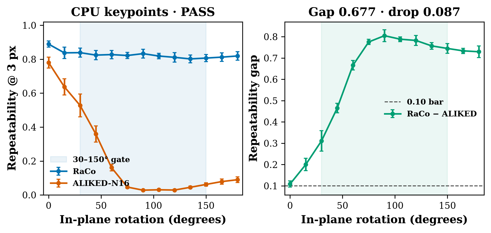

# raco-rotation-keypoints

CPU comparison of RaCo keypoints against ALIKED-N16 under known in-plane rotation. Both detectors come from VisMatch 1.4.0 (`vismatch==1.4.0`). RaCo is Shenoi, Lindenberger, Sarlin, and Pollefeys, [arXiv:2602.15755](https://arxiv.org/abs/2602.15755), *RaCo: Ranking and Covariance for Practical Learned Keypoints* (3DV 2026). Found via a bookmarked X post by [@gabriberton](https://x.com/gabriberton/status/2116957948497039474). That post was **not** fetched. The VisMatch 1.4.0 release notes, the installed modules, and the RaCo paper HTML were read on 2026-11-12.

The post's quoted line calls RaCo a rotationally equivariant detector. The paper's abstract and Section 3.2 say the robustness comes from rotation augmentation over the full circle, not from equivariant convolutions. Table 3's equivariant-convolution variant is about 3 points higher and about 10× slower, and VisMatch does not ship it. This run measures repeatability under rotation.

**The code is the installed VisMatch wrappers**, `get_matcher("raco-lightglue")` and `get_matcher("aliked-lightglue")`. RaCo weights and ALIKED-N16 weights download at run time and are not committed. VisMatch, RaCo, LightGlue, and ALIKED are not vendored. See `NOTICE`.



*Symmetric repeatability at 3 px versus in-plane angle, seeds 0/1/2. Video: [`artifacts/raco-rotation-keypoints.mp4`](artifacts/raco-rotation-keypoints.mp4). Still: [`artifacts/raco-rotation-keypoints.png`](artifacts/raco-rotation-keypoints.png), 0° against 90° on `i_bridger`.*

## Status (honest): **PASS**

Both bars hold on the mean over seeds.

| Check | Bar | Result |
|---|---|---:|
| RaCo − ALIKED, mean repeatability over 30–150° | ≥ 0.10 | **0.677** |
| RaCo drop from 0° to its worst angle (135°) | ≤ 0.10 | **0.087** |

Over 30–150° the mean repeatability is **0.820** for RaCo and **0.143** for ALIKED-N16. At 0° RaCo is 0.889. Its worst angle on the sweep is 135°, at 0.802.

Each seed also clears both bars on its own four images: gaps 0.676, 0.671, 0.685 and drops 0.083, 0.099, 0.087. Seed 1's drop is 0.099, close to the bar. Sample std is ddof=1 over seeds. The rule uses the mean.

## What the paper reports

Section 4.3 rotates the first 20 HPatches images in 10° steps through a square that stays valid over 360°, resizes to 512, adds Gaussian noise with σ = 10, and keeps 200 keypoints. Figure 5 is repeatability at 2 px. The prose says RaCo stays near 80% at every angle while other learned detectors fall off. Table 3's rotation AUC at 3 px is 79.5 for RaCo and 16.7 for ALIKED.

Those AUC numbers are not this run. This run uses 4 of those 20 images per seed, steps of 15° from 0° to 180°, and a symmetric repeatability at 3 px. It does not integrate a 360° curve.

## Hypothesis

On CPU, RaCo keypoints from VisMatch 1.4.0 stay more repeatable under known in-plane rotations than ALIKED-N16 from that same install. The mean gap over 30–150° is at least 0.10, and RaCo's own repeatability falls by at most 0.10 from 0° to its worst angle.

ALIKED-N16 is the baseline because RaCo's backbone is ALIKED-N(16) (Section 4.1) and Table 3 is the comparison the paper prints. VisMatch's default `model_name` is `aliked-n16`. `aliked-n16rot` is not loaded. SuperPoint is also in VisMatch; its weights are under a restrictive license, so it is not the baseline.

## What was compared

RaCo is the extractor inside `RaCoLightGlue`, with `ranker=False` and `covariance_estimator=False`. The wrapper says disabling those heads leaves the keypoints unchanged. ALIKED is the extractor inside `AlikedLightGlue`. `get_matcher` also builds LightGlue and an ALIKED descriptor. Neither is used in the score.

Both detectors see the same 512×512 RGB tensor in `[0, 1]`. ALIKED's default long-edge resize of 1024 is turned off (`resize=None`). ALIKED's default score threshold of 0.2 is replaced by a top-200, matching RaCo's budget and the paper's "extract 200 keypoints". No exact score ties occurred in the returned top-200 (`tie_count` 0 on every main row), so the seed did not have a tie to break. Seeds resample which four images are scored.

The photograph is rotated about the center of the largest square that stays inside the frame at every angle (`floor(min(H, W) / √2)`), that square is cropped, and it is resized to 512. Independent N(0, 10²) noise is added on the 0–255 scale and clipped. The homography is the same rotation, about the center `cv2.resize` assigns to the crop center. A point is eligible when it and its warp lie at least 3 px inside the canvas. Symmetric repeatability is the fraction of eligible points whose nearest detection in the other view is inside 3 px.

## Experiment (`experiments/exp1_cpu_rotation/`)

- **Pre-registration:** `config.yaml` is commit `ac22ed4`, before `raw.json`. Thresholds were not edited after that commit. `config_sha256` in `raw.json` is `4387c48d27dd66d2232bd7737e5ffa2ca448727832ed6e3fc405f5e3f3552b1a`.
- **Smoke:** `smoke.json` is a 96×128 checkerboard, k=32, angles 0° and 45°. Not a gate. At 45° that smoke goes the other way (RaCo 0.256, ALIKED 0.852). The bars were not moved.
- **Seeds:** 0, 1, 2. Each draws 4 of the first 20 HPatches reference frames (`1.ppm`) without replacement.
- **Pool:** `i_ajuntament` through `i_greenhouse`. Archive order puts illumination sequences first, so all 20 are `i_*`. The rotation is synthetic. The dataset's own homographies are not used.
- **Primary metric:** symmetric repeatability at 3 px.
- **Machine:** 4 vCPU, Python 3.12.3, torch 2.15.0+cpu, vismatch 1.4.0, kornia 0.8.2. Official `run_experiment.py` wall time **122 s** with weights and the HPatches zip already cached. Detector time inside that process **110 s**.

### Repeatability at 3 px, mean ± std

| Angle | RaCo | ALIKED-N16 | Gap |
|---:|---:|---:|---:|
| 0 | 0.889 ± 0.018 | 0.780 ± 0.032 | 0.109 |
| 15 | 0.838 ± 0.034 | 0.637 ± 0.048 | 0.200 |
| 30 | 0.839 ± 0.026 | 0.528 ± 0.067 | 0.311 |
| 45 | 0.824 ± 0.027 | 0.359 ± 0.048 | 0.465 |
| 60 | 0.827 ± 0.024 | 0.161 ± 0.019 | 0.666 |
| 75 | 0.822 ± 0.018 | 0.047 ± 0.007 | 0.775 |
| 90 | 0.833 ± 0.026 | 0.028 ± 0.003 | 0.805 |
| 105 | 0.819 ± 0.016 | 0.031 ± 0.005 | 0.788 |
| 120 | 0.811 ± 0.028 | 0.029 ± 0.005 | 0.782 |
| 135 | 0.802 ± 0.023 | 0.045 ± 0.007 | 0.757 |
| 150 | 0.807 ± 0.021 | 0.062 ± 0.010 | 0.745 |
| 165 | 0.812 ± 0.025 | 0.079 ± 0.016 | 0.734 |
| 180 | 0.819 ± 0.025 | 0.090 ± 0.017 | 0.729 |

Report-only, repeatability at 2 px (Figure 5's threshold): RaCo stays between 0.784 and 0.882. ALIKED-N16 is 0.776 at 0° and 0.001 at 90°. Geometric mutual-nearest-neighbor inlier ratio at 3 px, also report-only and descriptor-free: at 90°, RaCo 0.824 and ALIKED 0.027.

Samples: seed 0 `i_bridger`, `i_contruction`, `i_crownnight`, `i_duda`; seed 1 `i_chestnuts`, `i_contruction`, `i_duda`, `i_greenhouse`; seed 2 `i_bologna`, `i_boutique`, `i_bridger`, `i_duda`.

## Breakpoints

Seed 0, `i_bridger` only. Not part of the PASS rule. Full table: `breakpoints.md`.

| Stress | What happened |
|---|---|
| 7° and 23° (off the 15° grid) | RaCo 0.859 and 0.888. ALIKED 0.738 and 0.547. The odd angles do not knock RaCo off the plateau. |
| 45° and scale 0.5 | RaCo 0.434, ALIKED 0.119. Rotation-plus-scale is a different claim, and RaCo's repeatability is about half the rotation-only number. |
| 45° and scale 2 | RaCo 0.594, ALIKED 0.254. |
| Blur σ = 3 on the rotated view only | RaCo 0.206, ALIKED 0.121. The flat rotation curve does not survive this blur. |
| 64×64 canvas, still 200 keypoints, 3 px | RaCo 0.791, ALIKED 0.928. The order reverses. 3 px is a large fraction of 64 px, and 200 points on that canvas are dense. |
| k = 16 at 45° | RaCo 0.375, ALIKED 0.125. VisMatch's RaCo wrapper leaves the ranker off. The paper's ranker is the piece aimed at small budgets, and it was not scored. |
| k = 2048 at 45° | RaCo 0.808, ALIKED 0.483. More points make a 3 px neighbor easier to find, so ALIKED recovers and the gap shrinks. RaCo stays near its rotation-only number. |

## Run (CPU)

```bash
cd apps/raco-rotation-keypoints
python3 -m venv .venv && source .venv/bin/activate
pip install torch torchvision --index-url https://download.pytorch.org/whl/cpu
pip install vismatch==1.4.0 --no-deps
pip install -r requirements.txt
./run_all.sh
PYTHONPATH=src python -m unittest test_geometry -v
```

`vismatch` is installed with `--no-deps` so matchers other than these two do not pull TensorFlow, e2cnn, or uniception. The first run downloads RaCo and ALIKED weights (a few MB), the LightGlue checkpoints `get_matcher` fetches (about 45 MB each, unused by the score), and the HPatches sequences zip (1.3 GB) from `honggyuAn/hpatches-sequences-release`. Only the 20 reference `1.ppm` files are extracted, into `work/hpatches/` (gitignored). No GPU. `python src/run_experiment.py --smoke` rewrites `smoke.json` only.

## Caveats

- This is 4 images per seed from the first 20 HPatches reference frames, not the paper's 20-image, 10° rotation AUC. The first 20 frames in the archive are all illumination sequences.
- 0° repeatability is 0.889, not 1, because each view gets its own σ = 10 noise.
- The ranker and the covariance head are off, which is how VisMatch 1.4.0 builds `raco-lightglue`. A small keypoint budget is where the paper says the ranker matters.
- Blur, a 64 px canvas, and an extra scale change are outside the gate. Blur and the tiny canvas are where the rotation story fails or flips.
- The checkerboard smoke at 45° has ALIKED ahead of RaCo. It is a periodic 64 px pattern with k = 32, and it was not used to set the bars.
- Descriptors are not matched. A LightGlue inlier rate would mix ALIKED's descriptor into both sides.
- Upstream code and weights are not copied into this directory. This directory is MIT. HPatches photographs are not redistributed; their dataset repo is MIT and the frames themselves come from earlier sequences.

## Licences

- This directory: **MIT** (`LICENSE`).
- VisMatch 1.4.0: **BSD-3-Clause**. Not vendored. See `NOTICE`.
- RaCo code and the `raco.pth` weights: **Apache-2.0**. Downloaded at run time.
- ALIKED code in the LightGlue submodule: **BSD-3-Clause**. `aliked-n16.pth` downloaded at run time.
- LightGlue: **Apache-2.0**. Checkpoints download and are not used in the score.
