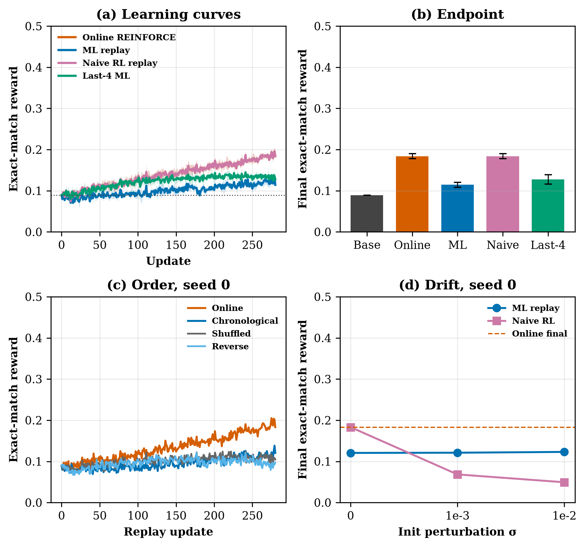

# rl-rollout-replay

CPU toy of **Reinforcement Learning Can Be Recovered From Its Own Rollouts** (Sheng, Gu, Zeng, Zhou, Viel, Wang, Tajwar, Zanette, [arXiv:2611.33102](https://arxiv.org/abs/2611.33102)). A 20,077-parameter GRU learns two-digit addition by on-policy REINFORCE. The same base checkpoint is then trained on the archived rollouts.

Found via a bookmarked X post by [@rosinality](https://x.com/rosinality/status/2125531243681038427). The post was **not fetched**. Every claim attributed to the paper was checked on the [arXiv HTML (v2)](https://arxiv.org/html/2611.33102v2).

The HTML does not link official code. The paper's language-model runs use verl, which is not vendored. This app is a clean-room reimplementation. See `NOTICE`. No paper figures are copied.



*Seed-mean exact-match reward, the endpoint, rollout order, and a weight perturbation.* Video: [`artifacts/rl-rollout-replay.mp4`](artifacts/rl-rollout-replay.mp4).

## Status (honest): **FAIL**

The bars were fixed in `config.yaml` at `bd3afc3f98151c85e3da838e1baf580fa30f1e81`, before seeds 0/1/2, and were not edited afterward. An online-only probe chose the step budget. It did not run replay and did not set the bars.

| Check | Bar | Result |
|---|---|---|
| Online gain over the shared base | ≥ 0.15 | **miss** (0.095 ± 0.006) |
| ML endpoint gap, seed-mean | ≤ 0.08 | **met** (0.069) |
| ML trajectory MAE, steps 1..280 | ≤ 0.10 | **met** (0.039 ± 0.002) |
| Naive replay below online | ≥ 0.15 | **miss** (0.000) |
| Last-4 ML endpoint gap | ≤ 0.10 | **met** (0.056) |

FAIL because the online gain misses its bar. The rule does not promote the run to PARTIAL when that bar fails. Three of the five bars hold.

### Exact-match reward (mean ± sample std, 8 samples × 256 held-out sums)

| Run | Final |
|---|---|
| Base | 0.089 ± 0.000 |
| Online REINFORCE | 0.184 ± 0.006 |
| ML replay, one update per batch | 0.114 ± 0.006 |
| Naive REINFORCE replay | 0.184 ± 0.006 |
| Last-4 ML, 280 updates | 0.127 ± 0.011 |

Per seed, online / ML / naive / last-4:

| Seed | Online | ML | Naive | Last-4 | Gain |
|---|---:|---:|---:|---:|---:|
| 0 | 0.183 | 0.121 | 0.183 | 0.137 | 0.094 |
| 1 | 0.178 | 0.114 | 0.178 | 0.115 | 0.089 |
| 2 | 0.190 | 0.109 | 0.190 | 0.130 | 0.101 |

Naive replay matches online on every logged reward. The max absolute parameter difference is 0 on every seed. One deterministic REINFORCE step on the archived batch is the same update the online run took.

Wall time on 4 vCPUs: 180 s for SFT, three seeds, and the breakpoints.

## Hypothesis (locked)

On held-out two-digit addition, answer digits written least-significant first:

1. Online REINFORCE raises sampled exact-match reward by at least 0.15.
2. One maximum-likelihood update per archived batch, in generation order, with no correct/incorrect split, finishes within 0.08 of the online seed-mean and has trajectory MAE at most 0.10.
3. One REINFORCE update per archived batch finishes at least 0.15 below online.
4. Cycling maximum likelihood on only the last 4 batches, for the same number of updates, finishes within 0.10 of online.

## Breakpoints (seed 0, not in the status)

| Run | Final reward |
|---|---:|
| Chronological ML (the main run) | 0.121 |
| Shuffled order | 0.104 |
| Reverse order | 0.097 |
| ML, 8 updates per batch | 0.141 |
| Naive RL, 8 updates per batch | 0.000 |
| Last batch only, 280 updates | 0.073 |
| ML, weight noise σ = 0.001 | 0.121 |
| Naive RL, σ = 0.001 | 0.068 |
| ML, σ = 0.01 | 0.123 |
| Naive RL, σ = 0.01 | 0.049 |
| Foreign random init, then ML | 0.043 |
| ML on seed 1's archive | 0.114 |

Eight REINFORCE updates on each archived batch, which is off-policy after the first step, drive the reward to 0. The same eight likelihood updates raise ML from 0.121 to 0.141, still short of online 0.183. A Gaussian kick of σ = 0.01 at the start leaves ML at 0.123 and drops naive replay to 0.049. That is the paper's baseline-push, visible here only after the policies are no longer the same function.

The subtraction specialist, trained from the addition base, moves from 0.003 to 0.026. An alternating ML student ends at 0.112 on addition and 0.023 on subtraction. There is no second skill to combine. Section 4.1 of the paper is not reproduced by this pair.

## What the paper reports (QUOTED, not re-run)

Checked on the v2 HTML:

- Uncorrected MaxRL replay on MATH-500 improves, then falls to nearly zero by step 100. Truncated importance sampling tracks until about step 600, then drops.
- One maximum-likelihood update per batch tracks online MaxRL. Table 5(a) trajectory errors are 0.002 to 0.011, and endpoint errors are 0.003 to 0.013, depending on the benchmark.
- On Knights and Knaves, the pass@k endpoint gap is 71.9 points for the base model, 0.9 after replay of the last batch, and 0.3 after the full archive.
- For SmolLM2-360M on GSM8K, last-1 / last-5 / last-50 endpoint errors are 5.2 / 3.0 / 0.9 points. A single late batch is not enough in every setting.
- Shuffled order levels off below online. Reverse order rises, then falls back toward the base.
- Maze, all 1000 steps, 8 repeats each: pass@1 0.238 versus 0.252 online. The last step alone reaches 0.157. The last 10 steps reach 0.247.
- One student can track a math specialist and a Knights-and-Knaves specialist by alternating one likelihood update on each archive.

## What this toy actually runs

The prompt is two 2-digit numbers and a plus. The answer is three digits, least-significant first. REINFORCE uses exact match as the reward and the advantage `r − group mean` (Table 1, weight 1). It is not MaxRL's `1/p` weight. One AdamW step per batch of 64 prompts × 32 samples. Learning rate 0.003 for 280 steps, after 120 steps of supervised warm-start at learning rate 0.02. The metric is the exact-match rate of 8 fresh samples on 256 held-out sums, temperature 1. Maximum-likelihood replay is the token NLL of every archived answer, correct or not.

## Run (CPU)

```bash
cd apps/rl-rollout-replay
python3 -m venv .venv && source .venv/bin/activate
pip install --index-url https://download.pytorch.org/whl/cpu torch
pip install -r requirements.txt
./run_all.sh
```

No GPU and no network. `./run_all.sh --smoke` checks the code path only (`smoke.json`, seed 99). It is not a result.

After the run:

```bash
python3 -m http.server 43132 -d viewer
```

## Caveats

This is not Qwen, not MATH-500, and not verl. The online gain on this GRU is 0.095, under the locked 0.15 bar, so the recovery comparison is about a small climb. One-update naive replay cannot collapse while it remains the same computation as the online step. The paper says the same thing about deterministic updates, and then reports collapse once numerical drift appears. Here that drift had to be introduced on purpose, as a breakpoint. Last-4 replay and one-update ML both beat the base and both miss most of the online gain. Paper numbers in the quoted section were not re-run.
