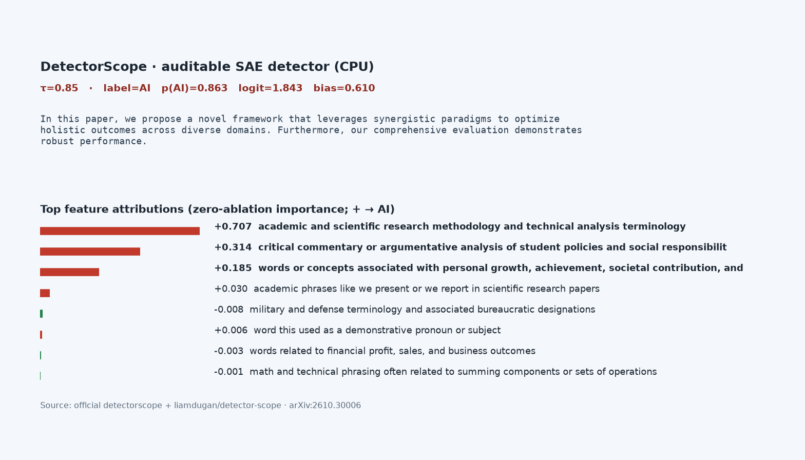
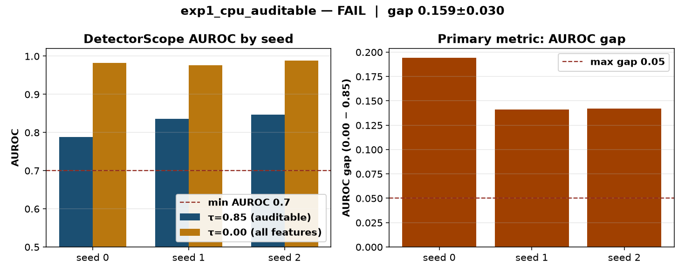

# sae-text-detector

CPU-only clear-experiment demo of **Building Auditable AI Text Detectors with Sparse Autoencoders** (Dugan et al., [arXiv:2610.30006](https://arxiv.org/abs/2610.30006), EMNLP 2026 / [HF papers](https://huggingface.co/papers/2610.30006)). Found via a bookmarked X post by [@_akhaliq](https://x.com/_akhaliq/status/2114730846426890689).

**Official code exists and is used here:** [`google-deepmind/detectorscope`](https://github.com/google-deepmind/detectorscope) (Apache-2.0, copy in `LICENSE`) via the `detectorscope` PyPI package and the released Hub detector [`liamdugan/detector-scope`](https://huggingface.co/liamdugan/detector-scope). This is a small CPU slice with a pre-registered hypothesis — **not** a reproduction of the paper’s COLING / RAID tables. See `NOTICE`.



*Official DetectorScope on CPU: p(AI) plus named SAE feature attributions (zero-ablation importances) for a short AI-ish abstract. Video: [`artifacts/sae-text-detector.mp4`](artifacts/sae-text-detector.mp4).*

## What runs

- Load `AuditableDetector.from_pretrained("liamdugan/detector-scope")` (Gemma-2-2b extractor + JumpReLU SAEs + logreg heads at many τ).
- Score a balanced subsample of [`dmitva/human_ai_generated_text`](https://huggingface.co/datasets/dmitva/human_ai_generated_text) (**CC-BY-4.0**).
- Compare the paper’s default auditable head **τ=0.85** to the unfiltered SAE head **τ=0.00** (same architecture; more features admitted).
- Primary metric: `auroc_gap = AUROC(τ=0.00) − AUROC(τ=0.85)`.
- Gradio UI (`src/gradio_app.py`) shows top named features and token highlights.

## Status (honest): **FAIL**

| Check (fixed in `config.yaml` before the run) | Threshold | Result |
|---|---|---|
| `AUROC(τ=0.85) ≥ 0.70` on every seed 0/1/2 | ≥ 0.70 | **met** (0.789 / 0.835 / 0.847) |
| `AUROC(τ=0.00) − AUROC(τ=0.85) ≤ 0.05` on every seed | ≤ 0.05 | **not met** (gaps 0.194 / 0.141 / 0.142) |

Status rule: PASS needs both on every seed; PARTIAL if mean gap ≤ 0.05 and mean AUROC_0.85 ≥ 0.70 but a seed fails; else FAIL. → **FAIL**.

### Per-seed results (96 texts: 48 human + 48 AI)

| seed | AUROC τ=0.85 | AUROC τ=0.00 | gap | mean n_active τ=0.85 |
|---|---:|---:|---:|---:|
| 0 | 0.7886 | 0.9826 | 0.1940 | 72.0 |
| 1 | 0.8351 | 0.9761 | 0.1411 | 72.1 |
| 2 | 0.8468 | 0.9887 | 0.1419 | 73.7 |

**Mean ± std:** τ=0.85 **0.8235 ± 0.0308**, τ=0.00 **0.9825 ± 0.0063**, gap **0.1590 ± 0.0303**.

On this CC-BY-4.0 essay-pair slice the released τ=0.85 head stays useful (AUROC ~0.82) and fully auditable, but it lags the unfiltered τ=0.00 SAE head by ~16 AUROC points — outside the pre-registered 5-point band. That does **not** refute the paper’s COLING/RAID results (different data, domain, and scale); it shows the interpretability–accuracy tradeoff is material on this small CPU eval set.



## Experiment (`experiments/exp1_cpu_auditable/`)

- **Hypothesis:** on a balanced 96-example stratified subsample of `dmitva/human_ai_generated_text`, DetectorScope logreg at τ=0.85 stays within 0.05 AUROC of τ=0.00 on every seed 0/1/2 (and AUROC_0.85 ≥ 0.70).
- **Pre-registration:** `config.yaml` committed with hypothesis, metric and thresholds **before** the official run (git: “pre-register exp1 config”). **Disclosure:** one smoke (16 texts, seed 0; `smoke.json`) verified the code path only. Truncation breakpoints use a balanced 32-example subset of seed 0 for CPU time; τ / top-k use the full seed-0 feature cache.
- **Seeds:** 0, 1, 2 — each redraws the 48+48 stratified subsample from a fixed 400-pair pool (`pool_seed=20261029`).
- **Machine:** 4-vCPU Linux box, torch CPU, Python 3.12. Extract ~4 min/seed after model load; no GPU, no API keys.

Tables: `results.md` / `results.csv`; raw: `raw.json`; verdict: `status.json`.

## Breakpoints (`breakpoints.md`, `breakpoints.csv`)

Seed 0:

- **Very short texts (truncate):** at 40 chars both heads are weak (sparse AUROC 0.45); gap stays large until mid lengths. At 80 chars the sparse head briefly *beats* dense on this tiny subset (gap −0.10) — unstable under extreme truncation.
- **Raising τ:** AUROC holds through τ=0.70 (0.95) then drops at τ=0.85 (0.79); at τ=0.95 **zero** active features remain → AUROC 0.50 (chance).
- **Top-k rescore (τ=0.85):** with only 1–4 features AUROC ~0.71–0.72; recovers toward the full head by k=32–64 (~0.78).

## Run (CPU)

```bash
cd apps/sae-text-detector
uv venv .venv && source .venv/bin/activate
uv pip install --index-url https://download.pytorch.org/whl/cpu torch
uv pip install -r requirements.txt
./run_all.sh            # downloads Hub detector + dataset; ~15–25 min on 4 vCPUs
# python src/run_experiment.py --smoke   # disclosed tiny code-path check
python src/gradio_app.py --port 7860     # interactive feature view
```

First run downloads Gemma-2-2b under the Hub repo’s `extractor/` (~10 GB) plus SAEs/heads. Subject to the [Gemma Terms of Use](https://ai.google.dev/gemma/terms). No HF token required for these public files.

## Caveats

- **Not the paper’s main tables:** 96-example CPU slices vs COLING/RAID; domain is paired essay-style text (CC-BY-4.0), not the COLING mix.
- **FAIL is about the pre-registered gap bar** on this slice. τ=0.85 still clears AUROC ≥ 0.70 on every seed and returns named features.
- Classification accuracy at the head’s default logit threshold is near chance here even when AUROC is high — calibration / threshold mismatch for this domain; AUROC is the primary metric.
- Hub weights stay out of git (`work/` and the HF cache are local).

## Licences

- App harness / this folder’s scripts: see repo root; upstream **Apache-2.0** for DetectorScope code (`LICENSE`).
- Hub detector: Gemma ToU (LM) + CC-BY-4.0 (SAEs/heads/descriptions) — see Hub `NOTICE`.
- Eval dataset: **CC-BY-4.0** (`dmitva/human_ai_generated_text`).
