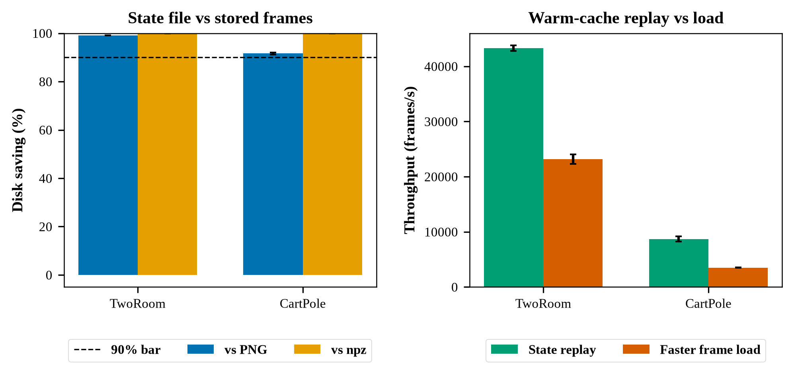

# stable-envs-state-replay

CPU-only, pre-registered experiment on **stable-envs** 0.1.0
([galilai-group/stable-envs](https://github.com/galilai-group/stable-envs),
commit `e2715139fd5e581f57f20cd0d2393b539351d37d`;
[arXiv:2611.23151](https://arxiv.org/abs/2611.23151);
[docs](https://galilai-group.github.io/stable-envs/)).

The library keeps the simulator state and can draw frames from that state
later. This run asks whether storing those states, instead of the frames,
saves disk, stays bit-exact, and is at least as fast as reading the frames
back. Found via a bookmarked X post by
[@randall_balestr](https://x.com/randall_balestr/status/2123183492066685420).
**The post was not fetched** — no X API, no X MCP, no x.com scraping. The
package was identified from PyPI and the GitHub README: authors Randall
Balestriero and Sami BuGhanem, and the same “store states, render later”
API the project documents. Claims below are from that README, the project
page, and the paper, then from this run.

The code under test is the installed `stable-envs` package, not a
reimplementation. It is not vendored. Upstream licence texts are in
`LICENSE` (MIT), `NOTICE`, `THIRD_PARTY_NOTICES.md`, and `LICENSES/`
(the wheel also carries LGPL-2.1 for pygame drawing ports).

## Hypothesis (pre-registered)

> Storing only simulator states at the default appearance and re-rendering
> on the fly gives at least 90% disk saving versus lossless PNG and versus
> uncompressed uint8 npz of the same episodes, the re-rendered frames are
> bit-identical to the frames drawn at collection, and state-replay
> throughput (`torch.load` plus `env.render`) is at least the faster of the
> two frame-loading baselines.

Bars were frozen in
[`experiments/exp1_cpu_state_replay/config.yaml`](experiments/exp1_cpu_state_replay/config.yaml)
in commit `d8aa7da` **before** the measured run.
`config_sha256` = `8332d484bed43d70d9c9ed9fed569d56f2670d74345691f3e66d6c95b4eccefb`.

| Check | Bar |
|---|---|
| H1: seed-mean disk saving vs PNG, each env | ≥ 90% |
| H2: seed-mean disk saving vs uncompressed npz, each env | ≥ 90% |
| H3: lossless fraction on every (env, seed) cell | = 1 |
| H4: seed-mean replay fps ≥ seed-mean faster frame-load fps, each env | ≥ 1× |

PASS = every env meets H1, H2 and H4, and H3 holds. FAIL = any cell is not
bit-identical, or any env misses both disk bars. PARTIAL = anything else.
Breakpoints are report-only.



*Disk saving and warm-cache throughput, seeds 0/1/2. Error bars are the seed
sample standard deviation. Video:
[`artifacts/stable-envs-state-replay.mp4`](artifacts/stable-envs-state-replay.mp4).
Still: [`artifacts/stable-envs-state-replay.png`](artifacts/stable-envs-state-replay.png).*

## Status (honest): **PASS**

All four bars hold on both main environments. The bars were not moved after
the run.

| Env | PNG saving | npz saving | Lossless | Replay fps | Load fps |
|---|---:|---:|---:|---:|---:|
| TwoRoom | **99.10% ± 0.01** | **99.98%** | **1.000** | **43298 ± 516** | 23178 ± 889 |
| CartPole | **91.68% ± 0.41** | **99.97%** | **1.000** | **8686 ± 470** | 3503 ± 23 |

The load column is the faster of uncompressed-npz read and sequential PNG
decode. On both envs that is the npz. Replay is 1.87× that load on TwoRoom
and 2.48× on CartPole. PNG decode is slower (about 2.7k fps and 0.86k fps).

Per seed, 4 environments × 32 steps = 128 frames. State file versus PNG
versus npz:

| Env | Seed | State | PNG | npz | PNG % | npz % |
|---|---:|---:|---:|---:|---:|---:|
| TwoRoom | 0 | 4061 B | 454365 B | 19267850 B | 99.11 | 99.98 |
| TwoRoom | 1 | 4061 B | 449556 B | 19267850 B | 99.10 | 99.98 |
| TwoRoom | 2 | 4061 B | 449752 B | 19267850 B | 99.10 | 99.98 |
| CartPole | 0 | 27801 B | 350438 B | 92160266 B | 92.07 | 99.97 |
| CartPole | 1 | 27801 B | 318014 B | 92160266 B | 91.26 | 99.97 |
| CartPole | 2 | 27801 B | 335914 B | 92160266 B | 91.72 | 99.97 |

Every cell has max absolute pixel difference 0, and a PNG round-trip of the
collection frames matches too. A second process re-rendering the TwoRoom
seed-0 states produced the same SHA-256 as the collection frames.
TwoRoom stepped with the Numba backend; CartPole stepped with the NumPy
backend. Both rendered with `backend="auto"` (Numba is installed).

Machine: 4 vCPU, Python 3.12.3, torch 2.15.0+cpu, numpy 2.5.5,
`torch.set_num_threads(4)`. Measured run wall time 18.3 s. Full cells:
`experiments/exp1_cpu_state_replay/raw.json`.

### Breakpoints (report-only — where it breaks)

- **Resolution.** `render(..., size=)` refuses anything but the native size:
  TwoRoom 224, CartPole 400×600. 112, 448, 300 and 1200 all raise
  `ValueError`. A nearest 2× upsample of the TwoRoom frames is 77 MB of npz
  versus 19 MB native, and it is not a stable-envs render. The paper’s
  “arbitrary resolution” sentence does not hold for these two classes.
- **Long episode.** TwoRoom, 1 env, 512 steps: PNG saving 99.43%, npz 99.99%,
  lossless, replay still faster than load (27.4k vs 16.5k fps). No step
  repeated the agent position.
- **Many envs.** TwoRoom, 64 envs, 8 steps (512 frames): PNG saving 99.44%,
  npz 99.99%, lossless, replay 31.5k vs load 15.2k fps.
- **Visual variation left out of the file.** TwoRoom collected with
  `agent.color = [0, 80, 255]`. Replaying the states on a default (red)
  env matches **0 of 16** frames (max abs 255). Passing the variation row
  back into `render` matches **16 of 16**. The row costs 697 bytes
  (2269 → 2966). “Store only the state” is lossless for the default
  appearance. A changed colour is not in the TwoRoom state.
- **Third family.** Acrobot, 2×16 frames at 500²: PNG saving 91.40%, npz
  99.96%, lossless, replay 10.6k vs load 4.2k fps. Same shape as CartPole:
  schematic PNG is the tight disk bar, and it still clears 90%.
- **PNG compress level 9** on TwoRoom seed 0 shrinks the PNG from 454 KB to
  414 KB. Saving stays 99.02%.

### What this run does not show

The paper’s speed tables were not re-run. They need an NVIDIA L40S and a
stable-worldmodel baseline. Table 3 reports render speedups versus
stable-worldmodel up to 24.1× (TwoRoom, GPU, batch 128) and 21.3× on CPU.
The abstract’s average is 8.5×. Table 4 reports LeWM training at 1.16×–1.33×
(PushT 6.09 vs 4.58 optimizer steps/s). The README’s family table sums to
**80** environment classes; this process executed TwoRoom, CartPole and
Acrobot. The marketed “99% disk” matches TwoRoom versus PNG and both envs
versus raw pixels. It does not match CartPole versus PNG (91.7%).

## Run

```bash
cd apps/stable-envs-state-replay
bash run_all.sh
```

The script creates `.venv` if needed, installs the CPU torch wheel, then
`stable-envs[navigation,classic]==0.1.0`. No GPU and no paid compute.
Viewer: `python3 -m http.server 43131` from this directory and open
`/viewer/`.
