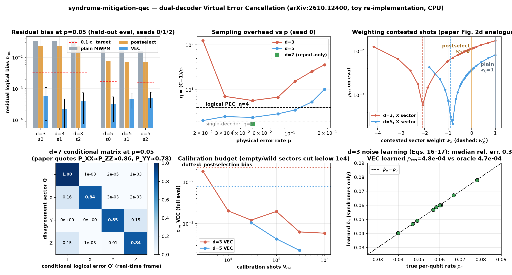
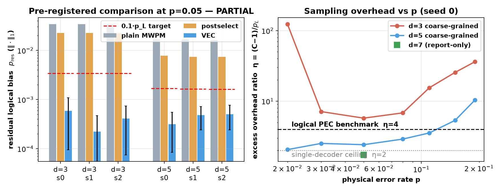

# syndrome-mitigation-qec

CPU-only clear-experiment toy of **"Measure Now, Mitigate Later: Virtual Error Cancellation for Logical Quantum Circuits"** (Oles Shtanko, Saswata Roy, Shashwat Kumar, Zlatko Minev, Google Quantum AI, [arXiv:2610.12400](https://arxiv.org/abs/2610.12400), CC BY 4.0). Found via a bookmarked X post by [@zlatko_minev](https://x.com/zlatko_minev/status/2110718095568622016). The paper ships **no official code** — this is an independent re-implementation of its dual-decoder coarse-grained VEC protocol in the paper's own code-capacity benchmark setting (rotated surface code, depolarizing noise, one perfect extraction round), built on [stim](https://github.com/quantumlib/Stim) and [PyMatching](https://github.com/oscarhiggott/PyMatching) (both Apache-2.0; see `NOTICE`). No figures from the paper are copied; paper numbers quoted for comparison are marked QUOTED.



*Results grid: pre-registered residual-bias comparison, overhead ratio η vs p, the paper-Fig.-2d-style weight sweep, the d=7 conditional error matrix, calibration-budget breakdown, and syndrome-only noise learning.* Video: [`artifacts/syndrome-mitigation-qec.mp4`](artifacts/syndrome-mitigation-qec.mp4) animates the running ⟨Z_L⟩ estimate vs shot count for plain / postselect / VEC converging toward the ideal +1.

## What is implemented (paper equations)

- **Noise & readout:** code-capacity depolarizing channel `E_p(ρ) = (1−p)ρ + p/3(XρX+YρY+ZρZ)` on each data qubit of a rotated surface code (d∈{3,5,7}), one perfect syndrome-extraction round sampled with stim; the true logical frame flip `Q′ ∈ {I,X,Y,Z}` is recorded through a **noiseless reference ancilla** (Bell-paired logical observables), used for benchmarking/oracle calibration only (paper Supp. II.A).
- **Real-time decoder** `D_rt`: PyMatching MWPM on the decoupled X/Z graphs, log-likelihood weights `w_e = ln[(1−q)/q]`, `q = 2p/3`, with precomputed lookup tables `T_X(s_Z)`, `T_Z(s_X)` (paper Supp. II.B).
- **Offline decoder** `D_off`: **exact** maximum-likelihood coset probabilities `Z_L(s)` (Eq. S.1) — exhaustive `4^9` enumeration at d=3 and an exact transfer-matrix (BSV-MPS-style) contraction with bond dimension ≤ `2^d × 4` for d=5,7, **verified against brute force at d=3 to ~1e-15** (`src/verify.py`), with per-syndrome caching.
- **Dual-decoder sectors** `S_Q = {s : D_rt(s)·D_off(s) ~ Q}` (Eq. 10) and **coarse-grained VEC weights** (Eq. 11): `V = (p_X−p_I, p_Y−p_I, p_Z−p_I)`, `w_I = (1 + 1ᵀV⁻¹p_I)/q_I`, `w_Q = −(V⁻¹p_I)_Q/q_Q`.
- **Estimator & overhead:** `⟨O⟩_VEC = N⁻¹ Σᵢ w(sᵢ)mᵢ` (Eq. 2), `C = Σ_k q_k w_k²`, `η = (C−1)/p_L` (Eq. 9/12). Baselines: plain decoding (`w ≡ 1`) and agreement postselection (`w_Q = 0`, renormalised).
- **Primary metric:** residual logical bias `p_res = ‖Σ_k q_k w_k p_k‖₁` on **held-out** eval shots, weights fitted on a separate calibration split.
- **Stretch (report-only):** syndrome-only noise learning via Walsh–Hadamard fidelities with degree-1 + adjacent same-sector degree-2 characters and bias-corrected weighted NNLS (Eqs. 16–17 / S.2–S.9), then VEC with learned instead of oracle weights.

## Status (honest): **PARTIAL**

| Check (fixed in `config.yaml` before the run) | Threshold | Result |
|---|---|---|
| p_res_VEC ≤ 0.1·p_L(MWPM), every seed 0/1/2, d=3 **and** d=5 | 10× bias reduction | **met** (33–152× at d=3, 32–53× at d=5) |
| p_res_VEC < p_res(postselect), every seed, both d | strict | **met** (15–101× below postselection) |
| η = (C−1)/p_L < 4 (paper's logical-PEC benchmark), every seed, both d | η < 4 | **not met at d=3** (η = 5.4–5.7); met at d=5 (η ≈ 2.4) |

Status rule: PASS needs all three everywhere; **PARTIAL** = VEC beats postselection and plain decoding on all seeds but misses the 10× or η<4 bar; FAIL otherwise. → d=3's sampling overhead ratio misses the η<4 bar, so **PARTIAL**. This is consistent with the paper's own Fig. 2e, where the coarse-grained overhead ratio *decreases with code distance* and only the larger distances sit below the PEC benchmark: our d=5 gives η≈2.4 and the report-only d=7 gives **η=1.73**, right in line with the paper's story.

### Per-seed results (p = 0.05, eval split, jackknife 1σ)

| d | seed | p_L MWPM | p_res postselect | p_res VEC | η | verdict vs thresholds |
|---|---|---|---|---|---|---|
| 3 | 0 | 3.398e-2 | 2.262e-2 | **5.86e-4 ± 4.9e-4** | 5.69 | 10× ✓, <PS ✓, η ✗ |
| 3 | 1 | 3.399e-2 | 2.263e-2 | **2.23e-4 ± 2.5e-4** | 5.66 | 10× ✓, <PS ✓, η ✗ |
| 3 | 2 | 3.388e-2 | 2.231e-2 | **4.08e-4 ± 3.3e-4** | 5.41 | 10× ✓, <PS ✓, η ✗ |
| 5 | 0 | 1.674e-2 | 7.734e-3 | **3.16e-4 ± 2.3e-4** | 2.44 | all ✓ |
| 5 | 1 | 1.647e-2 | 7.347e-3 | **4.82e-4 ± 2.4e-4** | 2.42 | all ✓ |
| 5 | 2 | 1.621e-2 | 7.367e-3 | **5.04e-4 ± 2.6e-4** | 2.44 | all ✓ |

Report-only d=7 (seed 0, 2e5+2e5 shots): p_L = 7.83e-3, p_res_PS = 2.20e-3, **p_res_VEC = 1.39e-4 ± 1.2e-4**, C = 1.0135, **η = 1.73**. Its weights (w_I, w_X, w_Y, w_Z) = (1.010, −0.405, −0.044, −0.434) and conditional diagonals P_XX = 0.839, P_ZZ = 0.840 sit close to the paper's QUOTED d=7, p=0.05 reference point (P_XX≈P_ZZ≈0.86, P_YY≈0.78, w_I*≈1.01, w_X*=w_Z*≈−0.42, w_Y*≈−4e-2); our P_YY = 0.846 comes from only ~13 Y-sector calibration shots, so it carries a large statistical error.

Direct observable check (ideal +1): e.g. d=3 seed 0 gives ⟨Z_L⟩ = 0.96497±0.00032 (plain), 0.97722±0.00031 (postselect), **1.00017±0.00053 (VEC)**; full table in `experiments/exp1_vec_cpu/results.md`.



## Experiment (`experiments/exp1_vec_cpu/`)

- **Hypothesis:** at p=0.05 on a rotated surface code under code-capacity depolarizing noise, dual-decoder coarse-grained VEC (MWPM real-time + exact ML offline) cuts the residual logical bias ≥10× vs plain MWPM, is strictly below agreement postselection, and costs η < 4 (the paper's logical-PEC benchmark) — on every seed 0/1/2 for d=3 **and** d=5.
- **Pre-registration:** `config.yaml` committed with hypothesis, metric and thresholds **before** the official run (git: "pre-register exp1 config"). **Disclosures:** one smoke (2e4 shots, seed 0; `smoke.json`) verified the code path only; the exact-d=5 feasibility decision was made *pre-registration* from decoder timing (`src/verify.py`: 0.003 ms/syndrome), so d=5 is in the primary claim and d=7 is report-only; the main experiment is **oracle-calibrated** (sector centroids from true frame flips on the calibration split, exactly like the paper's Fig. 2 benchmark) — the noise-learning breakpoint is the no-labels path. No threshold changed after any result.
- **Metric:** `p_res` (‖·‖₁ residual logical Pauli error) on held-out eval shots, per seed; paired delete-1 jackknife (B=20) error bars. Shot counts chosen so the 1σ statistical floor (~2–3e-4) sits well below 0.1·p_L (~3.4e-3 at d=3, ~1.6e-3 at d=5): d=3 uses 1e6 cal + 1e6 eval, d=5 uses 5e5 + 5e5.
- **Seeds:** 0, 1, 2 — calibration and eval sampling are independent stim streams per seed (`cal_seed = 10000+100d+s`, `eval_seed = 20000+100d+s`).
- **Report-only secondaries:** sector shares q_Q, conditional matrix P_{Q,Q′}, optimal weights, C and η, wall times, MWPM vs ML logical error rates — all in `results.md` / `raw.json`.
- **Machine:** 4-vCPU Linux box, Python 3.12, stim 1.16, PyMatching 2.4. Official run: **15 s**; everything incl. breakpoints + media: ~2.5 min.

Tables: `results.md` / `results.csv`; raw counts: `raw.json`; verdict: `status.json`.

## Breakpoints (`breakpoints.md`, `breakpoints.csv`)

Seed 0, pushing until it breaks (honest notes in `breakpoints.md`):

- **p sweep 0.01→0.19:** at p=0.01 the Y sector is **empty** on both distances — exact 4-sector VEC is undefined (the paper sees the same: no S_Y counts at p≤0.01). At p=0.02, d=3's tiny p_L makes η≈123. Toward threshold (p≥0.15) the VEC advantage collapses and η blows past the PEC benchmark (d=3: η≈26–36; d=5: η≈5–10).
- **Calibration budget 1e3→1e6:** below ~1e4 (d=3) / ~3e4 (d=5) calibration shots, contested sectors hold O(1) shots → weights undefined or wild (d=5 @ 1e4: C≈6e4, p_res≈5.8 — worse than useless). Above that, p_res improves roughly as 1/√N_cal to the eval floor.
- **Noise drift:** weights calibrated at p=0.05 stay below postselection for p′∈[0.01, 0.08]; at p′≥0.11 the drifted VEC degrades to ~2e-2 residual (still under the unmitigated LER) — miscalibration bias scales with ‖p_I‖ (paper Eq. 14), not p_L.
- **Weight sweep:** residual vs one contested w_Q shows the clean minimum at w_Q* (d=3: w_X*≈−2.08; d=5: ≈−0.90) vs postselection (w_Q=0) and no mitigation (w_Q=1), as in the paper's Fig. 2d. *Disclosed post-hoc grid extension:* the pre-registered [−1,1] grid missed the d=3 optimum (the paper's −0.42 is a d=7 value), so relative points around w* were added; no threshold depends on this.
- **Stretch (report-only):** syndrome-only noise learning at d=3 with inhomogeneous per-qubit p (U[0.03,0.08]): median relative error **0.31%** on learned p̂_q from 1e6 unlabelled shots; VEC with **learned** weights reaches p_res = 4.8e-4 vs 4.7e-4 with oracle weights (p_L = 4.3e-2, postselection 2.8e-2) — calibration from syndrome records alone works in this toy.

## Run (CPU)

```bash
cd apps/syndrome-mitigation-qec
uv venv .venv && source .venv/bin/activate
uv pip install -r requirements.txt
./run_all.sh            # ~2.5 min on 4 vCPUs: verify + official run + breakpoints + plots + MP4 (needs ffmpeg)
# python src/verify.py                  # decoder correctness vs brute force
# python src/run_experiment.py --smoke  # disclosed tiny code-path check
```

## Colab (larger shots / d=7 as primary)

[`notebooks/syndrome_mitigation_colab.ipynb`](notebooks/syndrome_mitigation_colab.ipynb) is prepared but **not executed**: it installs the deps, verifies the decoder, and runs d=7 with 1e6+1e6 shots on seeds 0/1/2 plus a d=7 p-sweep. It runs on the **free CPU Colab tier** (no GPU needed or useful); **any paid or GPU runtime needs the repo owner's approval first.** No paid or GPU compute was used anywhere in this app.

## Caveats

- **Code-capacity, not circuit-level:** one perfect syndrome-extraction round with noiseless ancillas — the paper's own benchmark setting (Supp. II), but far from real-device circuit noise with measurement errors and multi-round decoding.
- **Oracle-calibrated weights:** the main experiment estimates sector centroids from true frame flips (available only in simulation), like the paper's Fig. 2 benchmark; the syndrome-only learning path is demonstrated at d=3 as a report-only breakpoint.
- **Toy distances:** d=3/5 primary, d=7 report-only with modest shots; the paper's headline >1000× suppression numbers live at d=7 with 1e7-shot budgets we don't attempt on 4 vCPUs.
- **Not the authors' code:** no official release exists; this re-implementation was verified internally (exact ML vs brute force, stim marginals vs exact enumeration) but any discrepancy with the paper is ours.
- Postselection bias here is the conditional error of accepted shots (‖p_I‖₁, the paper's consensus floor); MWPM tie-breaking and ML argmax ties follow fixed deterministic orderings.
