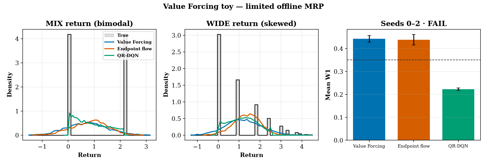
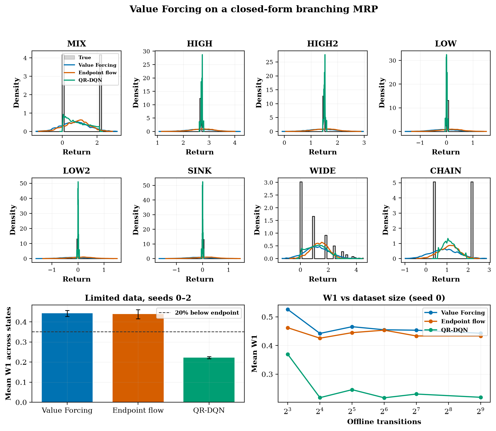

# value-forcing-toy

CPU-only clear-experiment toy of **Value Forcing: Aligning Return Distributions at All Noise Levels** (Zheng, Zhou, Li, Eysenbach, Levine — Princeton / UC Berkeley, [arXiv:2611.02160](https://arxiv.org/abs/2611.02160)). Found via a bookmarked X post by [@svlevine](https://x.com/svlevine/status/2117824001565479007). The post was not re-fetched. The operator was checked on the arXiv HTML and the [project page](https://chongyi-zheng.github.io/value-forcing/) on 2026-11-05. Official code ([chongyi-zheng/value-forcing](https://github.com/chongyi-zheng/value-forcing), **MIT**) exists — **not vendored**. This is a **clean-room** policy-evaluation toy on a tiny Markov reward process. See `NOTICE`.



*Seed-0 return histograms for the bimodal MIX state and the skewed WIDE state, plus mean Wasserstein-1 over seeds 0/1/2. Video: [`artifacts/value-forcing-toy.mp4`](artifacts/value-forcing-toy.mp4) pushes the flow from noise (τ=0) to the scaled return (τ=1).*

## What is implemented (paper idea, toy scale)

Paper Eq. 5, confirmed on the project page, is the flow Bellman equation

`Z(s, τ)  =d  τ r + γ Z(s', τ) + (1−τ) √(1−γ²) N`, with `N ~ N(0,1)` independent of the flow noise.

At τ=0 the Gaussian correction keeps both sides standard normal. At τ=1 it vanishes and the equation is the ordinary distributional Bellman equation. The practical loss in §4.2 multiplies the reward by `(1−γ)`. This toy does that, then divides samples by `(1−γ)` before comparing them to the unscaled closed-form return.

- **MRP:** 8 states. MIX is a 50/50 branch into HIGH (two rewards of 1.5, return 2.7 at γ=0.8) and LOW (return 0), so MIX is atoms at 0 and 2.16. WIDE is a geometric self-loop (stay 0.55, reward 1). CHAIN adds 0.4 and discounts MIX. HIGH, HIGH2, LOW, LOW2, and SINK are point masses. Means match the linear Bellman solution.
- **Value Forcing:** one state-conditioned velocity. At a random τ, bootstrap `Z(s', τ)` by Euler integration of an EMA target and regress the flow-Bellman velocity, including the Gaussian correction.
- **Endpoint baseline:** FlowCritic-style conditional flow matching onto one clean sample `y = (1−γ) r + γ Z(s', τ=1)`. No Bellman constraint at τ<1 (paper appendix Eq. 25, adapted to an MRP).
- **QR-DQN baseline:** 32 fixed quantile fractions, pairwise Huber quantile regression, same reward scaling.
- **Data:** 64 stratified offline transitions (8 per state). The behavior kernel is the MRP itself.

Not claimed: VF/IVF actor-critic, OGBench, OCBench, or the paper's 26-task success rates.

## Status (honest): **FAIL**

| Check (fixed in `config.yaml` before the run) | Threshold | Result |
|---|---|---|
| `mean W1(VF) ≤ 0.80 × mean W1(endpoint)` | 20% lower | **not met** (−0.9%) |
| `mean W1(VF) < mean W1(QR)` | strict | **not met** |
| VF std ratio inside [0.8, 1.2] | band | **not met** (0.753) |

Status rule: PASS needs all three. PARTIAL if mean W1(VF) is strictly below the endpoint baseline and the std ratio is inside [0.5, 1.5]. Else FAIL. The ratio 0.753 is inside the loose band, but mean W1 is not below the endpoint baseline. → **FAIL**.

### Per-seed results (mean W1 across states; lower is better)

| seed | VF | endpoint | QR | VF std ratio |
|---|---:|---:|---:|---:|
| 0 | 0.4550 | **0.4537** | **0.2174** | 0.761 |
| 1 | **0.4452** | 0.4490 | **0.2281** | 0.744 |
| 2 | 0.4266 | **0.4127** | **0.2213** | 0.753 |

**Mean ± std W1:** VF **0.4422 ± 0.0144**, endpoint **0.4384 ± 0.0224**, QR **0.2222 ± 0.0054**.

**Std ratio** (predicted std / true std, states with true std ≥ 0.2): VF **0.753 ± 0.009**, endpoint **0.637 ± 0.050**, QR **0.498 ± 0.011**.

Params: velocity nets **19,201**; QR **22,944**.

Value Forcing is the least collapsed of the three, and on the three states that actually have spread it is slightly closer than the endpoint baseline (MIX 0.604 vs 0.617, WIDE 0.420 vs 0.513, CHAIN 0.490 vs 0.525). Five of the eight states are point masses. There the flow samples stay blurry (W1 ≈ 0.40) while QR is nearly a spike (W1 ≈ 0.02–0.07), so QR wins the average. Seed 1 is the only seed where VF's mean W1 is below the endpoint method, and the gap is 0.004. This does **not** reproduce the paper's limited-data gains on OGBench.



## Experiment (`experiments/exp1_cpu_mrp/`)

- **Hypothesis:** with 64 offline transitions, flow matching trained with the flow Bellman operator at every noise level has lower mean W1 than endpoint-only flow TD and than QR-DQN, and a std ratio inside [0.8, 1.2], averaged over seeds 0/1/2.
- **Pre-registration:** `config.yaml` committed with hypothesis, metric, and thresholds **before** the official run (git: “pre-register exp1 config”, `44547e2`). **Disclosure:** one smoke (40 steps, seed 0; `smoke.json`) verified the code path only. No threshold was changed after any result.
- **Seeds:** 0, 1, 2 — each redraws the 64 transitions and the initial weights.
- **Machine:** 4-vCPU Linux box, torch 2.15.0+cpu, Python 3.12. Official `./run_all.sh`: **about 1 minute** including breakpoints and the MP4.

Tables: `results.md` / `results.csv`; raw: `raw.json`; verdict: `status.json`.

## Breakpoints (`breakpoints.md`, `breakpoints.csv`)

Seed 0, unless noted.

- **Very few transitions.** At 8 transitions (one per state) every method collapses: VF std ratio **0.286**, endpoint **0.244**, QR **0.001**, and VF's mean W1 (**0.526**) is worse than both baselines. From 16 transitions up, W1 flattens near the primary result. 512 transitions still does not produce a 20% gap. A branch that never appears in the data is not recovered.
- **Discount near 1.** This is where the toy breaks. The MRP's horizon is a few steps, so true returns stay O(1), but training multiplies rewards by `(1−γ)` and eval divides by it. At γ=0.9, VF W1 **1.06** (ratio 1.36, too wide) vs endpoint **0.73** vs QR **0.31**. At γ=0.95, VF **4.79** vs endpoint **1.44** vs QR **0.34**. At γ=0.99, VF **63.9** vs endpoint **7.91** vs QR **1.24**. Integrated flow error is amplified by `1/(1−γ)`; QR never integrates a noise path.
- **Long chain.** Depth 8, still 8 transitions per state: mean W1 stays moderate (VF **0.325**, endpoint **0.325**, QR **0.296**). The farthest state's W1 falls, because that return is a discounted copy of MIX. Depth is not the failure mode on this graph. QR's std ratio drops to **0.323** while VF's rises to **0.974**.
- **Euler steps.** 1 step: VF std ratio **0.466**. 2 steps: **0.386** (more collapsed). 8 steps (the registered run): **0.761**. 16 steps: **0.807**, inside [0.8, 1.2], but mean W1 **0.482** vs endpoint **0.501** is only a 4% edge, not 20%.

## Run (CPU)

```bash
cd apps/value-forcing-toy
python3 -m venv .venv && source .venv/bin/activate
pip install --index-url https://download.pytorch.org/whl/cpu torch
pip install -r requirements.txt
./run_all.sh            # ~1 min on 4 vCPUs: 3 methods × 3 seeds + breakpoints + MP4
# python src/run_experiment.py --smoke  # disclosed tiny code-path check
```

## Caveats

- **Not the authors' code or scale.** An 8-state MRP and a 19k-parameter velocity net, not OGBench / OCBench and not the JAX VF/IVF agents.
- **FAIL is about the pre-registered mean W1.** Value Forcing does keep more spread than either baseline. That is not enough for the 20% Wasserstein bar, and QR's sharp point masses dominate the average.
- **`(1−γ)` scaling** is the paper's practical loss. On this short-horizon chain it over-shrinks the target once γ is near 1, which is the γ=0.99 breakpoint above.
- Official MIT code at chongyi-zheng/value-forcing was **not** copied.
- Trained weights stay out of git (`work/` is git-ignored).

## Licences

- App harness / this folder: **MIT** (`LICENSE`). Clean-room; no upstream code vendored.
- Upstream repository, if you use it separately: **MIT** (copyright 2026 Value Forcing Authors).
