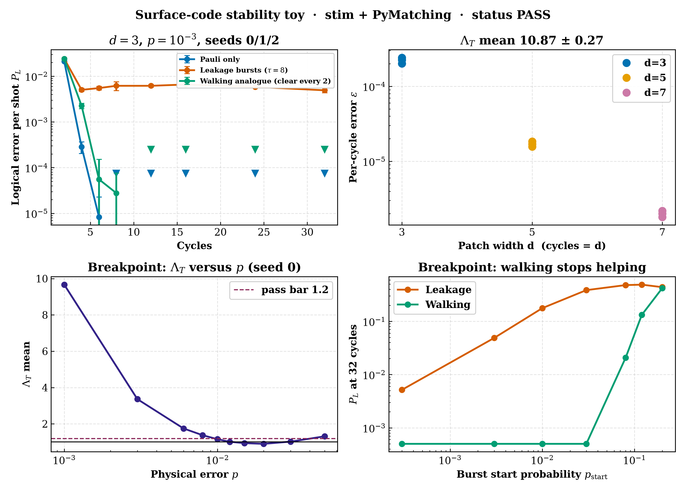

# willow-stability-timelike

CPU-only clear-experiment toy of the surface-code **stability experiment** (Craig Gidney, Quantum 6, 786, 2022, [arXiv:2204.13834](https://arxiv.org/abs/2204.13834)) aimed at the phenomenology in **"Resolving and Suppressing Temporally Correlated Noise in Quantum Error Correction"** (Google Quantum AI, [arXiv:2611.21578](https://arxiv.org/abs/2611.21578)). Found via a bookmarked X post by [@AEickbusch](https://x.com/AEickbusch/status/2122798788431716360); the post was **not fetched**. The bookmark text supplied with the task was checked against the paper.

Stim has memory-experiment generators only. This app builds the stability circuit itself and decodes it with PyMatching. Both libraries are Apache-2.0 (see `NOTICE`). No figures from the paper are copied. Hardware numbers quoted for comparison are marked **QUOTED** and were not re-run.

**This is a simulated toy analogue, not a Willow reproduction.** The hardware floor ≤ 3.20×10⁻⁸ and μ_T = 1.47 ± 0.25 are device results. They are not outputs of this run.



*Logical error versus cycles on a distance-3 patch, per-cycle error at cycles = d, and the two breakpoints.* Video: [`artifacts/willow-stability-timelike.mp4`](artifacts/willow-stability-timelike.mp4) draws the three curves out to 32 cycles.

## What the paper reports (QUOTED)

Checked against the arXiv HTML of 2611.21578, not against the X post:

- Stability patches from 3×3 to 7×7 on 105-qubit Willow. Timelike **block** suppression μ_T = **1.47 ± 0.25** (Pauli-model prediction 1.97 ± 0.44). μ is a block factor, not a per-cycle Λ.
- Logical error versus cycles is a sum of exponentials. The shallow slope is data-qubit heating into |3⟩, which stays for about 10–15 cycles because data-qubit leakage removal clears |2⟩ and not |3⟩.
- A walking stability circuit (data and measure roles swap every cycle, multi-level reset on every qubit every two cycles) reaches a logical-error floor of **≤ 3.20×10⁻⁸ at 60 cycles**, **two orders of magnitude below the standard construction** at that cycle count (1 failure in 3.2×10⁸ subsampled shots, point estimate 3.1×10⁻⁹). The floor is one radiation burst.
- The bookmark text says the same floor is **four orders of magnitude lower than any experiment in the literature** at 60 cycles. That comparison is different from the paper's "two orders below the standard construction." Both are recorded. Neither is claimed here.
- Adaptive stopping on the complementary gap cuts spacetime logical error by **≈ 38%** and mean stopping time by **≈ 34%** versus the best fixed cycle (offline analysis on the hardware shots).

## What this toy actually runs

Z-boundary stability patch, textbook opposite-basis schedule (data prepared and measured in X). The Willow experiment uses a ZXXZ schedule and |+Y⟩ preparation (paper SM S1); this is not that circuit. Corner data qubits that sit in only one tile are removed so the product of all Z stabilizers is the identity. After that cut the patches keep **7 / 23 / 47** data qubits at widths 3 / 5 / 7 (9 / 25 / 49 before the cut).

Noise is uniform circuit-level depolarization at probability p on two-qubit gates, single-qubit gates, reset, measurement, and data idling. It is not SI1000 and not Willow's component table. The decoder is PyMatching minimum-weight matching on the Pauli detector error model.

The leakage channel follows the supplement's phenomenological injection, not a |3⟩ transmon: with probability `p_start` per Z stabilizer per cycle, that stabilizer's measurement record is flipped for N cycles, N drawn from the exponential lifetime in their Eq. (S1) with τ = 8. The decoder is not told about the burst. The walking analogue does **not** move the patch or add qubits. It cuts each burst at the next multiple of 2 cycles, which is a stand-in for "every qubit is reset every two cycles." It therefore misses the walking circuit's extra qubit-count overhead (the paper's walking curve is *worse* than the standard curve at 10 cycles).

## Status (honest): **PASS**

| Check (fixed in `config.yaml` before the official run) | Bar | Result |
|---|---|---|
| Mean over seeds of Λ_T, and both steps > 1 on every seed | mean > 1.2, each step > 1 | **met** (10.87 ± 0.27; every step ≥ 7.8) |
| Leakage curve: P(2)/P(4), P(32)/P(8), and floor vs Pauli | ≥ 2, ≥ 0.5, ≥ 10× | **met** (4.79, 0.80, 197×) |
| Walking gain at 32 cycles, d = 3 | ≥ 3× | **met** (lower bound 59×; 0 walking failures in 36 000 shots) |

Λ_T(d → d+2) = ε(d) / ε(d+2) with ε = 1 − (1 − P_shot)^(1/cycles) and **cycles = d**, at p = 10⁻³, no leakage. A same-cycle ratio is reported below and is not part of the bar.

One disclosed code-path smoke (`smoke.json`, seed 0, tiny shots) ran before the official seeds. A first official execution left `clear_every` unset, so walking matched leakage; that execution was discarded, the sampler was fixed, and the seeds were re-run. **The pass bars were not edited.**

### Λ_T at p = 10⁻³, cycles = d (mean ± sample std over seeds 0/1/2)

| d | cycles | P_L (pooled) | ε (seed means) | Λ_T into the next width |
|---|---|---|---|---|
| 3 | 3 | 6.67×10⁻⁴ (400/600 000) | 2.22×10⁻⁴ | 3→5 = 13.16 ± 1.87 |
| 5 | 5 | 8.50×10⁻⁵ (153/1 800 000) | 1.70×10⁻⁵ | 5→7 = 8.58 ± 1.35 |
| 7 | 7 | 1.40×10⁻⁵ (63/4 500 000) | 2.00×10⁻⁶ | — |

Seed-mean of the two-step average: **Λ_T = 10.87 ± 0.27**.

At a **fixed 4 cycles** the same ratio goes the other way: seed-mean Λ_fixed = **0.33**. Wider patches have more places for a timelike chain, which is the quadratic width scaling in the paper's Fig. 1b inset. Suppression shows up when the timelike distance grows with the patch.

### Leakage knee, d = 3, p_start = 3×10⁻⁴, τ = 8 (mean ± std)

| cycles | Pauli P_L | Leakage P_L | Walking P_L |
|---|---|---|---|
| 2 | 2.10×10⁻² ± 7.6×10⁻⁴ | 2.41×10⁻² ± 1.2×10⁻³ | 2.41×10⁻² ± 1.2×10⁻³ |
| 4 | 2.83×10⁻⁴ ± 8.0×10⁻⁵ | 5.03×10⁻³ ± 4.3×10⁻⁴ | 2.25×10⁻³ ± 3.0×10⁻⁴ |
| 8 | 0 in 40 000 | 6.17×10⁻³ ± 1.3×10⁻³ | 2.8×10⁻⁵ ± 4.8×10⁻⁵ |
| 32 | 0 in 40 000 | 4.92×10⁻³ ± 5.8×10⁻⁴ | 0 in 12 000 |

The leakage curve drops from cycle 2 to 4, then sits on a shallow floor. Walking tracks the Pauli drop instead. Full per-seed counts: `experiments/exp1_cpu_stability/results.md`.

### Adaptive stopping (report-only, not in the status)

Complementary gap (two matchings, observable turned into an extra detector) on an open d = 3 leaked record, grid c ∈ {4, 6, …, 16}, pre-registered threshold T = 4 nats. Toy spacetime error is ½ (memory P_L(c) + stability failure), with memory from `stim`'s rotated memory-Z generator at the same p.

At T = 4 the mean stop is **4.01 cycles** versus a best fixed cycle of 4 (time **0.2% longer**). Spacetime error is **6.5% lower** (2.98×10⁻³ vs 3.18×10⁻³). Almost every shot is already confident at the first grid point, because p = 10⁻³ Pauli gaps are large by cycle 4 and the toy burst is rare. **This does not reproduce the hardware 38% / 34%.** Sweeping T from 1 to 12 nats does not change that picture (`results.md`).

## Breakpoints (seed 0)

- **p sweep, cycles = d.** Λ_T mean is 9.7 at p = 10⁻³, 1.15 at p = 0.01, and **first falls below 1 at p = 0.015**. At p = 0.03 and 0.05 it climbs back through 1: all three distances are then in the high-error regime, and the ratio is no longer a clean threshold diagnostic.
- **Burst rate, 32 cycles.** Walking gain stays above 3× through p_start = 0.12 and **falls below 3× at p_start = 0.2** (gain 1.04), where short bursts are common enough to chain across the 2-cycle clears.
- **Lifetime.** At τ = 1 and τ = 2 both curves have zero failures in 6 000 shots. At τ = 4 the gain is 2.0. From τ = 8 upward the clear removes a visible floor.

## Run (CPU)

```bash
cd apps/willow-stability-timelike
python3 -m venv .venv && source .venv/bin/activate
pip install -r requirements.txt
./run_all.sh    # verify + seeds 0/1/2 + breakpoints + figure + mp4
```

Sampling uses a process pool (default 4 workers). Official run about **10 s**, breakpoints about **10 s**, on this 4-vCPU box (stim 1.16, PyMatching 2.4). No GPU, no network, no weights.

[`notebooks/willow_stability_colab.ipynb`](notebooks/willow_stability_colab.ipynb) is the same CPU path for a longer shot budget. It was **not executed**. Free CPU Colab is enough; do not attach a GPU.

## Caveats

- Toy circuit and toy leakage. Not the Willow ZXXZ schedule, not a |3⟩ simulator, not the walking layout (25 qubits for a 3×3 walk), not correlated matching, not the SI1000 prior.
- Λ_T here is a per-cycle ratio at cycles = d. The paper's μ_T = 1.47 ± 0.25 is a block suppression factor at the experimental c*(d). Different quantity, different noise, different decoder.
- The 3.20×10⁻⁸ floor is a hardware upper bound at 60 cycles. This run's longest point is 32 cycles at p = 10⁻³, where the walking analogue has **zero** failures in 36 000 shots (upper bound ~8×10⁻⁵). That is not 3×10⁻⁸.
- Walking in this toy cannot be worse at short cycles, because the stabilizer circuit is unchanged. On the device, walking is about 10× worse at 10 cycles.
- Adaptive stopping does not reproduce the 38% / 34% hardware gains.
- Corner cuts mean a "3×3" patch here has 7 data qubits, matching the paper's rule that a corner data qubit in only one check is removed, not a marketing 9-qubit grid.
