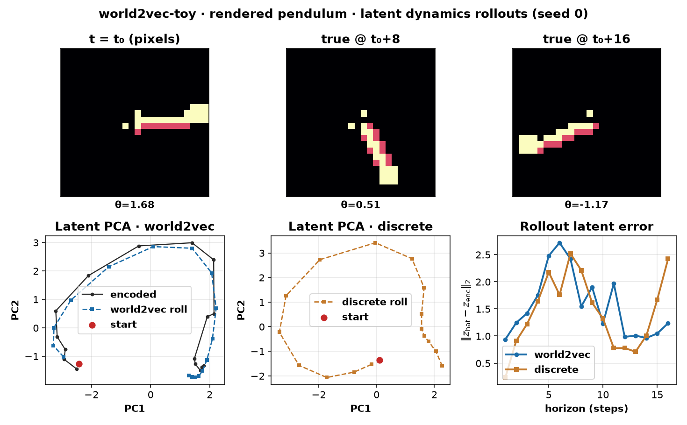
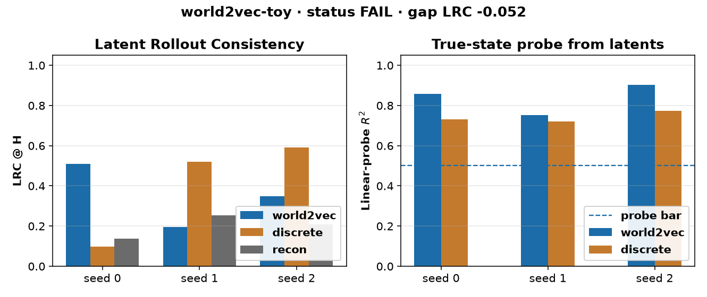

# world2vec-toy

CPU-only clear-experiment toy of **world2vec: Mechanistic world models through latent dynamics learning** (Schmidt, Gonzalez Laiz, Szuppinger, Schneider — Helmholtz Munich / MCML, [arXiv:2610.40637](https://arxiv.org/abs/2610.40637)). Found via a bookmarked X post by [@shumpeiMaxwell](https://x.com/shumpeiMaxwell/status/2116343144732377139) (Shumpei Takezaki, Oct 31 2026). Paper verified on arXiv + [project page](https://worldmodels.science/) + [HF Papers](https://huggingface.co/papers/2610.40637) on 2026-11-03. Official repo ([dynamical-inference/world2vec](https://github.com/dynamical-inference/world2vec)) exists but code is **not yet released** — **not vendored**. This is a **clean-room** toy of continuous-time latent dynamics matching from pixels + actions with no reward and no pixel reconstruction. See `NOTICE`.



*Rendered pendulum frames, latent PCA rollouts, and forecast error vs horizon (seed 0). Video: [`artifacts/world2vec-toy.mp4`](artifacts/world2vec-toy.mp4).*

## What is implemented (paper idea, toy scale)

- **Environment:** damped pendulum, torque actions (OU noise), rendered to 24×24 grayscale; no rewards.
- **world2vec-style:** CNN encoder over H=2 frame history → latent z (dim 8); continuous-time action-conditioned vector field with Euler / residual step; multi-step latent matching (K=4) + VICReg-style variance/covariance anti-collapse; **no pixel reconstruction loss**.
- **Baselines:** (1) discrete-time next-latent MLP (`Φ(z,a)=MLP(z,a)`, paper §3.1); (2) same discrete dynamics plus a pixel decoder (reconstruction auxiliary).
- **Primary metric:** Latent Rollout Consistency (LRC) R² at horizon H=8. Collapse gated by linear-probe R² of true `[sin θ, cos θ, ω]` from latents.

Not claimed: MuJoCo Pendulum/Reacher/CartPole control, DreamerV3 / TD-MPC2 / LeWM tables, 71-attractor system ID, SINDy/DYSCO symbolic dynamics, or CEM MPC.

## Status (honest): **FAIL**

| Check (fixed in `config.yaml` before the run) | Threshold | Result |
|---|---|---|
| `lrc_h_world2vec > lrc_h_discrete` on every seed 0/1/2 | strict | **not met** (only seed 0) |
| `mean(lrc_h_world2vec − lrc_h_discrete) ≥ 0.05` | ≥ 0.05 | **not met** (−0.0516) |
| `mean(probe_r2_world2vec) ≥ 0.50` | ≥ 0.50 | **met** (0.8371) |

Status rule: PASS needs all three; PARTIAL if mean(world2vec LRC) beats discrete and probe ≥ 0.40 but a seed/gap bar fails; else FAIL. → **FAIL** (mean LRC also loses: 0.351 vs 0.403).

### Per-seed results (LRC @ H=8; higher is better)

| seed | world2vec | discrete | recon | w2v probe R² | discrete probe R² | Δ LRC |
|---|---:|---:|---:|---:|---:|---:|
| 0 | **0.5085** | 0.0968 | 0.1364 | 0.8566 | 0.7308 | +0.4117 |
| 1 | 0.1952 | **0.5209** | 0.2535 | 0.7526 | 0.7204 | −0.3257 |
| 2 | 0.3493 | **0.5900** | 0.2093 | 0.9019 | 0.7731 | −0.2407 |

**Mean ± std LRC:** world2vec **0.3510 ± 0.1566**, discrete **0.4026 ± 0.2671**, recon **0.1997 ± 0.0591**.

**Mean probe R² (world2vec):** **0.8371 ± 0.0766** (clears the ≥0.50 bar — latents are not collapsed).

Params: world2vec / discrete **84,576**; recon **234,336**.

On this ~85k-param / 1200-step CPU toy the continuous-time model **does** learn identifiable physical latents and, on seed 0, clearly better long-horizon LRC than discrete — but seed variance kills the pre-registered every-seed and mean-gap bars. The discrete absolute next-latent baseline wins seeds 1–2. This does **not** reproduce the paper's MuJoCo / planner results; it shows that multi-step Euler matching alone is not an automatic win over discrete latent predictors at this scale.



## Experiment (`experiments/exp1_cpu_pendulum/`)

- **Hypothesis:** continuous-time multi-step latent dynamics matching beats a matched discrete next-latent baseline on LRC@H=8 on every seed 0/1/2, with mean gap ≥ 0.05 and mean linear-probe R² ≥ 0.50.
- **Pre-registration:** `config.yaml` committed with hypothesis, metric and thresholds **before** the official run (git: “pre-register exp1 config”). **Disclosure:** one smoke (40 steps, seed 0; `smoke.json`) verified the code path only. No threshold changed after any result.
- **Seeds:** 0, 1, 2.
- **Machine:** Linux box, torch 2.15.0+cpu, Python 3.12. Official end-to-end `./run_all.sh`: **~8–10 min** including breakpoints + media.

Tables: `results.md` / `results.csv`; raw: `raw.json`; verdict: `status.json`.

## Breakpoints (`breakpoints.md`, `breakpoints.csv`)

Seed 0:

- **Long horizon:** world2vec LRC stays higher than discrete past the training K=4 (H=8: 0.51 vs 0.10; H=16: −0.19 vs −0.64) — continuous matching degrades more slowly **when that seed works**, but this is report-only vs the failed primary.
- **Observation noise** (600-step retrain): both methods soft-break; LRC near 0 / negative under pixel noise.
- **Irregular Δt:** scaling the Euler step away from train Δt collapses world2vec LRC (0.5× / 2×); discrete ignores dt (same LRC) — continuous-time flexibility is unused / brittle here.

## Run (CPU)

```bash
cd apps/world2vec-toy
uv venv .venv && source .venv/bin/activate
uv pip install --index-url https://download.pytorch.org/whl/cpu torch
uv pip install -r requirements.txt
./run_all.sh            # ~10 min on 4 vCPUs: 3 kernels × 3 seeds + breakpoints + plots + MP4
# python src/run_experiment.py --smoke  # disclosed tiny code-path check
```

## Caveats

- **Not the authors' code or scale:** ~85k params / 24×24 pendulum vs 263k-param ViT encoders on 64×64 MuJoCo and 71 attractors.
- **FAIL is about every-seed / mean LRC vs discrete.** Probe R² is strong; seed 0 alone would look like a win. High seed variance is the story.
- Official code at dynamical-inference/world2vec was **not** available / not copied; this harness is MIT clean-room.
- Trained weights stay out of git (`work/` is git-ignored).

## Licences

- App harness / this folder: **MIT** (`LICENSE`). Clean-room; no upstream code vendored.
